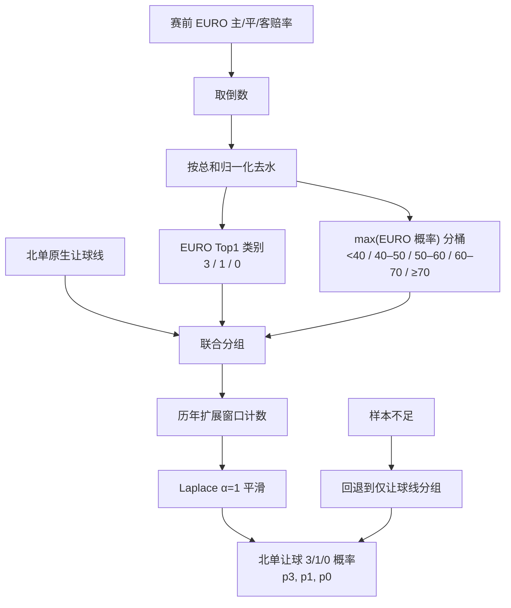

---
aliases:
  - EURO + 北单让球基线
  - EURO_BJLINE_BASELINE
tags:
  - beijing-lot
  - probability
  - euro
  - bjdc
status: research-control
updated: 2026-07-29
---

# EURO + 北单让球基线

> [!important]
> `EURO_BJLINE_BASELINE` 的输出概率才是本轮校准的对象。它不是把 EURO
> 无让球 1X2 概率直接拿来预测北单让球胜平负。

> [!update]
> #83 已证明连续 EURO 表达优于本页的离散概率桶。离散基线仍保留为透明的
> 历史控制组；交给 #77 的唯一历史候选已经更新为
> [[Issue-83-Continuous-Market-Model|`CONTINUOUS_EURO_BJLINE`]]。

## 要解决的口径错位

EURO 1X2 描述无让球主胜、平、客胜；北单目标描述在北单原生让球线下的
`3 / 1 / 0`。例如主队让一球时，EURO 的“主胜”并不等于北单的“3”。
直接比较两者会制造虚假的概率偏差和“价值”。

这也是 [[beidan_vs_euro_divergence|北单与 EURO 偏差研究]] 中最重要的边界之一。

## 基线构造



对 EURO 十进制赔率 \(o_3,o_1,o_0\)，先做比例去水：

\[
q_k = \frac{1/o_k}{\sum_j 1/o_j}
\]

随后使用以下离散键：

```text
(北单原生让球线, EURO隐含Top1类别, max(q)概率桶)
```

在训练样本中统计该键对应的北单让球 `3/1/0` 频率，使用 Laplace
`alpha=1` 平滑。完整键没有支持时，回退到仅按北单让球线统计的分布。

## 时间与样本合同

| 项目 | 合同 |
| --- | --- |
| 训练方式 | expanding calendar-year |
| 训练起点 | 2014 |
| 样本外年份 | 2016–2025 |
| 主快照 | 1h |
| 敏感性快照 | 10h、initial |
| 主样本量 | 153,627 场（1h） |
| 证据等级 | `RETROSPECTIVE_TIMING_PROXY`，C级 |
| 禁止混入 | final snapshot、final BJDC SP、ROI、投注预算 |

## 这个基线能做什么

- 作为北单让球 3/1/0 的历史概率控制组；
- 为 Top1 单选和 Top2 双选提供可校准的概率；
- 检查新特征是否真正改善 log loss、Brier 和覆盖率；
- 作为后续 V7.7.1、亚盘与北单市场信息融合的最低比较门槛。

## 这个基线不能做什么

- 不能证明存在正 ROI；
- 不能把历史 timing proxy 解释为严格赛前可获得性；
- 不能忽略北单最终 SP 漂移、65% 派彩因子与停售限制；
- 不能把单腿命中率独立连乘后直接当成 N4/N7 票命中率；
- 不能仅因 Top1 概率高就忽略校准尾部的系统性偏乐观。

## #83 的连续化升级

离散基线使用 `(让球线, EURO Top1, max(q) 概率桶)` 查找历史频率。
这样很透明，但会把概率不同的比赛压进同一个桶。例如 `50.1%` 与 `54.9%`
可能被视为同一市场状态。

#83 改为直接使用：

\[
\log(q_{\text{home}}/q_{\text{draw}}),\qquad
\log(q_{\text{away}}/q_{\text{draw}}),\qquad
\text{native BJDC line}
\]

并以固定 L2 正则化多项逻辑模型输出 `(p3,p1,p0)`。在同一组
152,825 场样本外比赛上，连续模型相对离散基线的结果为：

| 快照 | Δ Log loss | Δ Brier | Δ Top1 |
| --- | ---: | ---: | ---: |
| initial | -0.002659 | -0.001821 | +0.128pp |
| 10h | -0.003710 | -0.002551 | +0.147pp |
| 1h | -0.003704 | -0.002505 | +0.198pp |

三个快照都在 2016–2025 的 10/10 个样本外年份改善。这说明连续化不是
单一年份或晚盘视图制造的偶然结果。

但原始数据仍是 `RETROSPECTIVE_TIMING_PROXY`。所以目前的职责划分是：

- 离散 `EURO_BJLINE_BASELINE`：可解释的历史控制组；
- `CONTINUOUS_EURO_BJLINE`：进入 #77 的历史候选；
- V7.7.1：在 #77 与连续候选进行严格前瞻比较；
- 亚洲盘和盘口移动：本轮不晋级，不得静默加入候选。

## 结论

该基线的逻辑是合理的：先用 EURO 表达市场强弱，再用北单原生让球线把目标
映射回北单 3/1/0。当前证据支持把离散版本保留为研究控制组，并把连续版本
作为唯一历史候选。具体校准表现见 [[Top1-Top2-Calibration]]，亚盘增量实验
见 [[Issue-82-Market-Fusion]]，连续模型决策见
[[Issue-83-Continuous-Market-Model]]。
