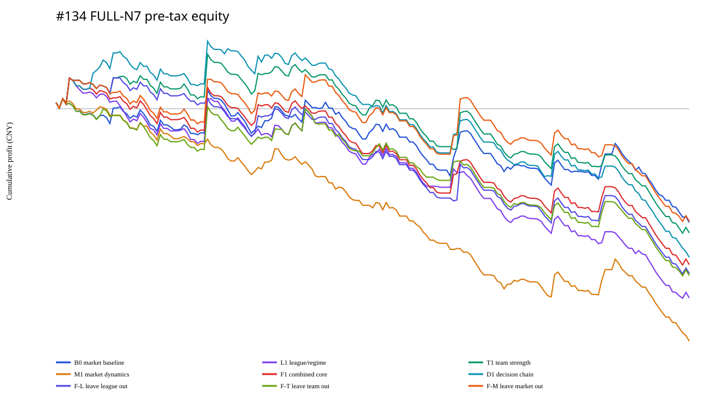
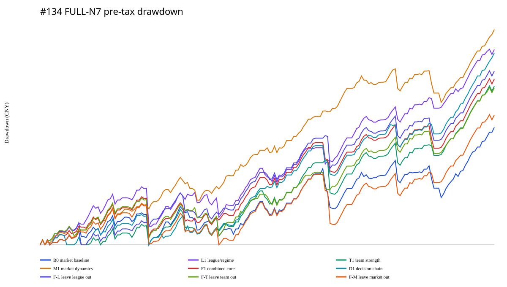

# Issue #134：FULL N7 基本面与决策链 overlay

## 结论

#134 在 #170 继承的 `BEST_FULL × FULL_ENUMERATED` 上，固定比较了 8 个赛前
基本面/决策链改写。结果为 **`NO_OVERLAY_PROMOTION / RETAIN_B0`**：没有任何 overlay
在 `ALL_189` 的同一期次配对口径上改善 B0。

| Arm | native settled | 税前 ROI | 税后 ROI | 同期 B0 lift | 20k lift 95% CI |
|---|---:|---:|---:|---:|---:|
| B0 market | 163 | -9.47% | -14.35% | 0.00pp | [0.00, 0.00]pp |
| L1 league/regime | 159 | -16.15% | -19.83% | -5.97pp | [-13.48, +1.71]pp |
| T1 team | 158 | -10.67% | -14.81% | -2.32pp | [-11.45, +7.02]pp |
| M1 market dynamics | 157 | -20.09% | -22.25% | -7.58pp | [-17.13, -0.01]pp |
| F1 combined | 158 | -13.40% | -17.56% | -4.02pp | [-11.79, +3.91]pp |
| D1 decision chain | 157 | -12.85% | -17.44% | -3.86pp | [-12.71, +5.47]pp |
| F−L | 157 | -14.25% | -17.93% | -5.27pp | [-16.84, +5.54]pp |
| F−T | 155 | -14.61% | -18.18% | -4.30pp | [-10.23, +1.21]pp |
| F−M | 159 | -9.60% | -14.26% | -0.86pp | [-8.82, +7.80]pp |

这里 absolute/native ROI 与 paired lift 是两个明确分开的分母。由于不同 identity 的
结果完整性不同，不能用 F−M 的 native `-9.60%` 直接与 B0 `-9.47%` 相减；在两者均
可结算的 159 期上，F−M 相对 B0 仍为 `-0.86pp`。

## 冻结身份归因

113 个有 2–7 个候选的 `CHOICE` 期次中，各 overlay 改变 62–71 个 identity；76 个
`INVARIANT` 期次所有 arm 完全相同，57 期可结算，税前 ROI 均为 `-21.39%`。

改变 identity 后的 paired win/loss 也没有支持新 lever：

- L1：23 胜 / 38 负，changed-pair lift `-15.46pp`；
- T1：27 胜 / 27 负，但金额加权 lift `-6.78pp`，说明负期损失幅度更大；
- M1：24 胜 / 32 负，lift `-21.13pp`；
- F1：22 胜 / 32 负，lift `-11.76pp`；
- D1：22 胜 / 37 负，lift `-10.27pp`；
- F−M 是最接近 B0 的改写，仍只有 25 胜 / 29 负、lift `-2.52pp`。

所以，结果不是“基本面完全没有信息”，而是这些已冻结的赛前投影在 COMPLETE-ISSUE
FULL-N7 选择任务里没有改善市场基线。尤其不能根据本次 outcomes 再改变权重或阈值。

## 决策链诊断

Gate A 冻结的 handicap-contradiction stage 在 424 个候选中总计恰为 0，因而没有任何
ranking power。D1 实际只由其余风险/概率/combined-score tuple 决定；Gate B 不能把
这一零方差特征解释成已验证的基本面过滤器。

## 风险与稳健性

- B0 原生 163 期税前 bootstrap 95% CI 为 `[-22.05%, +4.57%]`；接受的负 incumbent
  `-9.47%` 被精确保留，没有用较差 overlay 重置基线。
- M1 是唯一 paired lift 区间上界仍略低于 0 的 arm（`-0.013pp`），因此是明确的负
  改写，而不是不确定的潜在提升。
- 所有 arm 去最大 payout issue/year 后仍为负；B0 为 `-13.12%/-11.67%`，F−M 为
  `-13.34%/-11.96%`。
- B0 税前 issue-level Sharpe `-0.558`，最大回撤约 `56.08%`（按 runner 的保守研究
  bankroll），gross issue HHI `0.0120`。F−M Sharpe `-0.510`，但 paired lift 仍负，
  不能因单一风险指标稍好而推广。
- FULL 2187 覆盖所有 7 场结果码，所以只要该 identity 可结算就恰有一张中奖票；最长
  payout miss streak 为 0。这是 FULL 组合的机械属性，不是胜率优势。

YEAR、FOLD、LOYO、ex-largest issue/year、HHI、Sharpe、Sortino、Calmar、最大金额/
百分比回撤、逐期 equity/drawdown 和税后敏感性均在不可变 Gate-B 包中发布。

## 不可变证据

- Gate A manifest：`0a7e4d673e7fc5fd4832c91e3b519afe5a2bc3211b99f4c95f57c691921b65fd`
- Gate A content identity：`3fe014f3decdbd589cdded52d8a9b2bac0f3cb988c2ae8e15cf79314a02eede1`
- canonical outcome manifest：`fbbd3b53bd86f4bb0caff8f2587933cd6b0e4e7d04fb0f709bac934ec2a705cc`
- Gate B manifest：`6a08c310cd5999a8c615d85ac85cdce55f584a19a4b263dd638b682018975e44`
- Gate B content identity：`f92e7b8a14814f2d665da03c3ab7ca0ddea790773ddb0d28ed562ca177a3eb05`
- 45/45 manifest payload hashes 复算通过；B0 复现为 163 期、stake `¥712,962`、gross
  `¥645,459.393809`、税前 ROI `-9.4679107988%`。

完整逐期 ledger、主比较、identity 归因、20,000 次 paired bootstrap、稳健性、风险、
图源和 settlement card 见
[`#134 Gate-B package`](../../results/bj134_gate_b_fundamental_overlay_v1/README.md)。

## 权限边界

本结果仅淘汰新增 overlay lever，不授权购买、下注、生产或推广。由于没有 arm 出现实质
正 paired lift，本次不触发 strict independent EV；B0 仍是后续研究的负收益控制基线，
不是可执行策略。
