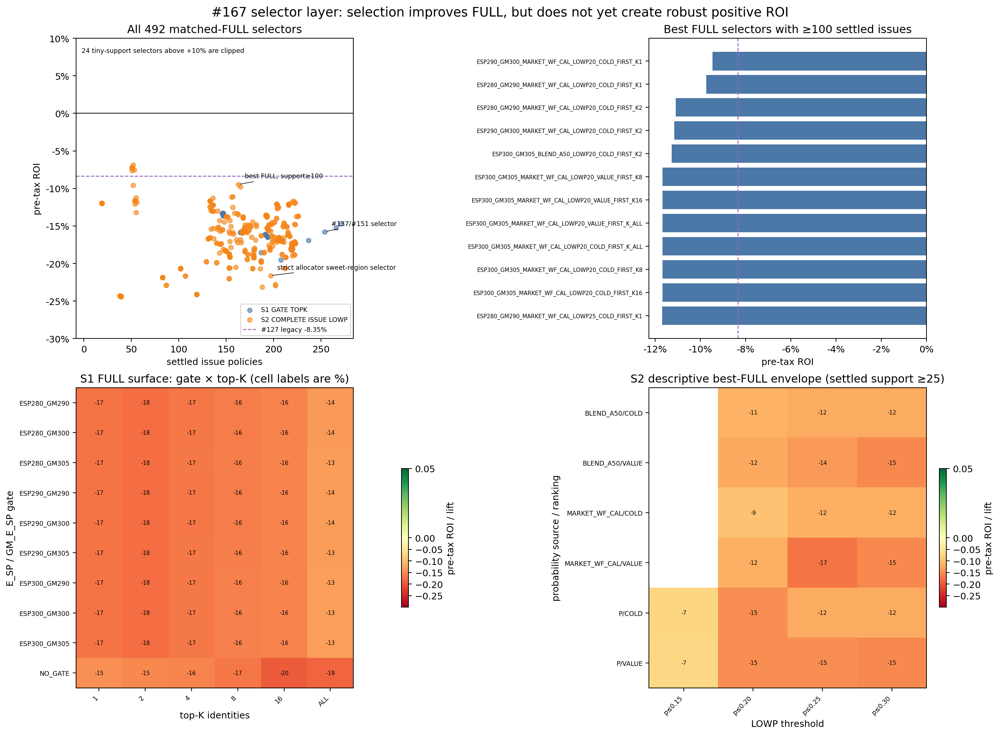
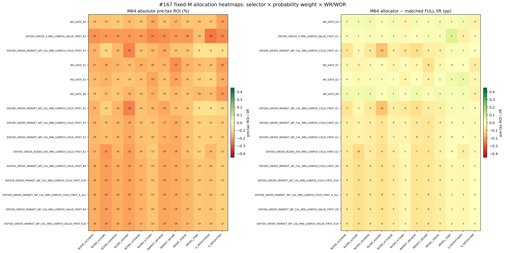
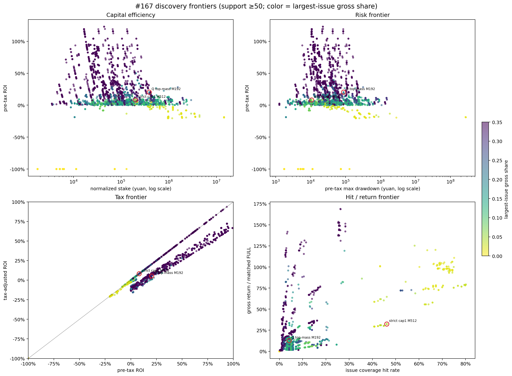

# Issue #167 — N7 selector × ticket-allocation strategy atlas

PI synthesis timestamp: **2026-08-04 09:20 Asia/Shanghai**

Primary economic metric: **pre-tax ROI**. Tax-adjusted ROI is secondary.

Scope: paper research only; no purchase, production, betting or promotion authority.

## Decision summary

#167 materially narrows the next search without proving production-grade positive EV.
The complete atlas contains **492 selectors × 963 effective allocation cells = 473,796
search cells**, with exactly 100 frozen seeds for every WR/WOR combination. The final
postscreen carried **17,135** discovery candidates into one common 20,000-draw paired
issue bootstrap.

Three conclusions control the next step:

1. **Selection helps, but remains the limiting layer.** The best matched FULL selector
   with at least 100 settled issues is
   `S2_ESP290_GM300_MARKET_WF_CAL_MIN_LOWP20_COLD_FIRST_K1`, at **−9.47% pre-tax
   ROI** over 163 settled issues. This is close to, but not directly comparable with,
   the #127 segment-scoped legacy reference of −8.35%.
2. **Allocator behavior is strongly conditional.** WOR beats WR on the historical
   `NO_GATE/K4 + Q_WEIGHT` surface, but WR beats WOR on the strict
   `ESP300_GM305/P_MIN/LOWP20/VALUE_FIRST/K1 + MODEL_P_CAL` surface. There is no
   context-free ranking of WR and WOR.
3. **Two positive point-estimate regions deserve inheritance, not promotion.** A
   high-return Q top-mass M192 peak is concentrated and unstable; a lower-return
   MODEL_P cap1/top-mass/residual M512 peak has broad support and much better
   exclusion behavior, but its absolute bootstrap interval still crosses zero.

The operational interpretation is therefore **sweet-region discovery**. These regions
should be inherited as fixed portfolio sleeves when #134 tests fundamental and
decision-chain overlays; they must not be relabeled as validated Edge.

## Immutable evidence

Controlling merged execution: [PR #168](https://github.com/algotradinglife/beijing-lot/pull/168),
merge commit `0e5caa2f6e5b724fa705669c7885b1d78fc73979`.

- Package: [`bj167_gate_b_strategy_atlas_v3r1_postscreen_exact_identity_v1`](../../results/bj167_gate_b_strategy_atlas_v3r1_postscreen_exact_identity_v1/README.md)
- `SHA256SUMS.json` SHA-256: `b3fa02f5cc2722932ff55fffb0bd9672508f6e78104cfb2458ad81c826f3b313`
- `CONTENT_IDENTITY.json` SHA-256: `bfe29083b74d5d212555c261e888d6f5d4d5fd163b56e1876944d1f5d04aa5c7`
- Full searched family: 473,796 cells
- Postscreen candidates: 17,135
- Common paired issue bootstrap: 20,000 replicates
- Selector identities: 492
- Complete issue instances: 343

The identity-correction package changed only the missing human-facing strategy
identifiers in two tables. All non-identity values in those tables are projection-
identical to the completed settlement, and 18 unaffected scientific payloads are
byte-identical. No ticket replay, outcome reread or bootstrap rerun occurred.

The contracted view coverage is explicit:

| required view | delivered figure/source |
|---|---|
| selector FULL surface | `bj167_selector_full_surface.png` |
| allocation lift surface | `bj167_roi_lift_heatmaps.png` |
| dense M curves, M64 emphasized | `bj167_allocation_m_curves.png` |
| absolute selector × allocator/M heatmaps | `bj167_roi_lift_heatmaps.png` |
| matched allocator−FULL heatmaps | `bj167_roi_lift_heatmaps.png` |
| capital-efficiency frontier | `bj167_capital_risk_tax_hit_frontiers.png` |
| risk frontier | `bj167_capital_risk_tax_hit_frontiers.png` |
| tax frontier | `bj167_capital_risk_tax_hit_frontiers.png` |
| hit/return frontier | `bj167_capital_risk_tax_hit_frontiers.png` |
| raw/robust Pareto | `bj167_stability_and_pareto.png` plus immutable Pareto CSV |
| seed distribution/prefix convergence | `bj167_stability_and_pareto.png` |
| #127/#137/#151/#159/#167 bridge | `bj167_baseline_bridge.png` and bridge CSV |

Every binding, source table and filter is recorded in
[`bj167_chart_manifest.csv`](assets/bj167_chart_manifest.csv).

## 1. Selection layer



Exact source:
[`chart_source_selector_full_surface_v3r1.csv.gz`](../../results/bj167_gate_b_strategy_atlas_v3r1_postscreen_exact_identity_v1/chart_source_selector_full_surface_v3r1.csv.gz).

The FULL surface separates selection value from allocation value. Its useful broad-
support points are:

| selector | settled issues | pre-tax FULL ROI | interpretation |
|---|---:|---:|---|
| `S2_ESP290_GM300_MARKET_WF_CAL_MIN_LOWP20_COLD_FIRST_K1` | 163 | **−9.47%** | best FULL with support ≥100 |
| `S2_ESP280_GM290_MARKET_WF_CAL_MIN_LOWP20_COLD_FIRST_K1` | 165 | −9.75% | neighboring broad-support selector |
| `S2_ESP290_GM300_P_MIN_LOWP15_VALUE_FIRST_K2` | 52 | −6.87% | better point ROI, materially smaller support |
| `S1_NO_GATE_K4` | 254 | −15.77% | #137/#151 comparable FULL control |
| `S2_ESP300_GM305_P_MIN_LOWP20_VALUE_FIRST_K1` | 197 | −21.61% | selector used by broad allocator sweet region; selection itself is weak |

This distinction prevents a false attribution. The M512 candidate below does not win
because its matched FULL selector is strong; it wins descriptively because its allocator
adds **+29.76pp** to a weak matched FULL. Conversely, the −9.47% FULL selector improves
selection but does not automatically inherit the best allocator behavior.

The #127 −8.35% line remains a legacy champion-board reference only. It is segment-
scoped, while #167 uses complete issue units, so it cannot replace the matched FULL
baseline or create a causal improvement claim.

## 2. Allocation and M curves


Exact source:
[`chart_source_full_dense_m_curve_v3r1.csv.gz`](../../results/bj167_gate_b_strategy_atlas_v3r1_postscreen_exact_identity_v1/chart_source_full_dense_m_curve_v3r1.csv.gz).

The curve resolves the apparent WOR/WR reversal:

- On `S1_NO_GATE_K4 + Q_WEIGHT`, WOR/M64 is **−13.28%**, while WR/M64 is
  **−19.48%**. Here WOR prevents repeated stake from being wasted on the same
  high-weight tickets.
- On the strict S2 selector with `MODEL_P_CAL`, WR/M32 is **−11.26%**, while
  WOR/M32 is **−24.69%**; the best WOR point is M208 at **−17.20%**. Here WOR
  eventually forces inclusion of lower-ranked distinct tickets, while WR preserves
  probability concentration.
- Therefore `WOR − WR` is an interaction surface over selector, probability vector
  and M. It is not an invariant property of the sampling mechanism.

The same curve reveals two isolated deterministic peaks:

| candidate | settled issues | stake | pre-tax ROI | tax-adjusted ROI | matched FULL | lift |
|---|---:|---:|---:|---:|---:|---:|
| `NO_GATE/K4 + Q_WEIGHT + TOP_MASS/M192` | 254 | ¥390,144 | **+20.37%** | +5.23% | −15.77% | **+36.14pp** |
| strict S2 + `MODEL_P_CAL + cap1/M512` | 197 | ¥201,728 | **+8.14%** | +8.14% | −21.61% | **+29.76pp** |

For the strict selector, cap1/M512, deterministic top-mass/M512 and residual/M512
produce the same realized ticket set and the same +8.14% result. Cap2/M1024 is the
same per-identity set repeated twice, so it has the same ROI but twice the stake; it
is not a separate scientific discovery.

Neither peak forms a smooth plateau. The strict deterministic curve is −2.99% at
M80, −6.96% at M96, +8.14% at M512, −3.21% at M1024 and −11.71% at M1458.
The historical Q curve peaks around M192–208 and then decays. M is therefore a
portfolio-construction lever with localized interactions, not an independent alpha
source.

## 3. Fixed-M selector × allocator comparisons



Exact sources:
[`chart_source_full_dense_m_curve_v3r1.csv.gz`](../../results/bj167_gate_b_strategy_atlas_v3r1_postscreen_exact_identity_v1/chart_source_full_dense_m_curve_v3r1.csv.gz)
and
[`chart_source_selector_full_surface_v3r1.csv.gz`](../../results/bj167_gate_b_strategy_atlas_v3r1_postscreen_exact_identity_v1/chart_source_selector_full_surface_v3r1.csv.gz).

The M64 heatmaps make selection and allocation attribution explicit. A selector can
have a relatively good FULL baseline but negative allocator lift, or a weak FULL
baseline and positive allocator lift. Future analysis must therefore continue to
report both:

1. selector matched FULL ROI;
2. allocator minus that same matched FULL on identical support.

A single absolute ROI number is insufficient to tell whether progress came from
match selection or ticket construction.

## 4. Capital, risk, tax and hit/return frontiers



Exact sources:
[`candidate_paired_bootstrap_20000.csv`](../../results/bj167_gate_b_strategy_atlas_v3r1_postscreen_exact_identity_v1/candidate_paired_bootstrap_20000.csv)
and
[`chart_source_capital_risk_tax_hit_v3r1.csv.gz`](../../results/bj167_gate_b_strategy_atlas_v3r1_postscreen_exact_identity_v1/chart_source_capital_risk_tax_hit_v3r1.csv.gz).

The high-return Q/M192 candidate is economically interesting but concentrated:

- absolute bootstrap 95% interval: **[−37.86%, +95.04%]**;
- ROI excluding largest signed issue: **−3.28%**;
- ROI excluding largest signed year: **−14.99%**;
- largest issue gross share: **19.97%**;
- gross issue HHI: **0.0833**.

The strict MODEL_P/M512 candidate is the better inheritance sleeve:

- absolute bootstrap 95% interval: **[−9.78%, +27.23%]**;
- lift interval: **[+6.75pp, +52.29pp]**;
- ROI excluding largest signed issue: **+4.40%**;
- ROI excluding largest signed year: **−0.21%**;
- largest issue gross share: **3.95%**;
- gross issue HHI: **0.0127**.

Its absolute interval still crosses zero, so the correct classification is a
**broad-support research sweet region**, not validated absolute Edge. The tax-adjusted
ROI equals its pre-tax ROI because no winning ticket in that realized sleeve crossed
the frozen per-ticket taxable line. This is an observed property of the frozen ledger,
not permission to ignore tax in later experiments.

## 5. Seed and football-history uncertainty


Exact sources:
[`chart_source_seed_ensemble_quantiles.csv.gz`](../../results/bj167_gate_b_strategy_atlas_v3r1_postscreen_exact_identity_v1/chart_source_seed_ensemble_quantiles.csv.gz),
[`candidate_paired_bootstrap_20000.csv`](../../results/bj167_gate_b_strategy_atlas_v3r1_postscreen_exact_identity_v1/candidate_paired_bootstrap_20000.csv),
[`robust_pareto_front_exact.csv`](../../results/bj167_gate_b_strategy_atlas_v3r1_postscreen_exact_identity_v1/robust_pareto_front_exact.csv)
and the fixed-candidate
[`prefix_convergence.csv`](../../results/bj167_gate_b_outcome_settlement_v2r3/prefix_convergence.csv).

Out of the 17,135 postscreen candidates:

- 15,511 have a positive absolute point estimate;
- **zero** have a positive absolute 20,000-draw issue-bootstrap lower bound;
- 800 remain point-positive after both largest signed issue and largest signed year
  exclusions, but many have small support or material concentration;
- 96 have a positive paired-lift lower bound;
- multiplicity correction does not turn any absolute interval into positive evidence.

This is why increasing from three to 100 seeds was necessary but insufficient. It
reduces allocation Monte Carlo noise. It does not create new football histories or
remove issue/year concentration. The #137/#151 three-seed +10.27% Q-WOR/M64 discovery
reverts to **−13.28%** across 100 seeds, with an absolute issue-bootstrap interval of
approximately **[−24.30%, −0.75%]**.

## 6. Baseline bridge and inheritance decision


Machine-readable bridge:
[`bj167_baseline_bridge.csv`](assets/bj167_baseline_bridge.csv). Key-candidate rows:
[`bj167_key_candidates.csv`](assets/bj167_key_candidates.csv). Figure-to-source binding:
[`bj167_chart_manifest.csv`](assets/bj167_chart_manifest.csv).

The bridge contains different evidence grades and denominators; it is not a single
causal ranking. The monotone research baseline rules are:

- retain #127 −8.35% as a segment-scoped legacy selection reference;
- retain #159 N7/M64 −22.23% as the complete-issue ESP transfer diagnostic;
- retain #167 100-seed Q-WOR/M64 −13.28% as the comparable reproduction of the
  historical stochastic incumbent, not as a better baseline;
- use the broad FULL −9.47% selector as the current complete-issue selection baseline;
- carry Q top-mass/M192 as a high-return/concentration stress sleeve;
- carry strict MODEL_P cap1/M512 as the primary broad-support allocator sweet sleeve.

No weaker result replaces a stronger but differently scoped incumbent. Every next
experiment must first reproduce the relevant sleeve on common support, then report
both absolute pre-tax ROI and incremental value against its matched FULL and comparable
incumbent.

## Route to #134

The live Issue Graph currently shows [#134](https://github.com/algotradinglife/beijing-lot/issues/134)
OPEN / Waiting in `BJ Prediction & Betting`; its native blocker #133 is closed. #167
does not change #134's graph in this documentation PR, but supplies the missing portfolio
starting points.

The fundamental/decision-chain overlay should test a small fixed inheritance panel:

1. **selection baseline:** broad FULL selector at −9.47%;
2. **historical stochastic sleeve:** `NO_GATE/K4 + Q_WEIGHT + WOR/M64`;
3. **high-return stress sleeve:** `NO_GATE/K4 + Q_WEIGHT + TOP_MASS/M192`;
4. **primary broad-support sleeve:** strict S2 + `MODEL_P_CAL + cap1/M512`.

The overlay's new lever must be fundamental or decision-chain information only. It
must not retune selector, M or allocation from the same outcomes. Positive evidence
should be judged by incremental improvement on common support; a negative overlay
retires only that overlay and preserves the #167 sweet-region map.

## Reproduction

From repository root:

```bash
uv run --with pandas==3.0.3 --with numpy==2.4.6 --with matplotlib==3.10.9 \
  python3 scripts/plot_bj167_strategy_atlas_report.py
```

The renderer verifies the immutable package manifest and content identity before
reading any chart source.
