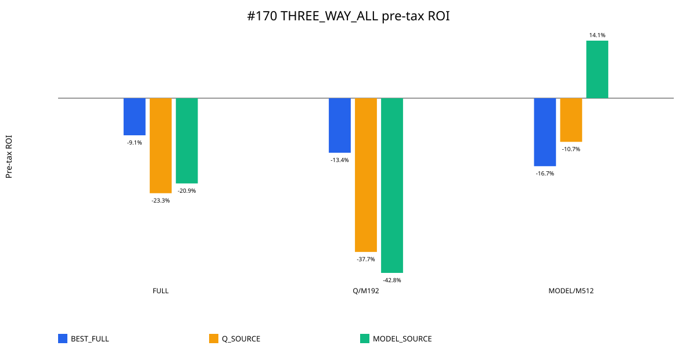
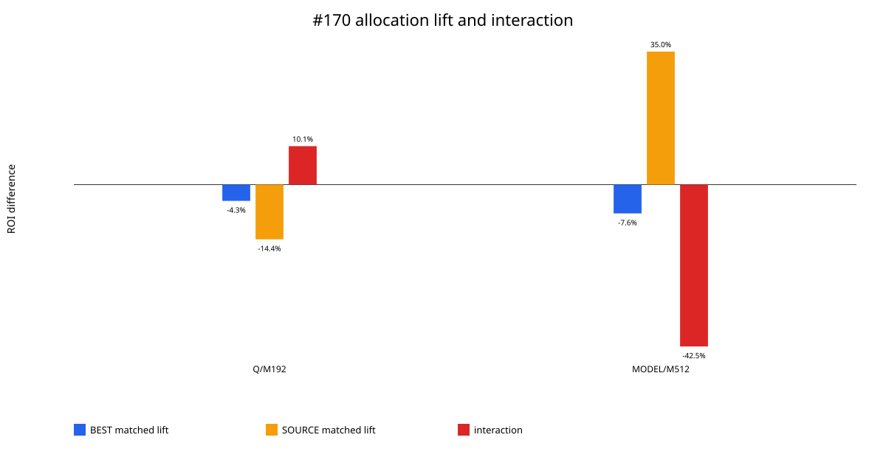
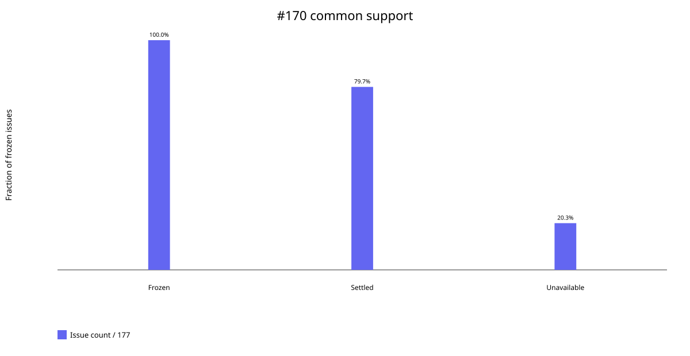

# Issue #170：N7 选场器 × 票分配 sleeve 叠加桥接

## 结论

在 Gate A 预先冻结的 `THREE_WAY_ALL` 177 期共同支持上，141 期的三个 selector
均有完整可信赛果，36 期按 selector-by-issue policy fail closed：九个格子全部零下注，
没有把缺失结果记成亏损，也没有用部分可用 selector 替代共同分母。

控制结论为 **`SELECTION_ONLY`**。#167 的 broad-support `BEST_FULL` 仍是 #134
应继承的选场基线，但两个历史正收益 sleeve 移到这个 selector 后均未保留正增量：

- `BEST_FULL × Q top-mass/M192`：税前 ROI `-13.37%`，相对同 selector FULL
  `-4.27pp`，paired bootstrap 95% CI `[-79.95pp, +116.17pp]`；
- `BEST_FULL × MODEL cap1/M512`：税前 ROI `-16.66%`，相对同 selector FULL
  `-7.57pp`，95% CI `[-35.24pp, +20.52pp]`。

所以，#134 的 controlling inheritance panel 是
`BEST_FULL × FULL_ENUMERATED`。这不把其完整 native-support 的 #167 基线
`-9.47%` 降级；本次共同支持的 FULL ROI 为 `-9.09%`，是不同但明确匹配的分母。

## 不可变输入与复现

- Gate A v2 manifest：`bb60ac5638d29674ad8c1c05f1ffe3ab9cdf12acb70ebdae6cea679743136d87`
- #167 corrected terminal manifest：`b3fa02f5cc2722932ff55fffb0bd9672508f6e78104cfb2458ad81c826f3b313`
- canonical outcome manifest：`fbbd3b53bd86f4bb0caff8f2587933cd6b0e4e7d04fb0f709bac934ec2a705cc`
- frozen allocator SHA-256：`5f8f5d75dd15758e62dd2a05f7b674cb12824b38ccba35cfee772e8904a8bd93`
- Gate B manifest：`08e83353ad483e5d75911116a413186f007385f5dd37b8c4b757ac903221e512`
- Gate B content identity：`75325aa0f60e277ad3fbf9d90116450833106bc3863b412ea3efcad9948a47b2`

五个 #167 source rows 的 selector policy census、stake、gross、ROI、coverage 和
ticket-hit 均复现通过。唯一非零差值是 MODEL cap1/M512 的 12 位 ROI 序列化差
`-1.0000056e-12`；身份、stake (`¥201,728`) 与 gross (`¥218,153.761276`) 完全一致，
并低于显式的 `1e-10` 序列化容差。

第二次完整独立生成与正式包逐文件 byte-identical，manifest 与 content identity
均一致。包内 25 个 manifest payload 全部复算通过。

## 完整 3 × 3 共同支持结果

税前 ROI 是主口径，税后 ROI 仅作敏感性。金额按每张独立 ¥2 票结算；只有单张中奖
票 payout 达到 ¥10,000 才按该张票计 20% 税，不跨票或跨期汇总。

| Selector | Allocation | Stake | Gross | 税前 ROI | 税后 ROI | 同 selector FULL lift |
|---|---|---:|---:|---:|---:|---:|
| BEST_FULL | FULL | ¥616,734 | ¥560,650 | -9.09% | -14.38% | 0.00pp |
| BEST_FULL | Q top-mass/M192 | ¥54,144 | ¥46,906 | -13.37% | -24.39% | -4.27pp |
| BEST_FULL | MODEL cap1/M512 | ¥144,384 | ¥120,329 | -16.66% | -16.66% | -7.57pp |
| Q_SOURCE | FULL | ¥2,466,936 | ¥1,892,662 | -23.28% | -24.90% | 0.00pp |
| Q_SOURCE | Q top-mass/M192 | ¥216,576 | ¥135,012 | -37.66% | -44.02% | -14.38pp |
| Q_SOURCE | MODEL cap1/M512 | ¥577,536 | ¥515,755 | -10.70% | -10.70% | +12.58pp |
| MODEL_SOURCE | FULL | ¥616,734 | ¥487,939 | -20.88% | -24.47% | 0.00pp |
| MODEL_SOURCE | Q top-mass/M192 | ¥54,144 | ¥30,972 | -42.80% | -48.38% | -21.91pp |
| MODEL_SOURCE | MODEL cap1/M512 | ¥144,384 | ¥164,725 | +14.09% | +14.09% | +34.97pp |

最后一格是唯一绝对正 ROI 的控制格；20,000 次 issue-block bootstrap 的绝对 95% CI
为 `[-7.39%, +37.28%]`，paired lift CI 为 `[+6.58pp, +62.66pp]`。它仍属于
#167 已经用同批历史 outcomes 选出的 source-selector/sleeve 组合，不能把这个正值当成
独立推广证据。按 PI 合同，终审前需要 strict independent EV。

## 归因与交互

MODEL sleeve 在 `MODEL_SOURCE` 的 lift 是 `+34.97pp`，移到 `BEST_FULL` 后变成
`-7.57pp`；交互项为 `-42.54pp`，95% CI `[-74.13pp, -11.13pp]`，bootstrap
正比例仅 `0.32%`。这是明确的 selector-context dependence，而不是可叠加 alpha。

Q sleeve 在 `Q_SOURCE` 的共同支持 lift 为 `-14.38pp`，在 `BEST_FULL` 为
`-4.27pp`；交互项 `+10.11pp`，但 95% CI `[-45.09pp, +91.54pp]`，无法支持稳定
叠加。Q_SOURCE 的 #167 native-support top-mass 正值也没有在这 141 期三方共同分母上
保留。

## 稳健性与集中度

- BEST_FULL/FULL 绝对 ROI 95% CI `[-22.98%, +6.68%]`；去最大 gross issue/year
  后为 `-13.32%/-12.36%`，gross issue HHI `0.0142`。
- BEST_FULL/Q-M192 的最大 issue 占 gross `63.61%`、最大 year 占 `86.81%`，最长
  miss streak `64`；其区间很宽，不能因低 stake 而误判为稳健。
- BEST_FULL/MODEL-M512 的 gross issue HHI `0.0232`，去最大 issue/year ROI
  `-22.07%/-26.39%`。
- 唯一正格 MODEL_SOURCE/MODEL-M512 的 HHI `0.0169`，去最大 issue/year ROI
  `+8.90%/+5.46%`，但仍需严格独立 EV，因为它是同历史 post-selection control。

所有三种 arm 均是确定性分配，因此 seed dispersion 标记为
`NOT_APPLICABLE_DETERMINISTIC_ARM`；历史不确定性由一张共同的 177 行 issue-resample
矩阵、20,000 次 paired bootstrap 估计。YEAR/FOLD/LOYO、drawdown、miss streak、
largest issue/year、HHI 与 ex-largest ROI 均已作为 chart-source/diagnostic 文件发布。

完整数据、图源、20,000 次 bootstrap 绑定与 settlement card 见
[`#170 Gate-B package`](../../results/bj170_gate_b_selector_allocator_stack_v1/README.md)。

## 权限边界

这是同历史 post-selection transfer/interaction 研究。`SELECTION_ONLY` 是 #134 的
继承建议，不是购买、下注、生产或推广授权；唯一绝对正格完成 strict independent EV
且通过 PI terminal review 前，#170 不能终结为可推广结果。
