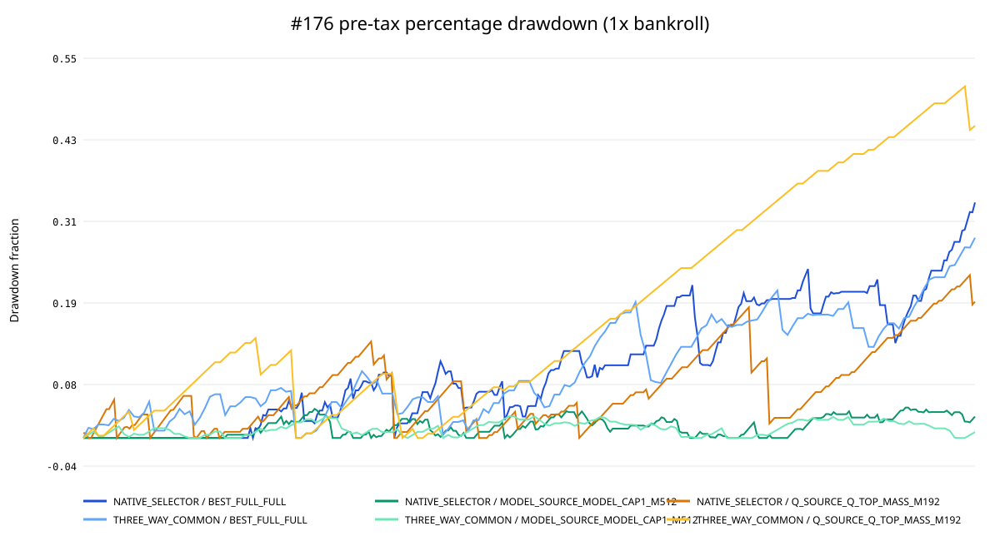

# Issue #176：#167/#170 N7 逐期权益曲线与风险调整指标

## 结论先行

本研究补齐了 #167/#170 缺少的逐期路径风险，但**没有产生新的可推广策略结论**。

- `BEST_FULL / FULL_ENUMERATED` 仍是 #134 的 controlling selection baseline；它在
  native support 上税前 ROI `-9.47%`、年化 Sharpe `-0.539`、最大回撤
  `¥78,519 / 33.99%`，税后路径进一步恶化。
- `MODEL_SOURCE / MODEL_P_CAL cap1 M512` 的 native source-context 结果是三者中
  风险路径最平滑的正诊断：税前 ROI `+8.14%`、Sharpe `+0.356`、Sortino
  `+0.702`、最大回撤 `¥10,716 / 4.39%`。但去掉最大 payout year 后 ROI
  `-0.21%`，且 #170 已证明它不能直接迁移到 BEST_FULL selector，因此仍不能称为
  BEST_FULL stack 或独立 edge。
- `Q_SOURCE / Q_WEIGHT TOP_MASS M192` 的 native 税前 ROI `+20.37%`，但其 HHI
  `0.0833`、最大回撤 `¥87,643 / 23.51%`、连续 active miss streak `52`；去最大
  payout year 后 ROI `-14.99%`。在 177 期三方共同支持上，它变为 `-37.66%`，最大
  回撤 `50.74%`、HHI `0.1707`，说明正点估计高度依赖 selector/support 和少数大额
  payout。

因此，风险调整证据能支持的决定是：#134 继续继承 `BEST_FULL/FULL` 作为选场控制，
把 MODEL 与 Q 结果保留为 source-context stress/diagnostic sleeves；它不能支持购买、
下注、生产或 promotion，也不能把 source-context 正值改名为 BEST_FULL stack。

## 不可变输入与复现

本包只使用已经合并并被 PI 接受的 #167/#170 身份、分配与结算来源：

- #170 Gate B manifest：
  `08e83353ad483e5d75911116a413186f007385f5dd37b8c4b757ac903221e512`
- #170 Gate B content identity：
  `75325aa0f60e277ad3fbf9d90116450833106bc3863b412ea3efcad9948a47b2`
- #170 Gate A manifest：
  `bb60ac5638d29674ad8c1c05f1ffe3ab9cdf12acb70ebdae6cea679743136d87`
- #167 terminal manifest：
  `b3fa02f5cc2722932ff55fffb0bd9672508f6e78104cfb2458ad81c826f3b313`
- canonical outcome manifest：
  `fbbd3b53bd86f4bb0caff8f2587933cd6b0e4e7d04fb0f709bac934ec2a705cc`
- 冻结 allocator SHA-256：
  `5f8f5d75dd15758e62dd2a05f7b674cb12824b38ccba35cfee772e8904a8bd93`
- #176 manifest：
  `39316952296c2349f5da2f963d43c0baf0d812fba4eea967536a8b80bd57d5ee`
- #176 content identity：
  `94188354baf01c68cb0ec0791248d3f8f03e31d4a7011db7b6b68e9797720f5c`

#170 的 177 期共同支持逐期账本直接读取，不重算。native support 为补齐逐期税额，
用 #170 manifest 覆盖的 package runner（SHA-256
`f593dd92c1b2afcc81ce50c65d61c9511070190c95b5cef98a13b05843ce2713`）、
Gate-A identities、byte-frozen allocator 和 canonical outcome 做确定性重放。3 个
required arms 在 native/common 两种支持下的 stake、gross、税前/
税后 ROI 和 policy census 共 6 个桥接全部 PASS。

独立重放到 repo 内 `.scratch` 后，正式包与重放包逐文件 byte-identical；manifest 与
content identity 完全一致。没有使用系统 `/tmp`。

## 时间轴与分母

### Native selector support

每个 arm 保留完整 348 期赛前日历：

- BEST_FULL/FULL：163 active、26 unavailable、159 no-bet；
- MODEL_SOURCE/MODEL cap1 M512：197 active、37 unavailable、114 no-bet；
- Q_SOURCE/Q top-mass M192：254 active、85 unavailable、9 no-bet。

#167 candidate issue array 只有 343 期；缺少的 `20031`、`20051`、`21011`、
`21062`、`25011` 均是 outcome-unexposed census 中的 no-bet。#176 从 #167 已绑定的
#137 `issue_census.csv` 取其 first kickoff，仅作为时间轴，把这 5 期补成明确的零流量行，
没有把它们当亏损或删掉。

### THREE_WAY_COMMON support

共同支持严格沿用 #170 的 177 期：141 期三 selector 同时可结算，36 期共同 fail
closed，三个 arm 都执行零 stake。native 与 common 指标分开报告，禁止跨分母排序。

## 风险指标口径

为了让百分比回撤和 Calmar 可比较，三 arms、两种 support、税前/税后共用固定研究
bankroll：`¥220,000`。它由所有路径中最差累计损失推导：最差是共同支持 Q sleeve
税后 `¥109,672.66`；bankroll 向上取整，使 0.5× (`¥110,000`) 下所有历史 equity
仍严格为正。金额 P&L 不随 bankroll 改变，也不做复利或动态加仓。

- calendar issue return：当期 net / 当期期初固定资金权益；no-bet/unavailable 零流量
  行保留；
- active stake return：只在 stake > 0 时计算 net / stake，另行报告；
- Sharpe：零无风险利率，样本标准差，按观测 issue frequency/year 年化；
- Sortino：downside target 为每期 0，downside deviation 为
  `sqrt(mean(min(r,0)^2))`；
- CAGR：以首末 kickoff 的实际经过时间计算；Calmar = CAGR / 最大百分比回撤；
- P&L Calmar：年化 net yuan / 最大金额回撤，隔离任意初始 bankroll 的影响；
- miss streak：连续 active issues 中 payout 为 0 的长度；零流量期不制造也不终止
  下注 miss；
- HHI/ex-largest：按 payout contribution 计算，并报告去最大 payout issue/year ROI；
- YEAR、FOLD、LOYO 在税前与税后均完整发布。

## 税前主结果（1× bankroll）

| Support | Arm | ROI | Sharpe | Sortino | Calmar | 最大回撤 | P&L Calmar | HHI | 去最大 year ROI |
|---|---|---:|---:|---:|---:|---:|---:|---:|---:|
| native | BEST_FULL/FULL | -9.47% | -0.539 | -1.006 | -0.167 | ¥78,519 / 33.99% | -0.137 | 0.0120 | -11.67% |
| native | MODEL_SOURCE/MODEL cap1 M512 | +8.14% | +0.356 | +0.702 | +0.263 | ¥10,716 / 4.39% | +0.244 | 0.0127 | -0.21% |
| native | Q_SOURCE/Q top-mass M192 | +20.37% | +0.319 | +2.365 | +0.214 | ¥87,643 / 23.51% | +0.145 | 0.0833 | -14.99% |
| common | BEST_FULL/FULL | -9.09% | -0.496 | -0.958 | -0.189 | ¥66,618 / 28.90% | -0.160 | 0.0142 | -12.36% |
| common | MODEL_SOURCE/MODEL cap1 M512 | +14.09% | +0.552 | +1.158 | +0.544 | ¥7,348 / 3.12% | +0.528 | 0.0169 | +5.46% |
| common | Q_SOURCE/Q top-mass M192 | -37.66% | -0.628 | -1.962 | -0.167 | ¥127,817 / 50.74% | -0.122 | 0.1707 | -80.69% |

MODEL sleeve 的 native/common 风险数值都比另外两条路径平滑，但 common 的正结果仍是
同历史 post-selection source-context control；#170 已经给出其迁移到 BEST_FULL 后
matched lift 为负的证据。#176 不能把较好的风险比率变成新的 promotion claim。

Q sleeve 展示相反模式：native 年化 Sortino 较高是因为大部分 downside 是小额固定 stake
而少数 payout 很大；HHI、去最大 year、miss streak 和 common-support 崩塌同时说明，
仅看 ROI 或 Sortino 会掩盖 payout concentration。

## 税后敏感性

- BEST_FULL native：税后 ROI `-14.35%`、Sharpe `-1.053`、最大回撤
  `¥108,253 / 47.91%`；
- MODEL sleeve native：没有命中单票 ¥10,000 税线，税前税后相同；
- Q sleeve native：税后 ROI 从 `+20.37%` 降到 `+5.23%`，Sharpe 从 `0.319`
  降到 `0.157`，最大回撤升到 `¥102,299 / 31.15%`，去最大 year ROI 为
  `-25.32%`。

税额继续按每张独立 ¥2 中奖票计算；单票 payout 达到 ¥10,000 才对该票收 20%，没有
跨票、跨期或跨人的汇总计税。

## Bankroll 0.5×/1×/2×

固定 P&L 下，bankroll 只改变百分比风险和 path-return 比率，不改变 ROI 或 P&L
Calmar。例如 native：

| Arm | 规模 | CAGR | 最大回撤 % | Calmar |
|---|---:|---:|---:|---:|
| BEST_FULL/FULL | 0.5× / 1× / 2× | -14.07% / -5.68% / -2.62% | 64.88% / 33.99% / 17.41% | -0.217 / -0.167 / -0.151 |
| MODEL cap1 M512 | 0.5× / 1× / 2× | +2.24% / +1.16% / +0.59% | 8.41% / 4.39% / 2.31% | +0.267 / +0.263 / +0.254 |
| Q top-mass M192 | 0.5× / 1× / 2× | +9.06% / +5.04% / +2.68% | 33.35% / 23.51% / 14.78% | +0.272 / +0.214 / +0.182 |

这组敏感性说明 Calmar 会受任意研究 bankroll 影响，所以决策时必须同时看
bankroll-independent 的 P&L Calmar、金额回撤与集中度。

## 图表与完整数据

三张图都使用同一条实际 `first_kickoff_ts` 日期轴；348 期 native 与 177 期 common
序列不会再按各自长度拉伸成看似对齐的期次轴。图内显示可读年月 tick，图源仍保留每行
精确 kickoff timestamp。

完整逐期账本、时间序列、active/calendar return、bankroll sensitivity、YEAR/FOLD/
LOYO、图源、source reconciliation 和方法定义见
[`bj176_issue_equity_risk_v1`](../../results/bj176_issue_equity_risk_v1/README.md)。

## 对 #134 的边界

#176 能做的是把 #167/#170 已接受点估计放回真实时间顺序，揭示回撤、集中度和年份
依赖；它不能根据同批 outcomes 重选 selector、M 或 allocation。#134 恢复后应继续以
BEST_FULL/FULL 为 selection control，基本面/决策链 overlay 只能作为预先冻结的新 lever。
任何正结果仍需独立 EV 或新的 held-out/forward evidence。
