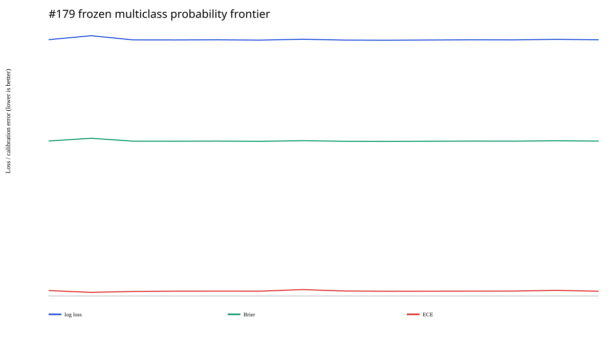
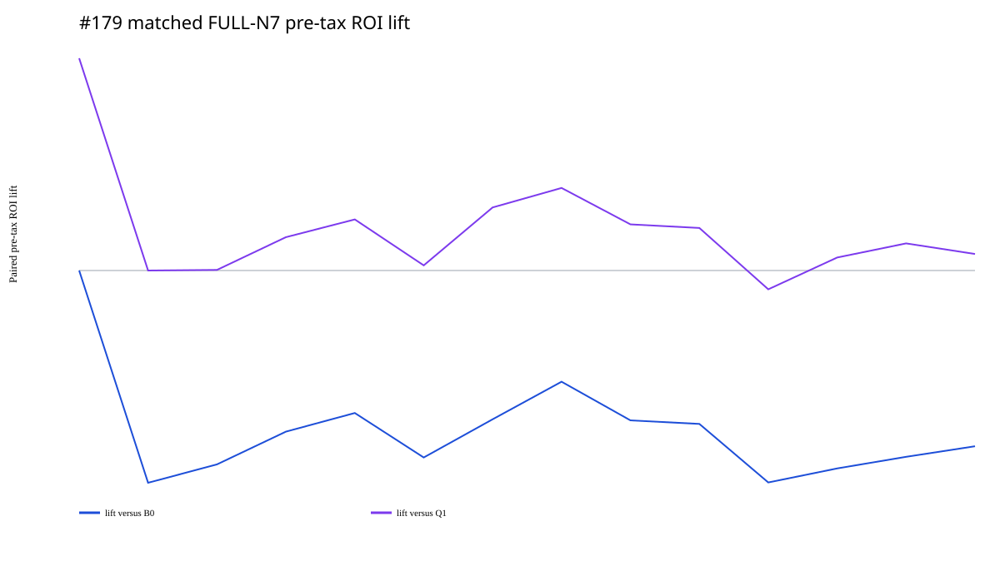

# Issue #179：N7 分层联赛—状态概率模型

## 结论

#179 在 outcome-unexposed Gate-A v2 的完整冻结面上，先比较 14 个概率向量，再用每个
arm 冻结选择的 FULL N7 组合做 matched 经济结算。终局结论是
**`NO_HIERARCHICAL_PROMOTION / RETAIN_B0`**：分层模型对多分类概率有小幅描述性改善，
但没有任何 challenger 在税前经济结果上击败接受的 B0 market control。

### 概率层

1,558 场冻结比赛中，1,507 场有 canonical result，51 场保持 missing；全部 arm 使用同一
分母。`H_MINUS_RAW_HDA` 是最低 log loss / Brier 的向量：

| Arm | Log loss | Brier | ECE | 相对 B0 log-loss 改善 |
|---|---:|---:|---:|---:|
| B0 market | 1.066377 | 0.644696 | 0.022476 | 0.000000 |
| Q1 quick league | 1.082858 | 0.656143 | 0.015020 | -0.016481 |
| H1 deep all | 1.065432 | 0.644107 | 0.018710 | +0.000945 |
| H minus raw H/D/A | **1.064101** | **0.643211** | 0.019552 | **+0.002276** |
| pricing conservative | 1.064637 | 0.643579 | 0.020638 | +0.001740 |

`H_MINUS_RAW_HDA` 在 OOS_2020/2021/2022/2024 的 log loss 最低；OOS_2023 和
OOS_2025 由 B0 最低。因此它是一个概率诊断信号，不是跨所有年份严格占优的模型。
Q1 的 ECE 最低，但 log loss/Brier 最差，说明“校准桶更平”不能替代完整概率质量。
本冻结样本没有 unknown-league 行；known/unknown 表仍保留零支持 unknown 行，避免把
零样本误写成通过。

### FULL N7 经济层

| Arm | native settled | 税前 ROI | matched lift vs B0 | 20k lift 95% CI | 税后 ROI |
|---|---:|---:|---:|---:|---:|
| B0 market | 163 | **-9.47%** | 0.00pp | [0.00, 0.00]pp | -14.35% |
| Q1 quick league | 159 | -16.15% | -5.97pp | [-13.45, +1.77]pp | -19.83% |
| H minus raw H/D/A | 161 | -13.12% | -4.21pp | [-9.70, +0.95]pp | -17.42% |
| pricing conservative | 161 | **-12.16%** | **-3.13pp** | [-8.28, +1.75]pp | -16.76% |
| H1 deep all | 160 | -14.27% | -5.45pp | [-11.45, +0.15]pp | -18.21% |

`pricing conservative` 是 hierarchical arms 中经济结果最好的一项，但仍是绝对负 ROI，
且 matched B0 lift 为负。它相对较弱的 Q1 control 为正，不能据此越过更强的 B0。
概率最好的 `H_MINUS_RAW_HDA` 也没有转化为组合收益：matched B0 lift `-4.21pp`。
`H_MINUS_EURO` 与 `H_MINUS_ASIAN` 的 B0-lift bootstrap 上界已低于 0；其余 challenger
虽然区间跨 0，点估计仍全部为负，因此没有正收益晋级对象。

## 稳健性与风险

- B0 税前 ROI `-9.47%`、Sharpe `-0.558`、最大回撤 `56.08%`、payout HHI
  `0.01195`；去最大 issue/year 后为 `-13.12%/-11.67%`。
- pricing-conservative 去最大 issue/year 后为 `-15.87%/-13.85%`；六个 LOYO ROI
  全部为负。
- `H_MINUS_RAW_HDA` 去最大 issue/year 后为 `-16.84%/-15.11%`；六个 LOYO ROI
  也全部为负。
- FULL N7 在每个可结算 identity 上机械地覆盖唯一中奖序列；`hit_ticket_count=1` 不是
  正收益证据。真正需要比较的是 payout 相对 2,187×¥2 stake 的规模。

YEAR、FOLD、LOYO、paired B0/Q1 bootstrap、ex-largest issue/year、HHI、Sharpe、
Sortino、Calmar、逐期 equity/drawdown 和逐票税务参考均在不可变包中发布。

## 数据边界

`LIQUIDITY_DRIFT` 只表示冻结的 prior-season EURO residual proxy，不是完整的
season-by-source interaction。Gate B 没有根据目标 outcomes 调 selector、参数、候选、
阈值、identity、allocator、ticket 或分母。

## 不可变证据

- Gate A manifest：`5839f5c03c94ef903472b64fffa3ad1462ec006717875d0a3903ecdfdc2aa056`
- Gate A content identity：`2e8314f00b8774501ecf0ed2cb6ede73a9e7a60c7422dd5dc0d464e1470b740b`
- canonical outcome manifest：`fbbd3b53bd86f4bb0caff8f2587933cd6b0e4e7d04fb0f709bac934ec2a705cc`
- Gate B manifest：`f802629bc0f174d0c9bfe388ddde86056d3be272a3abc0016508caddd1667811`
- Gate B content identity：`5d00a3fbb7ee474951271e1a6f1ab7e06a67745588539400ab9a17594d171946`
- 109/109 manifest payload hashes 复算通过；概率 ledger 21,812 行、经济 ledger 2,646
  行、概率 frontier 126 行、可靠性 bins 420 行、经济主表 42 行、稳健性 756 行。
- B0 桥接为 163 期、stake `¥712,962`、gross `¥645,459.393811`（与接受值的逐行
  序列化差 `¥0.000002`）、税前 ROI `-9.4679107988%`；Q1 桥接为 159 期、stake
  `¥695,466`、gross
  `¥583,133.098140`、税前 ROI `-16.1521773688%`。

完整概率、可靠性、参数、逐期经济、bootstrap、稳健性、风险、图源与 settlement card 见
[`#179 Gate-B package`](../../results/bj179_gate_b_hierarchical_league_v1/README.md)。

## #180 handoff 与权限边界

#180 只应继承 B0 作为 controlling economic baseline；`H_MINUS_RAW_HDA` 可作为概率层
diagnostic，但不能命名为已验证 selector 或盈利策略。结果不触发 strict independent EV，
也不授权购买、下注、生产或推广。
