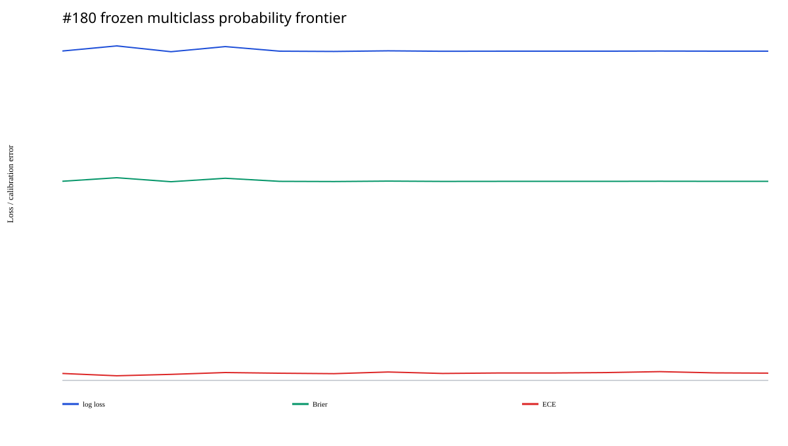
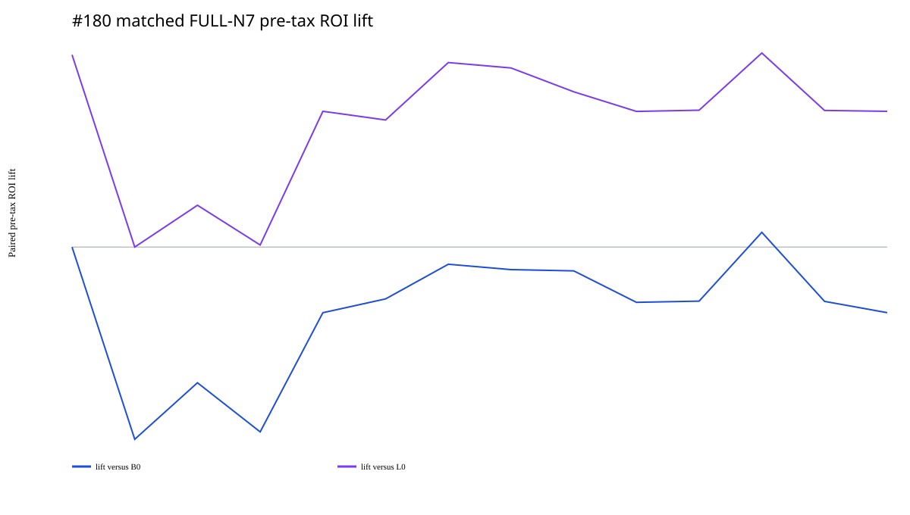

# Issue #180：联赛感知的球队与对阵模型

## 结论

#180 在 outcome-unexposed Gate-A v2 的 1,558 场冻结面上比较了市场 B0、quick
league、#179 league diagnostic、team-only、team+league 三个配置以及 7 个
leave-one-family-out arms，然后以每期 2,187 张独立 ¥2 FULL N7 票结算冻结 identity。

终局建议为 **`NO_TEAM_MODEL_PROMOTION / RETAIN_B0`**。没有任何 arm 取得正的绝对
税前 ROI。`TL_MINUS_OPPONENT` 是唯一 matched B0 lift 为正的点估计，但 lift 只有
`+0.46pp`，20,000 次 paired bootstrap 95% CI 为 `[-6.70pp,+8.18pp]`，positive
fraction `54.05%`；它既不稳定也没有达到 retrospective edge 的证据门槛。按合同它至多
是 strict independent-EV 的候选，不能直接晋级。

## 概率层

1,558 场冻结比赛中 1,507 场有 canonical result，51 场保持 missing；14 个 arms 使用
完全相同的概率分母。

| Arm | Log loss | Brier | ECE | 相对 B0 log-loss |
|---|---:|---:|---:|---:|
| B0 market | 1.066377 | 0.644696 | 0.022476 | 0.000000 |
| L0 quick league | 1.082858 | 0.656143 | **0.015020** | -0.016481 |
| H0 #179 diagnostic | **1.064101** | **0.643211** | 0.019552 | **+0.002276** |
| T1 deep team only | 1.080644 | 0.654396 | 0.025484 | -0.014267 |
| TL1 team+league | 1.065843 | 0.644432 | 0.023310 | +0.000534 |
| TL conservative | 1.064937 | 0.643802 | 0.021843 | +0.001440 |
| TL minus opponent | 1.066245 | 0.644701 | 0.028405 | +0.000132 |

结论很清楚：team-only 明显弱于市场和 #179 diagnostic；league+team 的保守混合恢复了
大部分概率质量，但没有超过 #179 diagnostic。去掉 opponent adjustment 的经济点估计
较好，却使 log loss、Brier 和 ECE 都比 TL1 差，说明该经济结果不能解释成更好的单场
概率模型。

## FULL N7 经济层

| Arm | native settled | 税前 ROI | matched lift vs B0 | 20k lift 95% CI | 税后 ROI |
|---|---:|---:|---:|---:|---:|
| B0 market | 163 | **-9.47%** | 0.00pp | [0.00,0.00]pp | -14.35% |
| L0 quick league | 159 | -16.15% | -5.97pp | [-13.45,+1.77]pp | -19.83% |
| H0 #179 diagnostic | 161 | -13.12% | -4.21pp | [-9.70,+0.95]pp | -17.42% |
| T1 deep team | 160 | -14.99% | -5.74pp | [-16.55,+4.05]pp | -18.32% |
| TL1 team+league | 160 | -10.76% | -2.04pp | [-9.90,+6.15]pp | -15.27% |
| TL conservative | 160 | -10.34% | -1.61pp | [-9.54,+6.65]pp | -14.99% |
| TL responsive | 160 | -9.27% | -0.53pp | [-8.30,+7.67]pp | -14.21% |
| TL minus opponent | 160 | **-8.29%** | **+0.46pp** | **[-6.70,+8.18]pp** | -13.37% |

其余消融的 matched B0 lift 全部为负。`TL_MINUS_H2H` 与 TL1 的选择和经济结果完全
相同，说明冻结样本中的低权重 prior-only H2H 没有改变最终 K1 identity。相对较弱的 L0
得到正 lift 并不能越过 controlling B0。

## 稳健性与风险

- `TL_MINUS_OPPONENT` 只有 2020 年税前 ROI 为正（`+22.98%`）；2021–2025 分别为
  `-2.90%/-13.27%/-16.54%/-15.43%/-43.36%`。
- 它的 6 个 LOYO ROI 全部为负；去最大 payout issue/year 后分别为
  `-12.00%/-9.91%`。
- 税前 Sharpe `-0.455`、最大回撤 `77.31%`（统一研究 bankroll ¥120,000）、payout
  HHI `0.01277`，没有形成风险调整后的正收益证据。
- FULL N7 对每个完整 identity 机械覆盖唯一中奖序列，所以可结算期的 ticket hit 为 1；
  这不是盈利证据，关键仍是 payout 是否超过每期 ¥4,374 stake。

## 机制读回与下一步

1. 保留 B0 作为 controlling economic baseline；#179 H0 仍只是概率 diagnostic。
2. 不推广 team-only 或任何 team+league 配置；不使用结果回写权重、selector 或阈值。
3. 若 PI 希望继续检验 `TL_MINUS_OPPONENT`，必须新建严格独立的 EV/held-out 或前瞻验证，
   预先锁定该 exact arm，并以绝对 ROI 与 matched B0 lift 双重失败条件判断。
4. 后续若研究 opponent adjustment，应优先检查它的时间安全实现与概率退化机制，而不是
   因单一经济点估计为正就删除该信息族。

## 不可变证据

- Gate A manifest：`96cbd2565f5d1f837700e476d7a7412225677581b5e4448a4f9bfac4c9220835`
- Gate A content：`6a0abe9cb36198dae11a5da06679d22b786cdf49f3619e6e34d7782f29915288`
- canonical outcome manifest：`fbbd3b53bd86f4bb0caff8f2587933cd6b0e4e7d04fb0f709bac934ec2a705cc`
- Gate B manifest：`9f48b29325d817ce873bd1430be459c9e70ad052064f8e03e02ccbc1d8bc6fcf`
- Gate B content：`d9b41dec45c1c6215755d9dad8774e00fc0f19f564ee6ef8bf2387cb8d309108`
- 26/26 manifest payload hashes 独立复算通过；概率 ledger 21,812 行、经济 ledger
  2,646 行、主经济表 42 行、可靠性 bins 420 行、稳定性 756 行。
- B0 桥接：163 期、stake ¥712,962、税前 ROI `-9.4679107988%`；L0 桥接：159 期、
  stake ¥695,466、税前 ROI `-16.1521773688%`。

完整概率、可靠性、配置、逐期经济、bootstrap、稳健性、风险、图源与 settlement card 见
[`#180 Gate-B package`](../../results/bj180_gate_b_team_matchup_v1/README.md)。

本结果不授权购买、下注、生产或推广。
