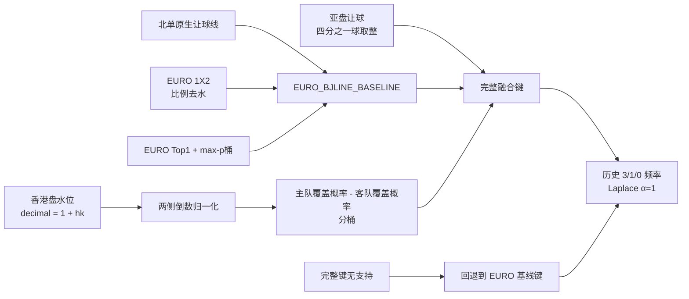

---
aliases:
  - Issue 82 市场融合实验
  - EURO Asian BJLINE Fusion
tags:
  - beijing-lot
  - issue-82
  - fusion
  - asian-odds
status: completed-no-promotion
updated: 2026-07-29
---

# Issue #82：市场融合实验

> [!abstract]
> EURO + 亚盘 + 北单让球的融合在 1h/10h 上有极小 log loss 和 Brier 改善，
> 但 Top1 没有改善，initial 快照还略有恶化。结论是
> `NO_NEW_FUSION_PROMOTION`：保留 [[EURO-BJLINE-Baseline]]，融合仅作为研究候选。

GitHub：[Issue #82 — BJ-HIST-MARKET-FUSION-001](https://github.com/algotradinglife/beijing-lot/issues/82)

## 研究问题

在已经考虑北单原生让球线的 EURO 基线上，加入亚盘让球与两侧水位，能否稳定改善
北单让球 `3/1/0` 的概率质量？

比较三条 arm：

1. `BJLINE_FREQUENCY_CONTROL`：仅按北单让球线的历史频率；
2. `EURO_BJLINE_BASELINE`：北单让球线 + EURO Top1 + EURO 最大概率桶；
3. `EURO_ASIAN_BJLINE_FUSION`：在 EURO 基线键上增加亚盘让球与水位差。

## 融合方法

亚盘水位使用香港盘口径，先转换为十进制赔率：

\[
o_h=1+hk_h,\qquad o_a=1+hk_a
\]

然后对两侧倒数比例去水：

\[
r_h = \frac{1/o_h}{1/o_h+1/o_a},\qquad
r_a = \frac{1/o_a}{1/o_h+1/o_a}
\]

融合特征使用 `r_h-r_a`，分桶边界为
`(-∞,-0.20)、[-0.20,-0.05)、[-0.05,0.05)、[0.05,0.20)、[0.20,∞)`。
亚盘让球按 0.25 球取整。

> [!warning]
> Gate B v1 曾把香港盘水位当作十进制赔率。v2 修正影响
> 215,530 / 569,935 个特征桶（37.82%），所以只有 v2 可以作为本页证据。

## 结果

### 相对 EURO + BJLINE 基线

负的 delta 表示融合更好。

| 快照 | 样本 | Δ Log loss | Δ Brier | Δ Top1 |
| --- | ---: | ---: | ---: | ---: |
| 1h | 153,627 | **-0.000243** | **-0.000345** | -0.012pp |
| 10h | 152,832 | **-0.000434** | **-0.000461** | -0.041pp |
| initial | 153,622 | +0.000456 | +0.000178 | -0.051pp |

### 绝对指标

| 快照 | Arm | Log loss | Brier | Top1 | Top2 |
| --- | --- | ---: | ---: | ---: | ---: |
| 1h | EURO + BJLINE | 1.067917 | 0.645231 | 43.764% | 73.576% |
| 1h | EURO + Asian + BJLINE | **1.067675** | **0.644886** | 43.751% | **73.662%** |
| 10h | EURO + BJLINE | 1.069944 | 0.646708 | **43.556%** | **73.443%** |
| 10h | EURO + Asian + BJLINE | **1.069510** | **0.646246** | 43.516% | 73.419% |
| initial | EURO + BJLINE | **1.073152** | **0.649013** | **43.103%** | **73.249%** |
| initial | EURO + Asian + BJLINE | 1.073608 | 0.649191 | 43.052% | 73.145% |

让球线频率控制组在 1h 的 log loss 为 1.085393、Top1 为 39.907%，明显弱于
两个市场模型。这说明 EURO 信息本身有清晰增量；亚盘在 EURO 之上的增量则很小。

## 改善有多大

1h log loss 的相对改善约为：

\[
\frac{1.067917-1.067675}{1.067917}\approx 0.023\%
\]

这不是 2.3%，而是约 **0.023%**。即使方向为正，效应也很小，容易被：

- timing proxy 偏差；
- 年份、联赛或让球线构成变化；
- 亚盘源与快照时间误差；
- 分桶边界与稀疏回退；
- 后续模型选择

所覆盖。

## 逻辑合理性审查

| 环节 | 判断 | 原因 |
| --- | --- | --- |
| EURO 比例去水 | 合理 | 清除博彩公司总体 overround，保留相对概率。 |
| 加入北单原生让球线 | 必要 | 修复无让球 EURO 与北单让球赛果的目标错位。 |
| 香港盘 `1+hk` 转换 | 必要 | v1 的口径错误会大面积改变水位差分桶。 |
| 亚盘让球按 0.25 取整 | 可接受的粗粒度代理 | 与常见亚洲让球档位一致，但会丢失来源差异和移动路径。 |
| 水位差离散分桶 | 可解释但粗糙 | 抑制噪声和稀疏性，也可能抹掉弱但连续的信号。 |
| 历史频率 + Laplace 平滑 | 合理的透明基线 | 易审计，但不能建模连续非线性关系。 |
| 稀疏键回退 EURO 基线 | 必要 | 防止小样本极端概率；也使融合增量被主动收缩。 |
| expanding-year OOS | 合理 | 避免用未来年份训练过去；但原始快照仍只是 timing proxy。 |

## PI 结论

`NO_NEW_FUSION_PROMOTION`

- **存活：** [[EURO-BJLINE-Baseline]] 继续作为历史研究控制组；
- **未晋级：** 当前离散 EURO + Asian 融合不能成为下注概率源；
- **允许继续研究：** 在严格赛前样本中，用连续特征、正则化和明确的
  shrinkage 重新验证；
- **禁止：** 因 1h 的 `-0.000243` 就宣称亚盘融合产生可投注优势。

## 下一步最小实验

这一步已经由 [[Issue-83-Continuous-Market-Model|#83]] 完成：

1. 固定连续 EURO、静态 Asian、market movement 三层增量；
2. 使用透明的 L2 正则化多项逻辑模型；
3. 与本页离散 `EURO_BJLINE_BASELINE` 做同样本配对比较；
4. 先验收 log loss、Brier、逐年稳定性与高置信校准；
5. 最终只有 `CONTINUOUS_EURO_BJLINE` 晋级为 #77 的历史候选。

静态 Asian 和盘口移动依然没有获得独立晋级。#83 使用的 named snapshots
也仍是历史 timing proxy，所以“严格赛前共同快照”的验证责任继续留在 #77，
而不是由历史回放补写完成。

相关：[[Top1-Top2-Calibration]] · [[Research-Wiki]] ·
[[Issue-83-Continuous-Market-Model]] · [[track_b_beat_the_close]]
