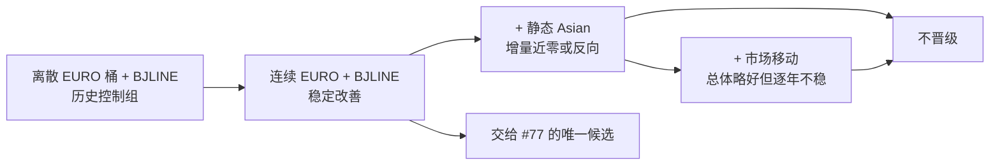

---
aliases:
  - Issue 83 连续市场概率模型
  - CONTINUOUS_EURO_BJLINE
  - Continuous EURO BJLINE
tags:
  - beijing-lot
  - issue-83
  - probability
  - euro
  - calibration
status: completed-historical-candidate
updated: 2026-07-29
---

# Issue #83：连续市场概率模型

> [!summary]
> #83 证明了一个窄但稳定的结论：把 EURO 去水概率作为连续变量使用，
> 比把最大概率切成粗桶更好。最终唯一历史候选是
> `CONTINUOUS_EURO_BJLINE`。亚洲盘静态特征和盘口移动没有获得独立晋级。

GitHub：
[Issue #83 — BJ-CONTINUOUS-MARKET-FUSION-001](https://github.com/algotradinglife/beijing-lot/issues/83)

## 研究问题

[[Issue-82-Market-Fusion|#82]] 使用透明的离散频率模型，确认 EURO 市场信息
明显优于仅按北单让球线统计的频率，但离散的 EURO + Asian 融合没有稳定晋级。
#83 进一步回答三个问题：

1. EURO 连续概率是否保留了分桶丢失的信息？
2. 在连续 EURO 和北单让球线之后，亚洲盘还能否增加稳定信息？
3. initial、10h、1h 之间的市场移动能否继续改善概率？

本实验只评价让球 `3/1/0` 概率质量，不评价 SP、ROI、N4/N7、资金或投注包。

## 四个冻结模型

| Arm | 输入 | 作用 |
| --- | --- | --- |
| `CATEGORICAL_EURO_BJLINE_BASELINE` | EURO Top1 类别、最大概率桶、北单原生让球线 | [[EURO-BJLINE-Baseline|#82 离散控制组]] |
| `CONTINUOUS_EURO_BJLINE` | 连续 EURO 对数概率、北单原生让球线 | 检验连续化本身 |
| `CONTINUOUS_EURO_ASIAN_BJLINE` | 上一 arm + 亚盘让球差、正确香港盘水位差 | 检验静态 Asian 增量 |
| `CONTINUOUS_MARKET_MOVEMENT` | 上一 arm + initial→10h→1h 移动和跨市场分歧 | 检验动态市场增量 |

连续 EURO 的核心输入为：

\[
x_{\text{EURO}} =
\left[
\log\frac{q_{\text{home}}}{q_{\text{draw}}},
\log\frac{q_{\text{away}}}{q_{\text{draw}}}
\right]
\]

其中 \(q\) 是 EURO 十进制赔率经过倒数归一化后的去水概率。模型是固定
`C=0.10` 的 L2 正则化多项逻辑回归，按年份扩展训练，不进行赛果后的特征或
超参数搜索。

## 证据边界

| 项目 | 数值或合同 |
| --- | --- |
| 历史来源 | `data/derived/beidan_xlsm/beidan_xlsm.sqlite` |
| 证据等级 | `RETROSPECTIVE_TIMING_PROXY`，C级 |
| 冻结比赛 ID | 188,793 |
| 比分与北单赛果一致 | 186,725 |
| 每个快照样本外比赛 | 152,825 |
| 样本外年份 | 2016–2025 |
| 快照 | initial、10h、1h |
| 预测明细 | 1,833,900 行，即 3 快照 × 152,825 场 × 4 arm |
| 禁止输入 | final 快照、最终北单 SP、ROI、投注结果 |

历史 XLSM 中的 named snapshot 没有逐行独立采集时间证明，因此这里的
initial/10h/1h 只能作为历史时间代理。结论必须由
[Issue #77](https://github.com/algotradinglife/beijing-lot/issues/77)
用真实时间戳的新样本验证。

### 证据回执与存储边界

- [Gate B 证据回执](https://github.com/algotradinglife/beijing-lot/issues/83#issuecomment-5117810382)
- [PI 终审回执](https://github.com/algotradinglife/beijing-lot/issues/83#issuecomment-5117862697)

下表是 Issue 回执接受的本地资产标识，不表示这些目录已经进入 `main`：

| 资产 | Strategist 本地位置 | `SHA256SUMS.json` SHA-256 |
| --- | --- | --- |
| 唯一授权 Gate A v3 | `results/bj83_gate_a_preoutcome_v3/` | `32b420c15ba7bbaace52aeb90127c3d3a108c8b18cf0ddc18515a0759f2c22a7` |
| PI 授权 Gate B | `results/bj83_gate_b_settlement_v3_pi_authorized/` | `0311b14d11306e14af6b727adc47dedcd679c39c25ed78486073a2b620b6b0fa` |
| 直接对离散基线的配对附录 | `results/bj83_gate_b_paired_baseline_addendum_v1_pi_authorized/` | `63380216345ad9df5803e562c1ebb159d1dad9f6d60edd8c88d6f9be4d3132a3` |

Gate B 中 `prediction_rows.csv` 的 SHA-256 为
`3c55cdc58ef14a19406c91de93f96df88f5cb88a10ef583d00e3fc902c6b0330`。
PI 已独立复算 12 组快照 × arm 聚合指标。

这些行级资产当前只存在于本机 `.worktrees/strategy/`，未被本 PR 纳入 Git，
因此不能仅从仓库恢复。当前可持久审计的是 GitHub 回执、资产标识、哈希和
本页结论；不得把它描述成仓库内已持久化的完整证据包。

> [!warning]
> 本地 `results/bj83_gate_b_settlement_v3/` 是 PI 授权前产生的
> `INVALID_PARTIAL_PREAUTH`。它不能恢复、汇总、引用或覆盖。

## 核心结果

下表是 `CONTINUOUS_EURO_BJLINE` 减去离散控制组。Log loss 和 Brier
为负表示更好，Top1 为正表示命中率提高。

| 快照 | Δ Log loss | Δ Brier | Δ Top1 |
| --- | ---: | ---: | ---: |
| initial | **-0.002659** | **-0.001821** | +0.128pp |
| 10h | **-0.003710** | **-0.002551** | +0.147pp |
| 1h | **-0.003704** | **-0.002505** | +0.198pp |

这不是强烈的命中率跃升。它的价值是方向稳定：

- 三个快照的 Log loss 和 Brier 都改善；
- 每个快照都是 10/10 个样本外年份同方向；
- 排除表现最好的一年或最差的一年后，方向仍保持；
- 零让球和非零让球的聚合结果都不是唯一驱动来源。

## 改善归因

完整 movement arm 的总体指标略好，但主要改善已经由连续 EURO 实现：

| 快照 | 连续 EURO 占完整 movement 改善的比例 | movement 对 Asian arm 的额外 Δ Log loss |
| --- | ---: | ---: |
| initial | 93.2% | -0.000205 |
| 10h | 95.3% | -0.000184 |
| 1h | 98.6% | -0.000070 |

静态 Asian arm 相对连续 EURO：

- 10h 的 Log loss 几乎为零变化，Brier 仅极小改善；
- 1h 和 initial 的 Log loss、Brier 总体略差；
- 逐年方向频繁变化。

movement 相对 Asian arm 也存在多个逐年反转，且 1h 排除最佳年份后
Brier 轻微反向。因此：

> [!important]
> 证据支持“连续 EURO 表达有效”，不支持“亚洲盘或盘口移动已经产生稳定
> 独立增量”。不能用完整 arm 的总体最好成绩，把基础连续化的收益归功于
> movement。

## 高置信 Top2 校准

Gap 定义为“实际覆盖率减去平均预测概率”。负值表示模型偏乐观。
连续 EURO 在每个快照的 Top2 高置信尾部都比离散控制组更接近零：

| 快照 | Top2 ≥80 离散基线 | Top2 ≥80 连续 EURO | Top2 ≥85 离散基线 | Top2 ≥85 连续 EURO |
| --- | ---: | ---: | ---: | ---: |
| initial | -3.85pp | **-2.15pp** | -5.96pp | **-3.26pp** |
| 10h | -1.00pp | **+0.10pp** | -4.07pp | **-3.91pp** |
| 1h | -1.07pp | **-0.35pp** | -4.56pp | **-3.42pp** |

这些阈值只用于描述校准，不是新的选腿门槛。不同 arm 进入尾部的比赛集合
也不同，不能只比较尾部命中率而忽略总体 Log loss 和 Brier。

更完整的 Top1/Top2 定义与历史分桶曲线见
[[Top1-Top2-Calibration|Top1 / Top2 校准曲线]]。

## 原生让球线异质性

连续 EURO 的改善没有覆盖每一条北单让球线。`+2` 是主要薄弱点：

| 快照 | `+2` 场次 | Δ Log loss | Δ Brier |
| --- | ---: | ---: | ---: |
| initial | 2,271 | +0.007932 | +0.000945 |
| 10h | 2,271 | +0.004920 | -0.001851 |
| 1h | 2,271 | +0.008149 | +0.000776 |

`+2` 的 Log loss 在三个快照都反向，且样本量远小于 `0`、`-1` 等主线。
这要求 #77 单独报告 `+2`，但不能在看到历史结果后直接发明“排除 +2”的规则。
是否排除必须由预注册的前瞻验证决定。

## PI 决策

### 存活

`CONTINUOUS_EURO_BJLINE`

它是交给 #77 的唯一历史概率候选。它代表：

- EURO 去水概率连续化；
- 北单原生让球线显式进入模型；
- 固定正则化、按年份扩展训练；
- 先评价概率和校准，不先评价收益。

### 未晋级

- `CONTINUOUS_EURO_ASIAN_BJLINE`：静态 Asian 增量太小且不稳定；
- `CONTINUOUS_MARKET_MOVEMENT`：总体略好，但额外改善小、逐年反转；
- 任何历史高置信阈值或 `+2` 排除规则；
- ROI、下注或生产结论。

### 下一步

Issue Graph 中 #83 已完成并关闭，#77 负责严格前瞻验证：

1. 同时冻结 `CONTINUOUS_EURO_BJLINE` 与 V7.7.1 概率；
2. 使用真实采集时间和同一比赛集合；
3. 比较 Log loss、Brier、Top1、Top2 与高置信校准；
4. 单独报告 `+2`，但不事后删线；
5. 概率模型锁定后，才允许下游组合与收益研究使用。

## 不能从本实验得出的结论

- 不能说连续 EURO 已经证明正 ROI；
- 不能说亚洲盘或盘口移动没有任何信息；
- 不能把历史 named snapshot 当作严格 as-of 快照；
- 不能把 Top2 单腿覆盖率直接连乘成 N7 票命中率；
- 不能因为完整 movement arm 总体最好，就选择更复杂模型。

相关：[[Research-Wiki]] · [[EURO-BJLINE-Baseline]] ·
[[Top1-Top2-Calibration]] · [[Issue-82-Market-Fusion]]
