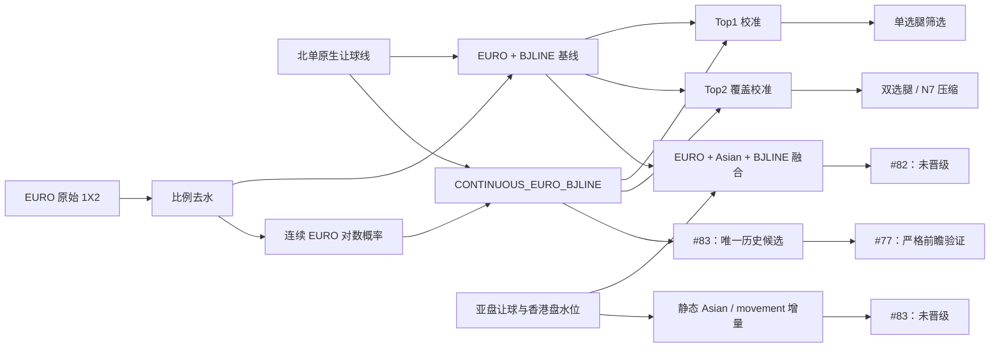

---
aliases:
  - Beijing-lot Research Wiki
  - 研究 Wiki
tags:
  - beijing-lot
  - research
  - moc
status: active
updated: 2026-08-02
---

# Beijing-lot Research Wiki

> [!summary]
> 这是研究结论的入口，不是盈利承诺。概率、覆盖率和模拟收益必须分别阅读；
> 历史代理结果不得冒充严格赛前结果。

## 当前结论

1. **EURO 市场信息是目前最稳定的概率基线之一。** 但北单结算目标是带让球的
   3/1/0，不能把无让球 EURO 概率直接当作北单概率。正确入口见
   [[EURO-BJLINE-Baseline|EURO + 北单让球基线]]。
2. **基线在主体概率区间内校准良好，高概率尾部偏乐观。** 1h 样本中，
   Top1 的 40%–60% 区间和 Top2 的 70%–85% 区间最稳定；Top2 ≥85%
   的预测均值为 88.15%，实际覆盖为 84.22%。详见
   [[Top1-Top2-Calibration|Top1 / Top2 校准曲线]]。
3. **加入亚盘让球与水位只有极小的平均改善，尚不足以晋级。** #82 的
   1h 融合相对基线仅改善 log loss `0.000243`，Top1 反而略降；
   初盘快照上 log loss 还略有恶化。详见
   [[Issue-82-Market-Fusion|Issue #82 市场融合实验]]。
4. **连续 EURO 表达已经晋级为唯一历史候选。** #83 不再把 EURO 最大概率
   切成粗桶，而是直接使用去水后的连续对数概率，并结合北单原生让球线。
   相对离散基线，三个快照的 log loss 和 Brier 均改善，且每个快照都是
   10/10 个样本外年份同方向。详见
   [[Issue-83-Continuous-Market-Model|Issue #83 连续市场概率模型]]。
5. **亚洲盘和盘口移动没有获得独立晋级。** 完整 movement arm 的总体指标
   略好，但 93%–99% 的改善已经由连续 EURO 实现；其额外增量很小且逐年
   反转。因此 #77 只接收 `CONTINUOUS_EURO_BJLINE`。
6. **Top2 比 Top1 更贴近 N7 双选问题。** Top2 的覆盖率可以用来估计双选腿，
   但多腿之间并不独立，不能直接把单腿覆盖率连乘后当成真实票命中率。
7. **放松候选标准会产生候选，但尚未得到跨年可推广优势。** #119 的冻结
   敏感性网格显示 q/p 阈值会强烈改变候选密度；少量正 ROI 全部或几乎全部集中在
   2019 的少数 observation。宽松单选与全覆盖总体为负，严格 #106 控制仍为
   零候选。Gate B v1r3 已按真实 kickoff 时序修正回撤/连败，并将 Gate-A
   `NO_BET` 与 canonical outcome 不可用分别报告；这两项报告修正不改变任何
   stake、gross、tax、net 或 ROI。结果正在等待窄范围独立复验，不能用于购买或生产。详见
   [[Issue-119-Candidate-Sensitivity|Issue #119 候选标准敏感性]]。

## 知识图谱

## 阅读路径

| 想回答的问题 | 入口 |
| --- | --- |
| EURO 概率怎样映射到北单让球 3/1/0？ | [[EURO-BJLINE-Baseline]] |
| Top1 各概率段实际命中率是多少？ | [[Top1-Top2-Calibration#Top1 校准曲线]] |
| Top2 各概率段实际覆盖率是多少？ | [[Top1-Top2-Calibration#Top2 校准曲线]] |
| 胜、平、负作为 Top1 时是否一样可靠？ | [[Top1-Top2-Calibration#按 Top1 结果类别分层]] |
| 哪种双选组合更可靠？ | [[Top1-Top2-Calibration#按 Top2 组合分层]] |
| 加入亚盘信息改善了多少？ | [[Issue-82-Market-Fusion#结果]] |
| 为什么融合暂时不能晋级？ | [[Issue-82-Market-Fusion#PI 结论]] |
| 连续 EURO 比离散分桶改善了多少？ | [[Issue-83-Continuous-Market-Model#核心结果]] |
| 改善来自 EURO、亚盘还是盘口移动？ | [[Issue-83-Continuous-Market-Model#改善归因]] |
| 为什么最终只把简单模型交给 #77？ | [[Issue-83-Continuous-Market-Model#PI 决策]] |
| 严格候选门槛是否错过了可用信号？ | [[Issue-119-Candidate-Sensitivity#结论与下一步]] |
| 哪条北单让球线仍然薄弱？ | [[Issue-83-Continuous-Market-Model#原生让球线异质性]] |
| 如何按期望 SP 选场，并按最低赛果概率决定全包、双选或单选胆？ | [#121 Gate A 阈值冻结](../research/bj121_expected_sp_probability_gate_a_2026-08-02.md) · [Gate B ROI 对比](../research/bj121_expected_sp_probability_gate_b_2026-08-02.md) |
| 同一 N7 中全局只删一个最低概率代码是否有价值？ | [#127 Gate A 匹配单码删除冻结](../research/bj127_global_single_prune_gate_a_2026-08-02.md) · [Gate B matched settlement](../research/bj127_global_single_prune_gate_b_2026-08-02.md) |

## 证据等级

本 Wiki 沿用 [[research_status#2.4 Data quality grading|研究状态中的数据质量分级]]：

- **A级**：严格 as-of、赛前冻结、可审计；
- **B级**：有时间戳，但每次使用仍需核验；
- **C级**：历史快照代理，只能探索；
- **D级**：结算或赛后数据，禁止作为赛前特征。

当前 #82、#83 和本次校准曲线属于 **C级历史 timing proxy**。它们适合缩小
研究方向，不适合直接决定真钱投注。#83 的“晋级”只表示进入 #77 的严格前瞻
比较，不表示生产或投注晋级。

## #121：期望 SP × 最小概率阈值

#121 的完整 9 × 13 参数矩阵已经结算。108 个非空策略行全部为负，最佳为
`ESP300_GM305_LOWP30 / MIXED_N7`，税后绝对 ROI `-23.43%`；剔除最佳
payout/issue 后仍为 `-25.02%/-25.17%`，2020–2025 每个有样本年度均为负。

研究上仍有清楚的结构发现：`p_min=0.30` 将全包 N7 的资金量减少约 91%，并把
ROI 从约 `-31%` 改善至约 `-23%~-24%`；提高 E_SP/GM 门槛再改善不到一个
百分点。说明“高 E_SP 选场 + 删除最低概率赛果”有效压缩了成本，但当前两个
静态指标不足以形成正 edge。下一轮应引入基本面、盘口变化、让球线/联赛条件、
SP 不确定性或税线控制，而不是在已结算阈值附近事后微调。

## #127：匹配全局单码删除

#127 是与 #121 不同的、只删除一个全局最低概率代码的 matched-pair 复查。Gate A v2
将低 `p_min` 删除候选与六个高 `E_SP` companion 明确分离：候选自身不受 match-level
`E_SP` floor 限制，七场组合才受 `GM_E_SP` 检验。Gate B 的 9 个冻结 variant 全部是负
税后 ROI；最严格 `.20` PRUNE 为 -19.91%，同场 FULL 为 -21.75%。PRUNE 固定节省三分之一
stake，但删码实际发生约 18%–24%，税后改善主要来自较低 tax exposure 而非正的无税 edge，
所以结论为 `NO_PROMOTION`。

## 相关笔记

- [[beidan_vs_euro_divergence|北单与欧赔偏差研究]]
- [[track_b_beat_the_close|Track B：超越市场基线]]
- [[single_match_probability_calibration|单场概率校准设计]]
- [[Issue-119-Candidate-Sensitivity|Issue #119 候选标准敏感性]]
- [[roadmap|研究路线图]]
- [Issue #82](https://github.com/algotradinglife/beijing-lot/issues/82)
- [Issue #83](https://github.com/algotradinglife/beijing-lot/issues/83)
- [Issue #77](https://github.com/algotradinglife/beijing-lot/issues/77)
- [Issue #121：期望 SP × 最小赛果概率阈值](https://github.com/algotradinglife/beijing-lot/issues/121)
