---
aliases:
  - Beijing-lot Research Wiki
  - 研究 Wiki
tags:
  - beijing-lot
  - research
  - moc
status: active
updated: 2026-08-07
---

# Beijing-lot Research Wiki

> [!summary]
> 这是研究结论的入口，不是盈利承诺。概率、覆盖率和模拟收益必须分别阅读；
> 历史代理结果不得冒充严格赛前结果。

## 当前结论

1. **EURO 市场信息是目前最稳定的概率基线之一。** 但北单结算目标是带让球的
   3/1/0，不能把无让球 EURO 概率直接当作北单概率。正确入口见
   [[EURO-BJLINE-Baseline|EURO + 北单让球基线]]。
2. **基线在主体概率区间内校准良好，高概率尾部偏乐观。** 1h 样本中，
   Top1 的 40%–60% 区间和 Top2 的 70%–85% 区间最稳定；Top2 ≥85%
   的预测均值为 88.15%，实际覆盖为 84.22%。详见
   [[Top1-Top2-Calibration|Top1 / Top2 校准曲线]]。
3. **加入亚盘让球与水位只有极小的平均改善，尚不足以晋级。** #82 的
   1h 融合相对基线仅改善 log loss `0.000243`，Top1 反而略降；
   初盘快照上 log loss 还略有恶化。详见
   [[Issue-82-Market-Fusion|Issue #82 市场融合实验]]。
4. **连续 EURO 表达已经晋级为唯一历史候选。** #83 不再把 EURO 最大概率
   切成粗桶，而是直接使用去水后的连续对数概率，并结合北单原生让球线。
   相对离散基线，三个快照的 log loss 和 Brier 均改善，且每个快照都是
   10/10 个样本外年份同方向。详见
   [[Issue-83-Continuous-Market-Model|Issue #83 连续市场概率模型]]。
5. **亚洲盘和盘口移动没有获得独立晋级。** 完整 movement arm 的总体指标
   略好，但 93%–99% 的改善已经由连续 EURO 实现；其额外增量很小且逐年
   反转。因此 #77 只接收 `CONTINUOUS_EURO_BJLINE`。
6. **Top2 比 Top1 更贴近 N7 双选问题。** Top2 的覆盖率可以用来估计双选腿，
   但多腿之间并不独立，不能直接把单腿覆盖率连乘后当成真实票命中率。
7. **放松候选标准会产生候选，但尚未得到跨年可推广优势。** #119 的冻结
   敏感性网格显示 q/p 阈值会强烈改变候选密度；少量正 ROI 全部或几乎全部集中在
   2019 的少数 observation。宽松单选与全覆盖总体为负，严格 #106 控制仍为
   零候选。Gate B v1r3 已按真实 kickoff 时序修正回撤/连败，并将 Gate-A
   `NO_BET` 与 canonical outcome 不可用分别报告；这两项报告修正不改变任何
   stake、gross、tax、net 或 ROI。结果正在等待窄范围独立复验，不能用于购买或生产。详见
   [[Issue-119-Candidate-Sensitivity|Issue #119 候选标准敏感性]]。
8. **N7 多策略资金组合没有获得可推广证据。** #192 将 FULL、MODEL M512、Q top-mass
   M192 的 7 个 sleeve 组合与完整资本路径结算。此前的两条 candidate-vs-FULL 20,000 次
   bootstrap 数字（MODEL+Q `-¥157.49`，Q `-¥194.17` 下界）现明确仅为**未匹配 funding
   诊断**，不能建立 lift。确定性的共同资本复放也未改变结论：MODEL+Q 对 Q 的 180 期共同 ¥276,480
   schedule 得到 `-¥33,910.53` 的 matched-capital lift；Q 对 FULL 没有可共同执行的
   整 ticket schedule，故为 `NOT_IDENTIFIABLE_NO_COMMON_EXECUTABLE_SCHEDULE` 而不是零
   效果。最终 immutable package manifest 为
   `3159431d91dda7dfb23ea7dbe4daa42a5411f7e52616e50bb31f04722c17ebe4`，终局是
   `NO_PROMOTION`。正 ROI 或较低回撤均不能单独构成策略授权。详见
   [[Issue-192-N7-Strategy-Ensemble|Issue #192 N7 多策略组合与资金分配]]。
9. **统一概率模型的历史 PoC 采用按期次冻结的边界。** #204 Gate A v2 的开发／CV 止于
   `25042`；一次性回顾测试是 `25043–25125` 与 `26011–26049` 共 75 期，使用明确标为
   `RETROSPECTIVE_PROXY` 的赛前欧赔面板；`26051+` 完整保留给 #210。`predicted_final_sp`
   只是赛前输入代理，监督目标必须是官方 3/1/0 `final_sp`，且该标签与其更新时间均未在 Gate A
   读取。官方全 3SP 覆盖／赛后更新时间只作为 target-only 质量普查保存，不能把代理面板描述成
   live snapshot。市场概率仍是强制 fallback：缺失、OOD 或校准失败时只能回退至有效市场向量或
   `NO_BET_FROZEN`。v3 还冻结了历史平均欧赔标准化概率与 `p_close` 的桥接：使用
   `issue+match_idx → match_uid → p_close.match_id`，在 20,837 个完整重叠上 MAE 为
   0.005533，超过 0.05／0.10 的最大单格差异分别为 85／22 条；二者不会被当成
   byte-identical。缺失 reference 或超过阈值时保留显式 source grade／fallback 理由。
   Gate A 不产生模型优越性或策略授权结论。

## 近期 N7 策略结论（2026-08-02）

这一节记录最近几轮研究的可复用结论，供后续候选生成、选场和组合层研究引用。
统一经济口径是税前 `no_tax_roi`：已包含北单 `0.65` 派彩系数，但不扣逐票税；税后
结果只作次级参考。

### 选场、删码与软覆盖

- **#127：绝对改善主要来自选场，不是硬删码。** 在同一 `p_min<=0.20` 口径下，
  更严格的 `E_SP/GM_E_SP` 使 FULL 基线改善 **+6.79pp**；PRUNE−FULL 的增量
  却没有稳定改善，最严格档反而为 **-1.95pp**。18.66% 的删码开出率与 #101 的
  18.46% 基本一致，更像概率校准正常，而不是删码策略获得了新 edge。
- **#131：软覆盖没有稳定甜区。** 从 hard prune 到 FULL 的 sleeve（0%、5%、10%、
  20%、33%、50%、100%）在 189 个 ALL-scope 行上税前和税后均未出现可推广的正结果；
  不同 seed 的局部最佳比例不一致，因此不能把某个 sleeve 深度固化为策略规则。
- **#132：完整期次的 `q=p×predicted_SP` 没有击败 `p_min`。** 以完整 `(issue, fold)`
  为主单位，p-min、q-min 和 FULL 的冻结比较中，所有非控制 ALL 行均为负；最佳
  `p_min` 仍未达到盈亏平衡，q 排序没有提供稳定增量。早期按 segment 的结果不再作为
  主结论。

这三项共同确立一个强制报告规范：任何“选场 + 剪枝/抽样”实验都必须同时报告
每个选场门槛的 matched FULL 基线，以及同门槛下的 `PRUNE−FULL` 增量、stake retention
和 gross-return retention。不能用 PRUNE 绝对 ROI 代替剪枝增量，也不能把降低税负
解释成税前 edge。

### 概率抽样与独立验证

- **#137：找到描述性最强的候选，但没有得到验证。** `NO_GATE/K4/Q-WOR/M64`
  的三个 seed 税前 ROI 为 `+16.38%/+11.77%/+2.67%`，相对 exact-K FULL 的增量为
  `+32.15pp/+27.54pp/+18.44pp`；21 个 seed×LOYO 配对增量均为正。这个结果来自
  `q=p×predicted_SP` 的无放回抽样，不等于单纯选场或市场概率映射已经产生 edge。
- **#144：完整性通过，统计确认失败。** 独立重放、Gate-A/赛果绑定、逐票税务和
  manifest 均通过；但最大一期贡献最高 **24.23%**，去掉最大期次后两个 seed 的绝对
  税前 ROI 为负，三组 issue-bootstrap 95% 区间均跨零。候选来自 5,300 个冻结参数组，
  因此终局为 `NO_PROMOTION`，解释层级为
  `NOT_VALIDATED_AFTER_CONCENTRATION_OR_MULTIPLE_TESTING`。

结论不是“概率抽样无效”，而是：它显示了值得继续研究的资金效率信号，但目前不能
区分真实 edge 与少数大额期次加上大量参数搜索造成的集中性结果。任何正结果都需要
真正 held-out/forward 数据和严格独立 EV；普通负结果则应给出完整参数面和解释，不应
用 `fail-close` 或“无候选”替代分析。

### #146：分散化的当前结构瓶颈

PR #146 对 Issue #133 冻结了完整期次的 allocator frontier。关键发现不是收益，而是
候选几何：#137 的 N7 identity 大量共享 **6 条 companion legs**，所以主 K4 池中
match cap 1–3、Jaccard `.50` 以及联合严格 cap 均无法形成完整的 4 个 N7；q-delete
cap 1/2 分别仅在 **101/348** 和 **142/348** 个期次可行，cap 4 则基本回到集中结构。

这说明当前瓶颈主要在上游 N7 候选生成，而不是 allocator 本身。#133 Gate B 因此只应
把 q-delete cap 1/2 作为有辨识度的新分散臂，报告集中度、重叠、参与率、资金利用率和
税前 `PRUNE/ALLOCATOR−FULL` 增量；match/Jaccard 严格 cap 的结构性 `NO_BET` 作为诊断，
不能伪装成策略比较。FULL 与 M64/M128 的原始 stake 不同，FULL 只能作为资本归一化 ROI
基线，原始资金量必须单独报告。

### 后续推导的控制规则

1. 主分析单位是完整期次，segment 只能作为诊断标签。
2. 先分离 selector lift、sampler/allocator lift 和 interaction，再讨论总 ROI。
3. 先看税前结果；税后只用于说明税线和资金暴露的影响。
4. 每个候选都要报告集中度、最大期次敏感性、LOYO 和按期 bootstrap。
5. “描述性阳性”不等于推广；必须经过样本外验证。负结果也必须留下参数遍历和可复用的结构结论。

### #133 Gate B：WR 基线下的 12 个主比较（2026-08-02）

本节记录已合并 PR #147 的 v2 结算。主比较是同一完整期次、同一候选身份、同一
seed 下，`Q_DELETE_EXPOSURE_CAP_1/2` 相对于 `CONCENTRATED_TOP_SCORE` 的
`Q_INFORMED_WR_DUPLICATE_STAKE` 基线。WR 中每次抽样都是独立的 ¥2 票，重复代码
不去重；税前 ROI 是主口径，税后 ROI 为辅助口径。

| M | cap | seed | cap ROI | WR ROI | 税前增量 | cap 税后 ROI | WR 税后 ROI | 税后增量 |
|---:|---:|---:|---:|---:|---:|---:|---:|---:|
| 64 | 1 | 133001 | -24.51% | -51.16% | **+26.65pp** | -24.51% | -51.16% | **+26.65pp** |
| 64 | 2 | 133001 | -42.73% | -47.42% | **+4.69pp** | -42.73% | -47.42% | **+4.69pp** |
| 64 | 1 | 133002 | -55.22% | -37.69% | -17.53pp | -55.22% | -37.69% | -17.53pp |
| 64 | 2 | 133002 | -57.22% | -41.67% | -15.55pp | -57.22% | -41.67% | -15.55pp |
| 64 | 1 | 133003 | -61.28% | -50.19% | -11.09pp | -61.28% | -50.19% | -11.09pp |
| 64 | 2 | 133003 | -43.08% | -34.13% | -8.95pp | -43.08% | -34.13% | -8.95pp |
| 128 | 1 | 133001 | -45.12% | -55.56% | **+10.44pp** | -45.12% | -55.56% | **+10.44pp** |
| 128 | 2 | 133001 | -22.64% | -15.28% | -7.36pp | -26.49% | -19.13% | -7.36pp |
| 128 | 1 | 133002 | -47.93% | -40.08% | -7.85pp | -47.93% | -40.08% | -7.85pp |
| 128 | 2 | 133002 | -52.89% | -43.84% | -9.05pp | -52.89% | -43.84% | -9.05pp |
| 128 | 1 | 133003 | -57.50% | -40.80% | -16.70pp | -57.50% | -40.80% | -16.70pp |
| 128 | 2 | 133003 | -29.61% | -26.13% | -3.48pp | -32.71% | -29.23% | -3.48pp |

只有 12 项中的 3 项税前增量为正（M64/cap1、M64/cap2、M128/cap1，均为
seed 133001）；其余 9 项为负。需要注意，PR 文档中的“仅 2/12 为正”与冻结
`matched_effects.csv.gz` 的逐行数据不一致；Wiki 以可审计 CSV 为准，并将该计数
差异作为报告瑕疵记录。修正后的统计卡按预先锁定的 12 比较、24 个
ROI 指标、跨 seed、LOYO、issue bootstrap 和 Bonferroni 规则判断，正向结果没有
稳定证据，因此终局为 **NO_PROMOTION**。

这里的结论不是“重叠一定有害”，而是：在当前候选 identities 共享六条 companion
legs、可用场次池有限的条件下，主动去重没有产生稳定税前增量。集中度应作为风险
诊断，而不是硬性优化目标；若要继续研究 allocator，应先生成真正多样化的 N7 leg
sets，再重复 WR/WOR/overlap-cap 对照。

### #148 Gate B：密集 M 曲线（2026-08-02）

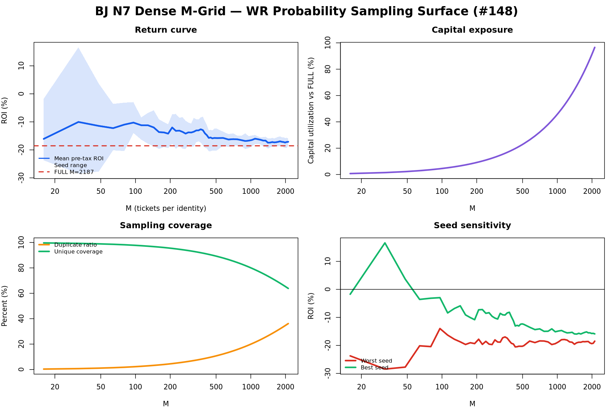

#148 在固定 common-support identities、三组 seed 和完整 issue 单位上，遍历 58 个
M 点：`16..512` 步长 16，`576..1024` 和 `1088..2112` 步长 64，另加 FULL
`M=2187`。没有单期下注上限；每期所有可用 identities 都参与，资金随候选数量自然
变化。WR 是主基线，WOR 仅作敏感性，FULL 是精确 `3^7` 枚举控制。

Gate B 只在 canonical outcome 完整的 187 个期次上结算（另有 156 个期次因 outcome
不完整而保留为 zero-stake unavailable），因此不能把不可结算期次误当作零收益期次。
FULL 执行资金为 ¥20,964,582，税前 ROI **-18.54%**，税后 ROI **-20.38%**。

| M | 相对 FULL 资金利用率 | 三 seed 平均税前 ROI | 平均重复票比例 | 平均 unique coverage |
|---:|---:|---:|---:|---:|
| 16 | 0.73% | -16.08% | 0.34% | 99.66% |
| 96 | 4.39% | -10.26% | 2.16% | 97.84% |
| 512 | 23.41% | -15.79% | 10.97% | 89.03% |
| 1024 | 46.82% | -16.46% | 20.36% | 79.64% |
| 2112 | 96.57% | -17.11% | 36.15% | 63.85% |

没有任何 M 在三个 WR seed 上同时取得正税前 ROI。跨 seed 平均最好的点是 `M=32`
（-10.04%），但三个 seed 分别为 -18.24%、-28.45% 和 +16.58%，属于 seed-local
maximum；最好的 worst-seed 点是 `M=96`，三个 seed 仍为 -13.98%、-13.86% 和
-2.96%。因此终局为 **DESCRIPTIVE_SURFACE_ONLY / NO_STABLE_SWEET_SPOT**，而
不是把某个 M 点晋级为策略。

解释上，M 增大确实使资金暴露快速上升、重复票增加、unique coverage 下降，但没有
带来稳定的税前回报改善。当前阶段应把 M 视为资金—覆盖率—风险的选择参数，而不是
独立 alpha 来源；后续优先改善候选场次和决策链，再重新评估 M 曲线。

### 从 #137 正收益候选到 #151 固定候选复现（2026-08-02）

此前 #137 曾出现一个值得保留的描述性正收益候选：
`NO_GATE/K4/Q_INFORMED_WOR_DISTINCT/M64`。三个 seed 的税前 ROI 约为
`+16.38%`、`+11.77%` 和 `+2.67%`，相对匹配 FULL 也有较大提升。但这不是已确认
的正 EV，原因包括：候选来自约 5,300 个参数组的筛选、收益集中于少数 issue、issue
bootstrap 区间跨过 0，以及独立验证未通过集中度/多重比较稳定性门槛。

后续研究并没有把该结果简单丢弃，而是分层处理：

```text
#137：发现描述性候选
   ↓ 固定 identities / gate / selection definition
#133：测试 overlap / allocator，发现候选池共享六条 companion legs
   ↓ 固定 common-support，遍历 M=16..2187
#148：没有稳定 M 甜区；M 主要改变资金暴露、重复率和 coverage
   ↓ 不重新挑参、不 outcome re-select
#151：复现 #137 候选，并与 #148 broader-pool 曲线并列
```

因此当前 Wiki 的证据分层是：

- **已知**：#137 有描述性正结果，但没有严格样本外稳定证据；#133 的当前候选池
  不适合通过强制去重创造稳定增量；#148 没有跨 seed 稳定的 M 甜区。
- **仍待验证**：#137 的候选定义本身是否具有可复现结构，或者正收益只是参数筛选、
  seed 波动和 issue concentration 的组合。
- **#151 的约束**：只继承 #137 冻结的 candidate definition，不重新遍历 outcome
  选择；比较 WR、WOR、FULL 和密集 M 曲线，并报告 candidate−FULL 及其相对
  #148 broader-pool 的差异。

这条路线保留了正收益假设的研究价值，同时避免把历史筛选峰值误当作已授权 edge。
若 #151 出现跨 seed、LOYO 和 bootstrap 稳定的阳性结果，再进入严格独立 EV；若阳性
消失，则要明确归因于 M、采样机制、候选池扩展或 issue concentration，而不是简单
以 `NO_PROMOTION` 结束。

### #151/#154：固定候选复现与独立验证结论（2026-08-02）

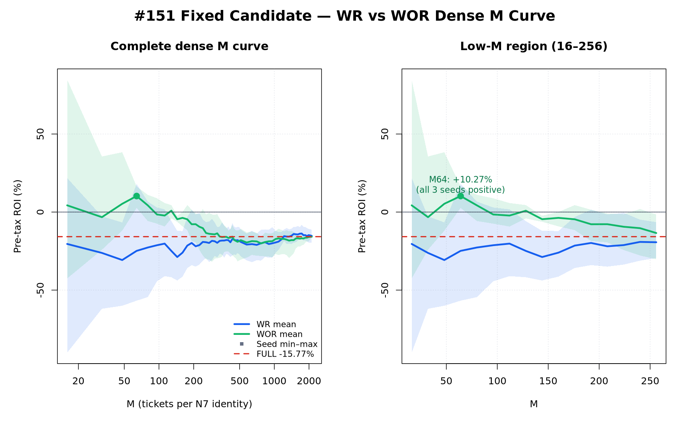

#151 固定 #137 `NO_GATE/K4` identities、Q vectors、seeds 和历史 sampler namespace，
没有重新挑参。原始 `Q_INFORMED_WOR_DISTINCT/M64` 税前 ROI 被精确复现：

| seed | WOR/M64 税前 ROI | 税后 ROI |
|---:|---:|---:|
| 137001 | +16.38% | +5.06% |
| 137002 | +11.77% | +5.95% |
| 137003 | +2.67% | -3.02% |
| 三 seed 平均 | **+10.27%** | — |

邻近 WOR 点的三 seed 平均也为正：M48 `+5.30%`、M80 `+4.29%`、M128
`+0.86%`。但是相同固定候选的 WR/M64 平均税前 ROI 为 **-24.86%**，且整个 WR
M 网格均为负；matched K4 FULL 为 **-15.77%**。因此历史阳性是明显的
**WOR-distinct sampler-specific signal**，不是候选池在任意抽样机制下的普遍正 EV。

#154 从 fresh detached checkout 独立重建 #137 sampler，并对全部 171 个非 FULL WOR
surface rows 得到零差异，确认历史结果是真实可重放的。但严格稳健性仍不成立：

- 三个 seed 的 issue-bootstrap 95% 区间均跨 0；
- 去掉最大贡献 issue 后税前 ROI 为 `-11.47%`、`+0.08%`、`-9.46%`；
- top issue gross share 为 `24.23%`、`10.82%`、`12.16%`；
- 58 个 M × 3 seeds 仍暴露于同一历史样本和多重比较。

最终分级为 **PASS_REPRODUCTION_ONLY**：#137 正收益候选及其附近 WOR 正值簇被独立
复现，值得作为 sampler 设计线索保留；但收益依赖少数期次、bootstrap 不稳定，不能
晋级为已验证正 EV，也不产生购买、生产或投注授权。后续若继续，应使用冻结的 WOR
机制进行真正的 held-out / forward validation，而不是继续在同一历史窗口选 M。

### #145：WR/WOR/残差/封顶重复票分配冻结（Gate A，2026-08-03）

#145 不再重开 #137/#151 的候选选择，而是固定 #151 的 `NO_GATE/K4` candidate，另加
`ESP300_GM290/K8` 作为次级敏感性臂。Gate A 只冻结分配规则，不读取结算结果：696 个
issue-arm 行、3,540 个 N7 identity、24,780 个 role 行和 1,006,416 个分配计划行均为
赛前输入。

同一 identity、同一 issue stake 下保留六个权重源（`MODEL_P_CAL`、`MARKET_WF_CAL`、
`BLEND_A25/A50/A75`、`Q_WEIGHT`），并比较 weighted WR duplicate-stake、WOR-distinct、
deterministic residual/systematic、cap `{1,2,4,8}`、top-mass 与 FULL。低 M 面是
`16..256` 步长 16，`512/1024/1458/2187` 仅作收敛控制；沿用 #137 的三枚 seed
`137001/2/3`。每个重复 `¥2` ticket 单独计数和未来单票税，不按 issue 或 policy 汇总。

Gate B 尚未授权；若获授权，先报税前 `no_tax_roi` 和同 stake 的机制差异，再单独报逐票
税，并保留 seed、LOYO、YEAR/FOLD、issue bootstrap、最大期次剔除、coverage 与重复票
浓度。v8 在 v5 绑定基础上逐字复用 #137 `stable_uniform`、WR/WOR token 顺序，并将
`identity_signature` 固定为 `selected_match_ids`；新增直接对照测试，确保相同权重/seed/identity
产生相同票码倍数，并增加真实 BLEND_A50/M2187 原始单位回归，防止总和缩放再次引入
边界票码偏移。v8 机制契约另行显式记录每个 arm 的 expected-unique formula 与
realized-unique rule，并将 `bj145_allocation_engine.py` 与六个 N7 golden-vector
fingerprints 绑定进 manifest，避免在 Gate B 才首次决定 residual/capped 的票码倍数，也避免
把 WR 的重复票、WOR 的无放回 distinct 和 FULL 控制混为同一指标。该冻结不构成
购买、生产或投注授权。详见 [#145 Gate A](../research/bj145_ticket_allocation_gate_a_2026-08-03.md)。

### #145：Gate B v2 完整结算与分配机制解释（2026-08-03）

v1 包原样保留，但其 coverage/miss 分母和 outcome-code marginal 不再作为终局解释。
权威替代包为 `results/bj145_gate_b_outcome_settlement_v2`；它不改 Gate-A v8 的
identity、权重、机制、M、cap、seed 或逐 issue 结算行，只修正结算后的汇总、完整
2,187-code allocation atlas、机制对照、稳定性分析、图表和报告。全矩阵仍为
1,006,416 个 issue/config 行、2,892 个配置、63,624 个 ALL/YEAR/FOLD/LOYO summary、
63,360 个 matched FULL 差、12,960 个全 M-grid 机制 pair、5,760 个 bootstrap 和
2,880 个 Holm 行；税务 reconciliation 2,892/2,892 PASS。

#### 分母修正与 FULL 控制

coverage、wager miss streak 和 chronological drawdown 只使用 `SETTLED + positive-stake`
行；Gate-A no-bet 与 canonical outcome unavailable 单独计数，不再伪装成 miss。主臂
支持集为 254 issues / 1,016 identities，次臂为 191 / 1,528。FULL 在两个支持集上均为
100% coverage；旧口径把主臂 `Q_WEIGHT/WOR_DISTINCT/M16/137002` 记成 13/348，v2
修正为 13/254 = 5.1181%。

| arm | FULL 税前 ROI | FULL 税后 ROI | settled issues | FULL coverage | tax-net max drawdown |
|---|---:|---:|---:|---:|---:|
| `PRIMARY_NO_GATE_K4` | -15.77% | -18.88% | 254 | 100.00% | ¥865,364.85 |
| `SECONDARY_ESP300_GM290_K8` | -16.12% | -18.30% | 191 | 100.00% | ¥1,246,062.84 |

#### 权重、机制与 cap

六个权重源的非 FULL 历史中位税前 ROI 均为负；`Q_WEIGHT` 产生最高 same-window
峰值，但也有明显 seed/期次集中。以下是主臂中位数；次臂的结论方向相同，完整六权重
×机制×cap×M×seed 数字面保存在包内 `mechanism_weight_surface_summary.csv`。

| 主臂权重 | 中位税前 ROI | 描述性最大值 | 正值 cells |
|---|---:|---:|---:|
| `MODEL_P_CAL` | -17.79% | +67.97% | 26/240 |
| `MARKET_WF_CAL` | -14.38% | +55.01% | 24/240 |
| `BLEND_A25` | -17.49% | +55.01% | 17/240 |
| `BLEND_A50` | -20.79% | +67.97% | 12/240 |
| `BLEND_A75` | -18.62% | +67.97% | 16/240 |
| `Q_WEIGHT` | -15.77% | +84.76% | 61/240 |

但 matched 归因并不支持把 Q 峰值解释成普遍权重优势：固定机制、cap、M、seed、stake
后，`Q_WEIGHT` 相对其余五个权重的主臂中位差为 -2.85pp（500 better / 675 worse /
25 tie，共 1,200 cells），次臂为 -5.52pp（376 / 798 / 26）。因此 Q 的最高 cell 是
尾部峰值，而不是跨配置的一般改善。

WOR 在相同 M 下消除 exact duplicate，主/次臂的中位 coverage 为 30.51%/56.02%，
中位税前 ROI 为 -11.68%/-8.51%；WR 保留自然重复 stake，中位 duplicate ratio
4.42%/4.34%，税前 ROI 为 -18.04%/-18.97%。residual、top-mass 和 cap=1 的
中位 unique ratio 为 100%；cap 从 1 增至 8 时重复集中和 miss streak 显著上升，主臂
中位税前 ROI 从 -18.06% 降至 -30.56%，次臂从 -20.16% 降至 -40.40%。没有一个 cap
在六权重、三 seed、YEAR/FOLD/LOYO 上形成稳定优势。降低 stake 或提高 unique coverage
本身都不是 edge；因此同时报告 capital utilization、gross retention、hit tickets、
winning identities、top-issue share、HHI、drawdown 和 miss streak。

matched 机制归因进一步区分了“机制信号”和“可晋级策略”：固定 arm、weight、M、stake
与 seed 后，WOR−WR 的主/次臂中位税前差为 +5.77pp/+9.69pp，分别有 243/360、
285/360 cells 有利于 WOR；WOR 同时把 duplicate-ratio 中位数降低约 4.42pp/4.34pp。
WR−residual 则方向不一致：主臂 -1.16pp（165/360 有利），次臂 +1.55pp
（205/360 有利）。cap2/cap4/cap8 相对 residual 的主臂中位差为
-0.39pp/-2.74pp/-12.24pp，次臂为 -0.35pp/-4.90pp/-19.20pp；coverage 随 cap
放宽下降而重复集中上升，没有稳定的 cap tradeoff 改善。

#### 稳定性与集中度

WR/WOR 的 matched seed ROI range 并不小：主臂中位 22.51pp/22.01pp，次臂
14.76pp/8.89pp；p95 可达 56.60pp–67.23pp。2,880 个税前 issue-bootstrap 比较中
只有 52 个 lower 95% bound 高于零，2,605 个区间跨零。1,983 个 Holm-significant
sign rows 中，1,898 个是 negative-issue majority，只有 85 个是 positive-issue majority；
这个 per-issue candidate−FULL sign test 主要记录 coverage/miss 方向，不衡量少量大额
派彩的幅度，因此不能把 1,983 解释成有利发现。每个配置另有真实
leave-one-issue-out（保留造成 min/max 的 issue ID）和“剔除本配置最大 gross issue 后
相对 matched FULL”的税前敏感性。历史最高的主臂 Q-WOR/M16/137002 从 +84.76%
降到 ex-largest +48.43%，但其它 seed 与 bootstrap 不稳定；这仍不是独立正 EV。

主臂 Q-WOR/M64 的三个 seed 为 +16.38%/+11.77%/+2.67%，这正是 #151/#154 已复现
的历史簇，不是 #145 新发现；三条 bootstrap CI 全部跨零，剔除各自最大 gross issue 后
为 -11.47%/+0.08%/-9.46%。该簇 YEAR/FOLD 仅 12/21 行为正，LOYO 15/21 为正，
仍是 mixed stability。M16/137002 的 +84.76% 更是 seed outlier：另两个 seed 为
-42.54% 与 -29.30%，跨 seed 中位数 -29.30%。

#### 五个终局问题

1. **概率/价值权重是否有 matched 增益？** 没有；Q 对五类匹配权重的中位差在两臂均负。
2. **WOR 是否改善？** 历史 matched 归因支持 distinct-coverage/WOR，但不构成晋级证据。
3. **WR 或 residual 是否更好？** 两臂方向相反，且 WR 增加约 4.4pp 重复暴露。
4. **repeat cap 是否改善 tradeoff？** cap1 接近 distinct identity control；cap2/4/8 均无稳定改善。
5. **是否存在稳定 sweet spot？** 没有；seed、YEAR/FOLD/LOYO、LOIO、ex-largest、
   bootstrap 与 multiplicity 的联合证据均不支持晋级。

完整 outcome-code atlas 对 2,892 个配置各列 2,187 个代码，共 6,324,804 行：目标概率
质量、实际分配 ticket copies/frequency、两者 delta 与真实赛果 identity/hit 分开记录；
每配置目标与 realized frequency 均守恒为 1，delta 和为 0。M=512/1024/1458/2187
也进入 matched pairwise 收敛控制，不再只看 M≤256。

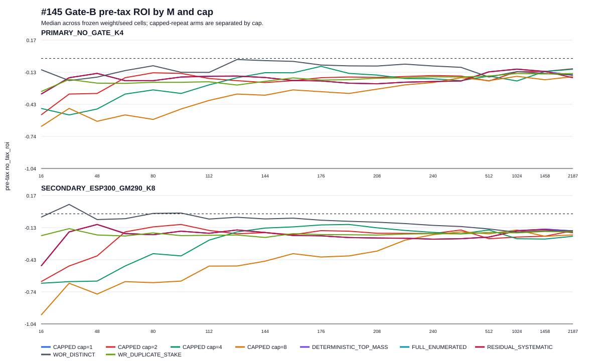

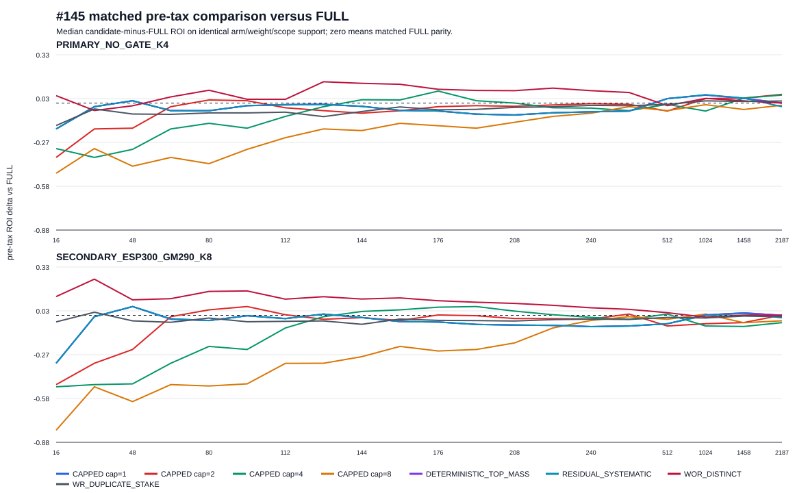

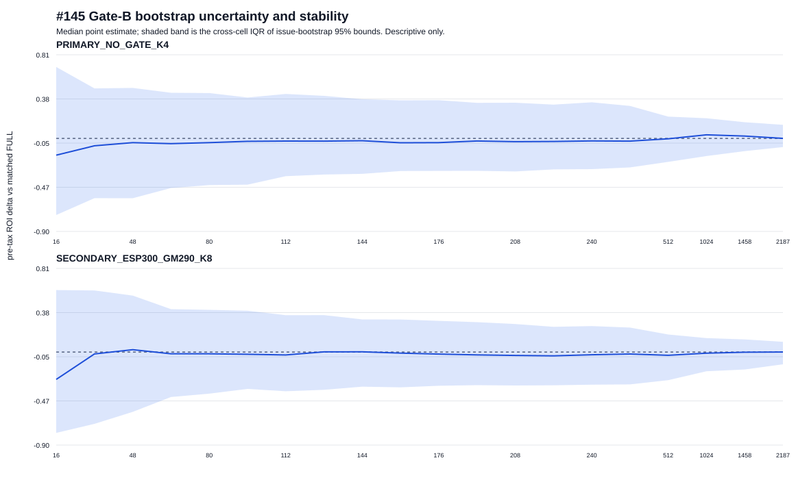

终局仍为 **DESCRIPTIVE_SURFACE_ONLY_NO_PROMOTION**。高历史 cell 只能作为后续 strict
independent-EV 与真正 held-out/forward validation 的候选，不能产生购买、生产或投注
授权。v2 不可变清单 `SHA256SUMS.json` 的 SHA-256 为
`10d5a5082a175ddc965b01fb257e8e5c7e91a844d7ee823fd6d2ad5aeff84cc9`。完整表格和
解释见 v2 包内 `report.md`；Gate-A 设计仍见
[#145 Gate A](../research/bj145_ticket_allocation_gate_a_2026-08-03.md)。

## 知识图谱

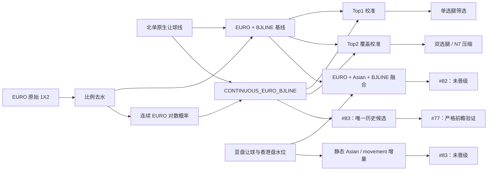

## 阅读路径

| 想回答的问题 | 入口 |
| --- | --- |
| EURO 概率怎样映射到北单让球 3/1/0？ | [[EURO-BJLINE-Baseline]] |
| Top1 各概率段实际命中率是多少？ | [[Top1-Top2-Calibration#Top1 校准曲线]] |
| Top2 各概率段实际覆盖率是多少？ | [[Top1-Top2-Calibration#Top2 校准曲线]] |
| 胜、平、负作为 Top1 时是否一样可靠？ | [[Top1-Top2-Calibration#按 Top1 结果类别分层]] |
| 哪种双选组合更可靠？ | [[Top1-Top2-Calibration#按 Top2 组合分层]] |
| 加入亚盘信息改善了多少？ | [[Issue-82-Market-Fusion#结果]] |
| 为什么融合暂时不能晋级？ | [[Issue-82-Market-Fusion#PI 结论]] |
| 连续 EURO 比离散分桶改善了多少？ | [[Issue-83-Continuous-Market-Model#核心结果]] |
| 改善来自 EURO、亚盘还是盘口移动？ | [[Issue-83-Continuous-Market-Model#改善归因]] |
| 为什么最终只把简单模型交给 #77？ | [[Issue-83-Continuous-Market-Model#PI 决策]] |
| 严格候选门槛是否错过了可用信号？ | [[Issue-119-Candidate-Sensitivity#结论与下一步]] |
| 哪条北单让球线仍然薄弱？ | [[Issue-83-Continuous-Market-Model#原生让球线异质性]] |
| 如何按期望 SP 选场，并按最低赛果概率决定全包、双选或单选胆？ | [#121 Gate A 阈值冻结](../research/bj121_expected_sp_probability_gate_a_2026-08-02.md) · [Gate B ROI 对比](../research/bj121_expected_sp_probability_gate_b_2026-08-02.md) |
| 同一 N7 中全局只删一个最低概率代码是否有价值？ | [#127 Gate A 匹配单码删除冻结](../research/bj127_global_single_prune_gate_a_2026-08-02.md) · [Gate B matched settlement](../research/bj127_global_single_prune_gate_b_2026-08-02.md) |
| 同一完整期次中按 `p_min` 或 `q=p×predicted_SP` 删除一个代码是否有价值？ | [#132 完整期次 Gate B 结算](../research/bj132_complete_issue_gate_b_2026-08-02.md) |

## 证据等级

本 Wiki 沿用 [[research_status#2.4 Data quality grading|研究状态中的数据质量分级]]：

- **A级**：严格 as-of、赛前冻结、可审计；
- **B级**：有时间戳，但每次使用仍需核验；
- **C级**：历史快照代理，只能探索；
- **D级**：结算或赛后数据，禁止作为赛前特征。

当前 #82、#83 和本次校准曲线属于 **C级历史 timing proxy**。它们适合缩小
研究方向，不适合直接决定真钱投注。#83 的“晋级”只表示进入 #77 的严格前瞻
比较，不表示生产或投注晋级。

## #121：期望 SP × 最小概率阈值

#121 的完整 9 × 13 参数矩阵已经结算。108 个非空策略行全部为负，最佳为
`ESP300_GM305_LOWP30 / MIXED_N7`，税后绝对 ROI `-23.43%`；剔除最佳
payout/issue 后仍为 `-25.02%/-25.17%`，2020–2025 每个有样本年度均为负。

研究上仍有清楚的结构发现：`p_min=0.30` 将全包 N7 的资金量减少约 91%，并把
ROI 从约 `-31%` 改善至约 `-23%~-24%`；提高 E_SP/GM 门槛再改善不到一个
百分点。说明“高 E_SP 选场 + 删除最低概率赛果”有效压缩了成本，但当前两个
静态指标不足以形成正 edge。下一轮应引入基本面、盘口变化、让球线/联赛条件、
SP 不确定性或税线控制，而不是在已结算阈值附近事后微调。

## #127：匹配全局单码删除

#127 是与 #121 不同的、只删除一个全局最低概率代码的 matched-pair 复查。Gate A v2
将低 `p_min` 删除候选与六个高 `E_SP` companion 明确分离：候选自身不受 match-level
`E_SP` floor 限制，七场组合才受 `GM_E_SP` 检验。Gate B 的 9 个冻结 variant 在绝对
无税及实际税后 ROI 上全部为负；最严格 `.20` PRUNE 为 -10.30% 无税、-19.91% 税后，
同场 FULL 为 -8.35% 无税、-21.75% 税后。PRUNE 固定节省三分之一 stake，删码实际发生约
18%–24%；无税 ROI 相对 FULL 在 7/9 行微升、2/9 行下降，但均未达 breakeven。税后改善
主要来自较低 tax exposure 而非正的无税 edge，所以结论为 `NO_PROMOTION`。

## #131：全局删码的软覆盖 sleeve

#131 以 #127 已冻结的七场与全局删码为 selector baseline，不重新选场。它预注册在 729 张
omitted-code slab 中按固定嵌套顺序加回 0%、5%、10%、20%、33%、50%、100% 的票，并以三个
赛果未知 seed 检查样本顺序敏感性。0% 精确复现 hard prune，100% 精确复现 FULL；中间 sleeve
仅改变 portfolio-layer coverage，不能被解释为新的 selector edge。Gate B 已结算：9 个 selector ×
3 个 seed × 7 个 sleeve 的 189 个 ALL-scope 行，无税和实际税后 ROI 全部为负。主 seed 的
严格 selector 以 hard prune -19.91% 税后最佳，10% sleeve -20.11%、FULL -21.75%；其它 seed
的“最佳”比例又变化，故局部改善不构成稳定、可推广的 sleeve 深度。结论为 `NO_PROMOTION`。
详见 [#131 Gate B 完整结算](../research/bj131_soft_cover_n7_gate_b_2026-08-02.md)。

### 选场与剪枝的分离归因

在同一 `p_min<=0.20` 口径下，`E_SP/GM_E_SP` 门槛越严格，FULL 基线从 -15.14%
改善到 -8.35%，即选场贡献 **+6.79pp**；但 matched PRUNE 相对 FULL 的无税增量没有
随之稳定改善，最严格档反而为 **-1.95pp**。因此 #127 中绝对表现的主要改善来自选场，
不能记在删码策略名下。

| 选场门槛 | FULL 无税 ROI | PRUNE 无税 ROI | PRUNE−FULL | 删码开出率 |
|---|---:|---:|---:|---:|
| `ESP280_GM290_LOWP20` | -15.14% | -15.28% | -0.15pp | 18.23% |
| `ESP290_GM300_LOWP20` | -13.24% | -13.14% | +0.10pp | 18.32% |
| `ESP300_GM305_LOWP20` | -8.35% | -10.30% | -1.95pp | 18.66% |

最严格档的 18.66% 删码开出率也不是新的预测进步：它与 #101 同口径
`p_min<=0.20` 的 18.46% 几乎一致，符合概率校准预期。#121 删除多场赛果，coverage
定义不同，不能把它当成这个 18.46% 的直接对照。按 `E_SP` 分层后的删码开出率也没有
显示稳定单调下降；当前样本只能支持“校准正常”，不能支持“选场使删码更准”。

因此 `NO_PROMOTION` 同时表达两件事，而不是笼统否定整个方向：

1. 当前 `E_SP/GM_E_SP` 选场虽显著改善 FULL 基线，但仍未把无税 ROI 推到正值；
2. 在同一批七场、同一资金口径下，当前 `p_min` 硬删除没有提供稳定的边际增量。

这不等于所有剪枝都不可行。对“删一个代码、stake 保留 2/3”的策略，剪枝无税 ROI
优于 FULL 的必要条件是删码后的 gross return retention 高于 `2/3`。#127 最严格档只有
65.249%，未越过这条 matched 基准线。

### 后续研究的强制双指标报告

以后所有“选场 + 剪枝/抽样”研究必须同时报告以下两组指标，且使用同一批 N7、同一
结算窗口和可比资金口径：

1. **选场基线**：每个选场门槛下的 matched FULL 无税/税后 ROI，用来衡量 selector
   相对历史 FULL 的改善；
2. **剪枝增量**：同门槛下 `PRUNE−FULL` 无税/税后 ROI，并同时报告 stake retention、
   gross return retention 与删码开出率，用来判断删码是否独立贡献 edge。

禁止用 PRUNE 的绝对 ROI 代替剪枝增量，也禁止把税负下降产生的表面改善解释为无税
edge。负结果仍需给出完整参数遍历、分层切片和 Wiki 结论，不能以“无候选”或
fail-close 代替策略分析。

## #132：完整期次 p-min 与 q-min 删码

#132 的主结果不采用早期按 segment 切分的敏感性计算，而以 348 个完整 `(issue, fold)`
实例的赛前冻结为唯一主样本。52,534 个 N7 identity 在 FULL、`p_min` 删码与
`q=p×predicted_SP` 删码三个臂中共享同七场；所有 160,734 个冻结行、3,132 个 no-bet、
期次税桶和 LOYO 单位均被保留。最终 27 条非控制 ALL 行均为负。最佳 `p_min` 行
`ESP300_GM305_LOWP20` 无税/税后 ROI 为 -16.90%/-29.68%，仍没有正 edge；最佳
`q_min` 税后为 -33.34%。因此 q 排名没有成为 `p_min` 的改进，也没有获得推广。

`p_min` 删码虽固定把 stake 降至 matched FULL 的 2/3，却未将收益保留到盈亏平衡。
YEAR、FOLD 与 leave-one-year-out 切片均作为诊断保留；此处的 `NO_PROMOTION` 只表示
当前完整期次历史证据不支持推广，并非购买建议。详见
[#132 完整期次 Gate B](../research/bj132_complete_issue_gate_b_2026-08-02.md)。

## #137：选场 × 概率加权 N7 抽样

#137 把完整期次的选场、`K={1,2,4,8,ALL}` identity 参与数和每个 N7 的抽样数
`M` 分开冻结；随后结算 10 个 gate、13 个 M、多个概率向量和三种随机 seed 的全矩阵。
税务以一张实际中奖票为唯一阈值单位：先逐张票判断 `¥2×0.65×Π(SP)≥¥10,000`，再累加
已逐票确定的税额；绝不汇总多张票来跨越税线。v2r1 的逐票账本对 14,450 个策略与
issue-policy 汇总账本全部零差额对账。

v3 将所有 selector、sampler、interaction 和 M=1458 hard-control 比较改为候选与基准
共同 `SETTLED` 完整期次的配对计算：685,080 行参数面同时报告双方支持数、税前主 ROI/
增量和税后敏感性。NO_GATE/K1 对 K_ALL 的例子从旧的未匹配 +3.84pp/+2.05pp 降为共同
187 期上的税前 +1.02pp、税后 +0.10pp，不能再解释为 selector 改善。

主尺度为 `no_tax_roi`（已含北单 0.65 因子，不扣逐票税）；随机策略需要三 seed 的 ALL
和全部 LOYO 配对增量为正，YEAR/FOLD 只保留为离散度诊断。唯一绝对税前正候选是
`NO_GATE/K4/Q_INFORMED_WOR_DISTINCT/M64`：三个 seed 税前 ROI 为 +16.38%/+11.77%/
+2.67%，相对 exact-K FULL 增量为 +32.15pp/+27.54pp/+18.44pp。但其最大单一期次份额
最高 24.23%，去掉最大期次后绝对 ROI 为 -11.47%/+0.08%/-9.46%（两负、一条近盈亏平衡
正值）。#144 已完成独立只读 EV：包哈希、Gate-A/赛果绑定、逐票税务和重放均通过，但三组
seed 的 20,000 次配对 issue-bootstrap matched-lift 95% 区间都跨零，且该候选来自 5,300 个
冻结 gate×K×sampler/vector×M 选择组。保守的家族错误率控制不能把普通区间已跨零的候选
转为已验证正 edge；终局决定为 `NO_PROMOTION`，解释层级
`NOT_VALIDATED_AFTER_CONCENTRATION_OR_MULTIPLE_TESTING`。这区分了**完整性通过**与
**统计未验证**，并不授权推广、购买或生产部署。

v3r1 报告派生包补齐完整解释：同族 Q-WOR/K4 曲线在 M32/64/128/256 中仅 M64 同时通过
三 seed 绝对 ROI 和 LOYO；ESP300/GM*/K8/Q/M128 是次级近盈亏平衡信号（ROI
+4.46%/-2.23%/+4.46%，增量 +20.58pp/+13.89pp/+20.58pp，最差 LOYO +5.90pp），不能替代
主候选。机制面中 q-WOR 为 111 个 ALL 正增量、29 个 LOYO 稳定、1 个绝对 edge；model
WOR 为 98/19/0，model WR 为 57/1/0，market WOR 为 53/0/0；raw M1 峰值不通过 controlling
rule。上述数值保留为描述性历史证据，不能据此回写选择规则或创建投注包。详见
[#137 Gate B v3r1 共同支持集终局结算](../research/bj137_probability_weighted_sampling_gate_b_2026-08-02.md)。

## #159：selected-baseline WOR 跨 N reporting recovery（2026-08-03）

#159 的 Gate-B v2 结算账本保持不可变；本节只记录从已认证账本派生的 v2r1
reporting recovery。v2r1 不重新打开 canonical outcomes，不改变 identity、issue、
winning-ticket、stake、payout、tax、net 或 ROI 行。

- source v2 manifest：`ad724693f7fbee8a120030cb4ace852a4cf69011bf98b39b41ae427bcfbd0917`
- source v2 content identity：`42f8960c9754efb3033cb6da54f38b759da3cb64d7272f195845aeabb51b1b08`
- v2r1 manifest：`17b42f65b834f2b5afff0e52795588f95340d76810f7faec75b193b6eecc4cc8`
- v2r1 content identity：`7ba60fcc8fa99c620c019f6098e3d9e8b5bb112f6622799baffa9c6f2422cbaf`

完整 81 个 N×M×seed 主表（税前主指标、税后次指标、实际 stake/ticket、coverage、
YEAR/FOLD/LOYO、bootstrap、matched/common-support N7、overlap、最大 issue/year 排除、
双 drawdown 和双 miss streak）可直接读取不可变包的
[`report.md`](../../results/bj159_gate_b_outcome_settlement_v2r1/report.md)、
[`surface_summary.csv`](../../results/bj159_gate_b_outcome_settlement_v2r1/surface_summary.csv)、
[`analysis_summary.json`](../../results/bj159_gate_b_outcome_settlement_v2r1/analysis_summary.json)、
[`issue_bootstrap.csv`](../../results/bj159_gate_b_outcome_settlement_v2r1/issue_bootstrap.csv) 与
[`matched_n7_deltas.csv`](../../results/bj159_gate_b_outcome_settlement_v2r1/matched_n7_deltas.csv)。图表包括：

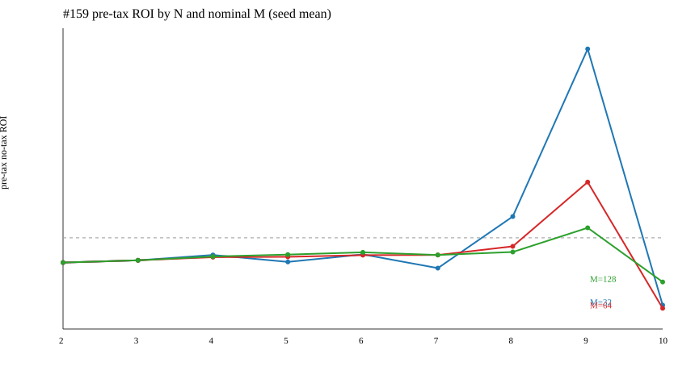

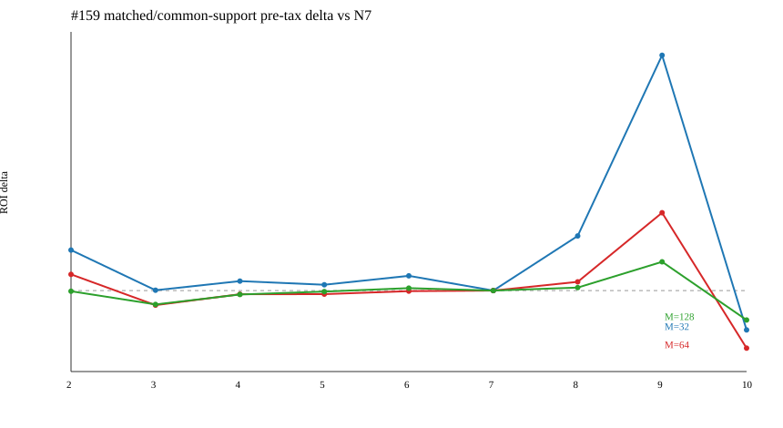

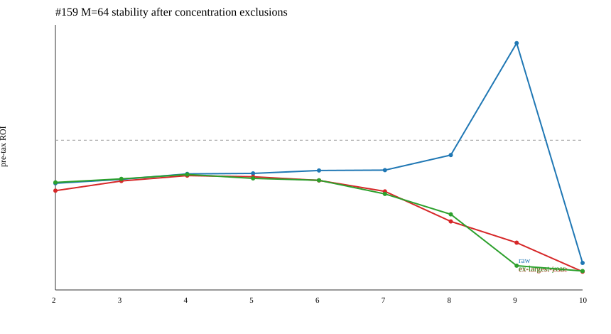

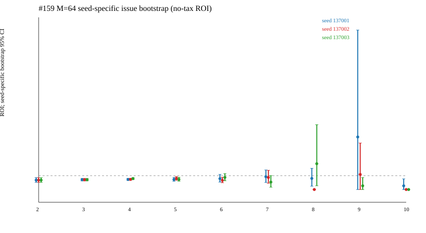

可读结论和 M64 摘要见
[#159 v2r1 reporting recovery](../research/bj159_selected_wor_cross_n_gate_b_v2r1_2026-08-03.md)。

M64 seed stability 的关键读回如下：N=9 三个 seed 的原始税前 ROI 范围为
`-73.0186%` 至 `+279.9801%`（SD `150.8451%`）；其 seed-specific bootstrap
point estimate 范围相同，seed-specific interval envelope 为 `[-1.000000, +10.528226]`，
positive fraction 范围为 `0.017` 至 `0.753`。这不是 seed-mean estimator 的组合 CI。
N=9 seed-mean 原始税前 ROI 为 `+71.97%`，去掉每个 seed 的最大
signed-issue 贡献后为 `-76.05%`，去掉最大 signed-year 贡献后为 `-93.12%`；其余 N
的原始曲线均为负。81 个 ALL 行中原始正值 8 行、最大 issue 排除后仅 1 行、最大 year
排除后 0 行。因此 N=9 是极端集中度信号，不是稳定的 N 甜点，也不构成 strict EV、
样本外验证、购买、生产或推广授权。

完整表面中的 across-cell 范围还显示：effective M 为 `9..128`，identity coverage
为 `0..1`，gross top-issue share 为 `0.0263..1.0000`，pre-tax max drawdown 为
`¥212.960421..¥243456.000000`。YEAR/FOLD/LOYO 不汇总资金：OOS-2019 没有 settled
support；OOS-2020 至 OOS-2025 的 pre-tax cell mean 为 `-0.410219..+0.181908`，
LOYO mean 为 `-0.259308..-0.077555`。matched/common-support N7 deltas、support
counts 与 cross-identity overlap 均见 `analysis_summary.json` 和 report 表格。

本次修正把最大贡献定义为**正 stake 行中 signed pre-tax net 的最大值**，排除时分别
扣除实际 stake、pre-tax net 和 tax-adjusted net；税仍按单张中奖 ¥2 ticket 独立判断，
绝不跨票、跨 issue 或跨 policy 汇总计税。执行 miss streak 明确跳过 no-bet 和 zero-stake
unavailable rows；drawdown 同时提供税前主值和税后次值。

## #167：N=7 Q-WOR 100-seed stability（2026-08-03）

#167 按 PI 纠偏后的新主线执行：固定 N=7，不再扫描 N=2..10，也不把 N9 当作主策略。
Gate-A 冻结 `#159` complete-issue selected baseline 的 `1,005` 个 N7 identities、`7,035`
role rows、M=`32/64/128` 和 `137001..137100` 的 100 个 deterministic seeds；每个
identity×seed 保留前 128 个 Q-informed WOR ticket ordinal。Gate-B 只打开一次已认证 canonical
outcome join，并把每张独立 ¥2 winning ticket 逐票结算/计税，不做 issue/policy pooling。

- Gate-A manifest：`3e9cd84d8714ee52c979da26b174bb32e0c1d1cdb5e72bca9e34cc80deeaa519`
- Gate-A content identity：`3fb79bf49f15484067b8934e96c1b7a4a831762929c5892b15679d38b87d443b`
- Gate-B manifest：`11e7019efa2eca044b012125bebcdcaaf4b25d843ac49d062ef62e9b409def34`
- Gate-B content identity：`61d9a60e3b7c9ef49e6dca786936d69d377fbcabc678a4e1e6041f96796eec6b`

100-seed 等权 pre-tax ROI（M32/M64/M128）分别为 `-22.2972%/-19.9009%/-19.5673%`；
positive-seed fraction 为 `21%/17%/11%`，因此没有稳健正均值。M64 的三 seed 历史均值与
100-seed 均值差为 `+2.3254pp`，不是新 edge。M64 固定 prefix `{3,10,25,50,100}` 的
mean ROI 为 `-22.2262%/-16.1814%/-12.7793%/-17.4695%/-19.9009%`，仅描述 seed
收敛，不选择最佳 prefix。M64 issue-cluster bootstrap（固定 seed 137064、2,000 次）
95% 区间为 `[-51.54%, +52.22%]`，跨零；M32/M128 也跨零或接近零。

Allocator seed SD 随 M 增大而下降（M32 `31.44%`、M64 `21.08%`、M128 `16.16%`），
但这是 Monte Carlo allocation uncertainty，不是 100 条独立足球历史。truth-rank 分布中
仅 `4.93%` 落在前 128，另有 `10.05%` 因 canonical outcome join 不完整而 unavailable；
这部分只计入计划账，不伪造结算结果。终局为描述性负/未验证，不触发 strict EV、购买、生产或推广。

完整 seed、prefix、issue-bootstrap、variance decomposition、truth-rank、overlap 和图表见
[`#167 Gate-B package`](../../results/bj167_gate_b_outcome_settlement_v1r1/README.md)。

### #167 Gate-B v1r2：风险与时间切片补全

PI 要求的 replacement package 保留 v1r1 不变，并把逐 seed 风险与时间稳定性控制补齐：

- Gate-B v1r2 manifest：`6946ea6c92a871fe97159980e5a8440e5927cf789b272c227b7d3c4175e96758`
- Gate-B v1r2 content identity：`6a86977a004b3a96c3b0eb9c488d4da2f272157af02051e01d4ff928f9dcee2f`
- `seed_summary.csv` 对每个 M/seed 固定报告 stake、unique/duplicate tickets、coverage、税前/税后 ROI、税前/税后最大回撤、最长 miss streak、最大 signed issue/year 及排除后的 ROI。
- `slice_summary.csv`、`year_fold_summary.csv` 和 `loyo_summary.csv` 用相同冻结 issue rows 给出 YEAR、FOLD 与 leave-one-year-out；没有针对切片重新选参。
- 新增 `concentration_hhi.svg` 与 `drawdown.svg`，并保留 issue-cluster 2,000 次 bootstrap、truth-rank、seed overlap、prefix convergence 和 seed/outcome variance decomposition。

v1r2 的 100-seed pre-tax ensemble 数值与 v1r1 一致：M32/M64/M128 均值分别为
`-22.2972%/-19.9009%/-19.5673%`，positive-seed fraction 为 `21%/17%/11%`；M64
seed SD 为 `21.08%`。平均最大税前回撤随 M 为 `¥25,719.79/¥39,626.49/¥68,084.81`
（M32/M64/M128），最长未命中 issue streak 的 seed 最大值为 `94/66/34`。按 seed
平均 gross-issue HHI 为 `0.1684/0.0903/0.0510`，排除最大 signed issue/year 后的
均值仍为负（分别约 `-44.03%/-34.54%/-29.51%` 与 `-43.62%/-34.80%/-29.38%`）。
这些只是风险与稳健性描述，不改变 `NO_PROMOTION`、严格 EV、样本外/前瞻验证和不生成购买包的边界。

完整 v1r2 见
[`#167 Gate-B v1r2 package`](../../results/bj167_gate_b_outcome_settlement_v1r2/README.md)。

### #167 controlling amendment：#137/#151 fixed candidate absolute Edge（2026-08-03）

PI 后续 live contract 已取代原 #159 transfer 口径。旧的 #159-based v1/v1r2 只保留作
transfer/generalization diagnostic；控制答案改为精确 `#137 NO_GATE/K4/Q_INFORMED_WOR_DISTINCT/M64/Q_WEIGHT`
候选与同一 issue/identity/outcome support 的 FULL 对照。新的 Gate-A 只从已接受的 #151
Gate-A 复制 1,356 identities、9,492 role rows 和 348 个 issue rows，再冻结
`137001..137100` 的 100 个 WOR seed allocation；没有打开赛果或 SP。

- Gate-A v2 manifest：`7d6698705a61c416387ae6aee713751b05f337147943e9d781a46252317076d`
- Gate-A v2 content identity：`0c4c3a6103d37e94707ac4837480af16d8e1bbc27472821edc106920fd66288f`
- Gate-B v2r3 manifest：`e604ac63a977a375acc4808eb822cd7272fe52dac9d16ff646894677d43a9668`
- Gate-B v2r3 content identity：`147e5d6f6debbcbb34be458d32a9fd848240ff01b8d67da0506fc707d0e68e4b`

三 seed reproduction 与 #151 完全一致：M64 candidate pre-tax ROI
`+16.3756%/+11.7736%/+2.6680%`，matched FULL 为 `-15.7697%`，paired lift
`+32.1452pp/+27.5432pp/+18.4377pp`。扩展到 100 seeds 后，candidate absolute
pre-tax ROI 均值为 M32/M64/M128 `-15.0232%/-13.2793%/-13.7673%`，对应
candidate-minus-FULL lift `+0.7464pp/+2.4904pp/+2.0024pp`；M64 positive-seed
fraction 为 `22%`、lift positive fraction `48%`。FULL 的同 cohort pre-tax ROI 为
`-15.7697%`，不能与 #127 或 #159 的不同 denominator 混用。

M64 allocator MC 95% 区间为 candidate `[-17.47%, -9.08%]`、lift
`[-1.70%, +6.69%]`；20,000 次 issue-block paired bootstrap 区间为 candidate
`[-24.48%, -0.88%]`、lift `[-2.31%, +7.77%]`。因此 terminal state 是
`NO_STABLE_LIFT`，而不是 `ABSOLUTE_EDGE_SUPPORTED` 或 `RELATIVE_LIFT_ONLY`。
平均最大候选税前回撤 M32/M64/M128 为 `¥24,134/¥38,677/¥61,108`，M64 seed
最长 miss streak 最大为 `70`；M64 平均 gross-issue HHI 为 `0.0709`，排除最大
signed issue/year 后 candidate ROI 仍约为 `-27.19%/-29.57%`，paired lift 约为
`-10.53pp/-13.05pp`。这说明前三 seed 的正值是集中且不稳定的历史线索。

每个 issue block 的 bootstrap 同时携带 100 个 candidate seed rows 与一个 matched FULL
row；`ensemble_year_fold_loyo.csv` 给出 equal-seed ensemble 的 YEAR/FOLD/LOYO，
`ticket_tax_reconciliation.csv` 验证逐张中奖 ¥2 ticket 的税，`seed_overlap_distribution.csv`
给出全部 seed 对的 M64 overlap（均值 `2.971%`），`truth_rank_distribution.csv` 把实际
truth coverage 与均匀 3^7 ticket-space fraction 并列。结论仍是纸面研究，不授予严格 EV、
购买、生产、下注或推广权限。

完整控制包见
[`#167 Gate-A v2`](../../results/bj167_gate_a_preoutcome_v2/README.md) 与
[`#167 Gate-B v2r3`](../../results/bj167_gate_b_outcome_settlement_v2r3/README.md)。

## #167 最终策略图谱：selection × allocation × M × 100 seeds（2026-08-04）

PR #168 已把 #167 从固定候选实验扩展为完整 N7 工艺图谱：492 个 selector、每个
963 个有效 allocator/M cell，共 473,796 个搜索 cell；所有 WR/WOR cell 使用冻结的
100 seeds。17,135 个正点估计或 Pareto 候选进入同一个 20,000 次 issue-block
paired bootstrap。税前 ROI 是主口径，税后仅作敏感性。

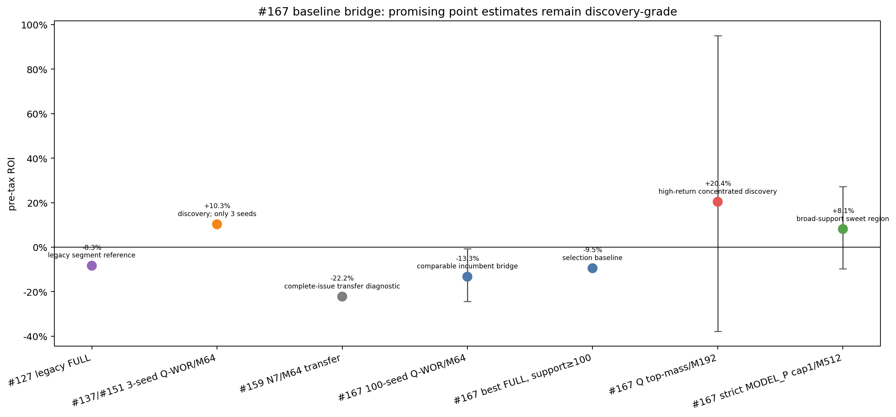

最终认知不是简单的 `NO_PROMOTION`，而是把下一轮的甜区缩小到可继承的几条路线：

1. **选场仍是限制层。** settled issue≥100 的最好 FULL selector 是
   `S2_ESP290_GM300_MARKET_WF_CAL_MIN_LOWP20_COLD_FIRST_K1`，税前 ROI
   **−9.47%**（163 期）。#127 的 −8.35% 属于 segment denominator，只保留作 legacy
   reference，不能与 complete-issue FULL 直接比较。
2. **WOR/WR 没有全局排名。** 在历史 `NO_GATE/K4 + Q_WEIGHT` 上，WOR/M64
   **−13.28%** 优于 WR/M64 **−19.48%**；在严格
   `ESP300_GM305/P_MIN/LOWP20/VALUE_FIRST/K1 + MODEL_P_CAL` 上，WR/M32
   **−11.26%**，而 WOR/M32 **−24.69%**、最佳 WOR/M208 也只有 **−17.20%**。
   机制优劣取决于 selector、概率权重和 M 的交互。
3. **发现两个局部正点估计峰。** `NO_GATE/K4 + Q_WEIGHT + TOP_MASS/M192`
   为 **+20.37%**，但 bootstrap 区间 `[−37.86%, +95.04%]`、去最大 year
   **−14.99%**、top issue share 19.97%，属于高收益/高集中 discovery。
   严格 S2 + `MODEL_P_CAL + cap1/M512` 为 **+8.14%**，matched FULL
   **−21.61%**、lift **+29.76pp**，bootstrap `[−9.78%, +27.23%]`、lift
   lower bound `+6.75pp`、去最大 issue `+4.40%`、去最大 year `−0.21%`、top
   issue share 3.95%，是更值得继承的 broad-support sweet region。
4. **不存在稳定 M 平台。** 两个峰分别集中在 M192 与 M512，邻近 M 点快速回落；M
   是组合构造参数，不是独立 alpha。cap1/M512、top-mass/M512、residual/M512 在严格
   selector 下实现同一组票；cap2/M1024 只是同组票重复两次，不算新发现。
5. **100 seeds 解决的是 allocator MC 噪声，不是足球历史不确定性。** 17,135 个
   postscreen 候选中 15,511 个绝对点估计为正，但没有任何一个 absolute issue-bootstrap
   lower bound 大于 0；800 个在排除最大 issue/year 后仍为正，仍需结合 support 与
   concentration 解读。#137/#151 三 seed +10.27% 的 Q-WOR/M64 在 100 seeds 下回到
   −13.28%，说明前三 seed 是 discovery cluster，不是稳定绝对 Edge。

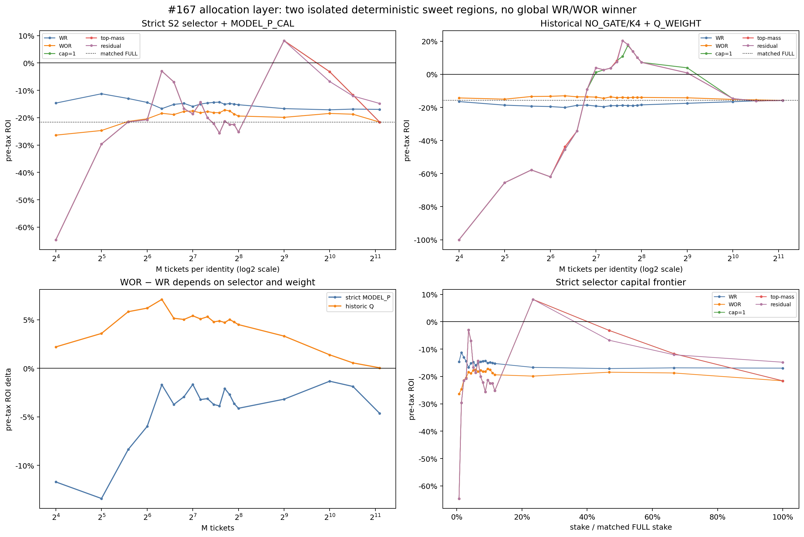

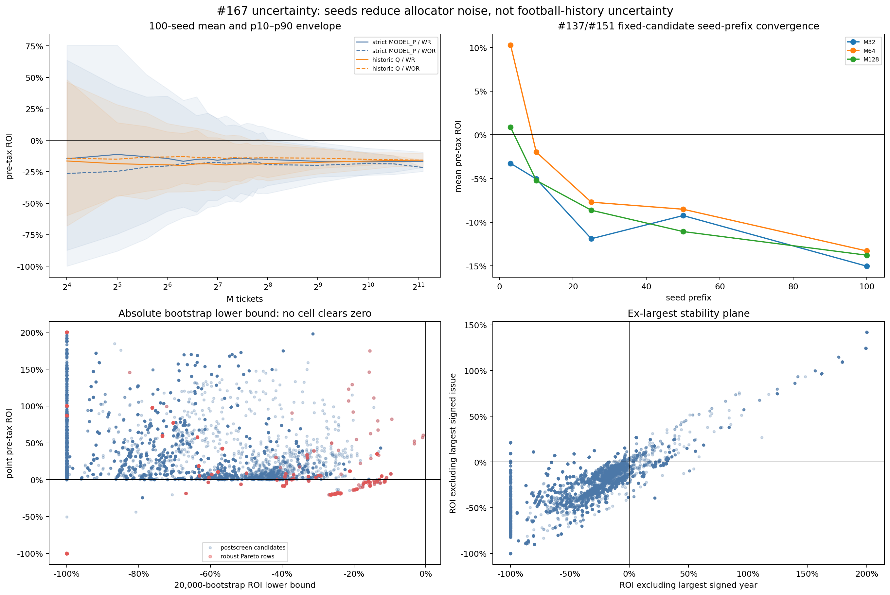

### 2026-08-04 baseline ladder 与继承规则

| 层级 | 当前参考 | 税前 ROI | 证据等级 | 决定 |
|---|---|---:|---|---|
| legacy selection | #127 `ESP300_GM305_LOWP20` FULL | −8.35% | segment legacy | 保留，不跨 denominator 替换 |
| complete-issue transfer | #159 N7/M64 selected WOR | −22.23% | transfer diagnostic | 保留作迁移失败参照 |
| complete-issue selection | #167 broad FULL | −9.47% | descriptive broad support | 作为 #134 的 selection baseline |
| historical stochastic | `NO_GATE/K4 + Q_WEIGHT + WOR/M64` | −13.28% | 100-seed comparable bridge | 保留作机制基线 |
| high-return sleeve | `NO_GATE/K4 + Q_WEIGHT + TOP_MASS/M192` | +20.37% | concentrated discovery | 只作压力/集中度袖套 |
| broad sweet sleeve | strict S2 + `MODEL_P_CAL + cap1/M512` | +8.14% | broad-support discovery | 作为 #134 主继承袖套 |

这张 ladder 不是把不同 denominator 的数值强行排序。下一轮必须先在 common support
复现相应 incumbent，再分别报告 matched FULL、challenger−FULL、challenger−comparable
incumbent。负结果只淘汰新增 lever，不能把研究基线重置到更差方案。

完整 PI 报告、六组图、关键候选 CSV 和图表来源绑定见
[`Issue-167-N7-Strategy-Atlas`](Issue-167-N7-Strategy-Atlas.md)、
[`bj167_key_candidates.csv`](assets/bj167_key_candidates.csv) 与
[`bj167_chart_manifest.csv`](assets/bj167_chart_manifest.csv)。后续 #134 应固定测试：
broad FULL、Q-WOR/M64、Q top-mass/M192 和 strict MODEL_P cap1/M512；新 lever 只能是
基本面或决策链 overlay，不得根据同批 outcomes 再调 selector/M/allocator。

## #170 固定选场器 × 分配 sleeve 叠加桥接（2026-08-04）

#170 把 #167 的最佳 broad-support FULL selector 与两个局部正点估计 sleeve 固定成
3×3 factorial，并在预先冻结的 177 期三方共同支持上一次性结算。141 期三方结果完整，
36 期九格共同 fail closed。结果是 `SELECTION_ONLY`：BEST_FULL/FULL 税前 ROI
`-9.09%`；Q top-mass/M192 与 MODEL cap1/M512 迁移到 BEST_FULL 后分别为
`-13.37%/-16.66%`，matched lift `-4.27pp/-7.57pp`。

MODEL sleeve 的 source-context lift 为 `+34.97pp`，但转移交互为 `-42.54pp`
（95% CI `[-74.13pp,-11.13pp]`），说明 #167 的 MODEL sleeve 价值不能与最佳 selector
直接相加。唯一绝对正格仍是原 MODEL_SOURCE/MODEL-cap1 控制格 `+14.09%`，它是同历史
post-selection 结果，按合同需 strict independent EV，不能自行推广。

### 2026-08-04 baseline ladder 增量

| 层级 | 共同支持税前 ROI | matched lift | #134 继承状态 |
|---|---:|---:|---|
| BEST_FULL/FULL | -9.09% | 0.00pp | controlling inheritance |
| BEST_FULL/Q top-mass M192 | -13.37% | -4.27pp | 不继承；diagnostic |
| BEST_FULL/MODEL cap1 M512 | -16.66% | -7.57pp | 不继承；diagnostic |
| MODEL_SOURCE/MODEL cap1 M512 | +14.09% | +34.97pp | source-context control；strict EV required |

详细方法、完整九格、bootstrap、交互与集中度见
[`Issue-170-N7-Selector-Allocator-Stack`](Issue-170-N7-Selector-Allocator-Stack.md)。

## #176 逐期权益曲线与风险调整指标（2026-08-04）

#176 用 #167/#170 已接受的三个 reference arms 重建了完整逐期 P&L。native support
保留 348 期日历，三方共同支持保留 177 期日历；no-bet/unavailable 都是显式零流量，
不记作亏损。统一研究 bankroll 为 ¥220,000，并发布 0.5×/1×/2×、calendar/active
returns、Sharpe、Sortino、Calmar、金额/百分比回撤、P&L Calmar、HHI、ex-largest、
YEAR/FOLD/LOYO。

风险路径没有改变 #170 的 `SELECTION_ONLY` 结论。BEST_FULL/FULL native 税前 ROI
`-9.47%`、Sharpe `-0.539`、最大回撤 `33.99%`，仍是 #134 selection control，
不是正收益方案。MODEL source-context cap1/M512 为 `+8.14%`、Sharpe `+0.356`、
最大回撤 `4.39%`，但去最大 payout year 后 `-0.21%`，且不能迁移命名为
BEST_FULL stack。Q top-mass/M192 native `+20.37%`，但 HHI `0.0833`、去最大 year
`-14.99%`，在共同支持上变为 `-37.66%`、最大回撤 `50.74%`，属于高集中压力
sleeve，而非稳定 edge。

税后 Q native ROI 仅 `+5.23%`，最大回撤 `31.15%`。计税继续按每张独立 ¥2 票，
不跨票或跨期汇总。完整定义、表格、三张图和不可变包见
[`Issue-176-N7-Equity-Risk`](Issue-176-N7-Equity-Risk.md)。

## #134 FULL N7 基本面与决策链 overlay（2026-08-04）

#134 在 #170 的 BEST_FULL/FULL controlling baseline 上冻结比较 L1/T1/M1/F1/D1 与
三个 leave-one-factor-out arms。结果为 `NO_OVERLAY_PROMOTION / RETAIN_B0`：B0 native
税前 ROI `-9.47%`；全部 8 个 overlay 的 ALL_189 paired lift 均为负。F−M 最接近，
也仍为 `-0.86pp`（20k bootstrap 95% CI `[-8.82pp,+7.80pp]`）；M1 为 `-7.58pp`，
区间上界仍略低于 0。

CHOICE_113 中 T1 的 changed identities 恰好 27 胜/27 负，但金额加权 lift 仍
`-6.78pp`，说明不能用简单胜负数替代利润幅度。INVARIANT_76 完全相同；冻结的
handicap-contradiction stage 在全部 424 candidates 上为零，没有 ranking power。
所有 arm 去最大 issue/year 后仍负，因此没有触发 strict independent EV，也没有重置
接受的负 B0 incumbent。详细表格、逐期 equity/drawdown、YEAR/FOLD/LOYO 与不可变绑定见
[`Issue-134-Fundamental-Overlay-N7`](Issue-134-Fundamental-Overlay-N7.md)。

## #179 分层联赛—状态概率模型（2026-08-04）

#179 先在 1,558 场冻结概率面上比较 B0/Q1、6 个 hierarchical configs 和 6 个
leave-one-family-out，再结算 matched FULL N7。`H_MINUS_RAW_HDA` 的 log loss
`1.064101`，比 B0 的 `1.066377` 好 `0.002276`，并在 6 个 OOS folds 中赢 4 个、
另 2 个由 B0 最优；这是小幅概率信号，不是收益晋级。

经济结论为 `NO_HIERARCHICAL_PROMOTION / RETAIN_B0`。B0 税前 ROI `-9.47%`；
hierarchical arms 中最好的 pricing-conservative 仍为 `-12.16%`，matched B0 lift
`-3.13pp`（20k 95% CI `[-8.28pp,+1.75pp]`）。概率最好的 H−raw-HDA 为
`-13.12%`，matched lift `-4.21pp`。所有 challenger 的 absolute ROI 与 matched
B0 lift 点估计均为负，去最大 issue/year 和 LOYO 也不支持晋级。

因此 #180 只继承 B0 作为 controlling economic baseline；H−raw-HDA 最多保留为概率
diagnostic。`LIQUIDITY_DRIFT` 仅是 prior-season EURO residual proxy，不代表完整
season-by-source interaction。详见
[`Issue-179-Hierarchical-League-N7`](Issue-179-Hierarchical-League-N7.md)。

## #180 联赛感知的球队与对阵模型（2026-08-04）

#180 在同一 1,558 场冻结概率面上比较 team-only、team+league 三配置与 7 个消融，
再以 matched FULL N7 结算冻结 identity。结论为
`NO_TEAM_MODEL_PROMOTION / RETAIN_B0`：team-only 的 log loss `1.080644`，明显弱于
B0 `1.066377` 和 #179 diagnostic `1.064101`；保守 team+league 改善到 `1.064937`，
但仍未超过 #179 diagnostic。

经济上没有绝对正 ROI。`TL_MINUS_OPPONENT` 是唯一 matched B0 lift 为正的点估计：
税前 ROI `-8.29%`、lift `+0.46pp`，但 20k bootstrap 95% CI
`[-6.70pp,+8.18pp]`，6 个 LOYO ROI 全负，去最大 issue/year 后为
`-12.00%/-9.91%`。它至多是 strict independent-EV 候选，不能晋级或回写调参。

计税继续按每张独立 ¥2 票，不跨票或跨期汇总。详细概率、经济、消融、风险、图与
不可变哈希见
[`Issue-180-Team-Matchup-N7`](Issue-180-Team-Matchup-N7.md)。

## #190 稀疏独立模型—盘口分歧 N7（2026-08-05）

#190 使用 Gate-A SHA 绑定的 SQLite `match_features` 建立新的 canonical ledger，
而不是沿用 #95 的 46,802 行旧分母。101,970 个 eligible matches 中有 100,906 个
trusted settlements；1,064 个 unavailable 保持 0 stake、绝不记作亏损。#95 重叠
46,802 行全部一致，fully settled N7 identities 为 2,946 / 3,181。

完整 2,424-policy × 四臂 attribution 显示：B0 的 expanded-support 税前 ROI 为
`-8.52%`；match-only 中位数 `-22.27%`，joint sparse 中位数 `-16.24%`，
direction-only 中位数 `-1.89%`。475 个描述性正 screen rows 中有 18 个通过内部严格
稳定性筛选的旧结论已被 #195 独立复验纠正：旧 coverage 错误继承 match-only 支持，
而这 18 个 direction-only cells 的自身身份都只覆盖盘口 `0`。因此严格候选数为 `0`，
最终为 `NO_PROMOTION_FROM_GATE_B`；475 行仍作为描述性 line-0 正信号保留。接受的 #95
共同支持 baseline `-9.47%` 未被替换或降级。

同时保留一层非晋级的 `performance-stable but coverage-limited` 证据：18 个 policy
aliases 折叠为 10 个不同 issue-economic identities；其中 Z100/K1 的 52/60/75/85 期
簇共有 12 aliases、6 个经济身份，税前 ROI 为 +8.78% 至 +20.48%，matched lift 为
+21.19pp 至 +28.62pp，但全部只有 1 个 line stratum，因此不改变严格候选数 0。

税仍按每张命中的 ¥2 票分别计算，不做跨票/跨期汇总。完整四臂结果、概率校准、
20k paired bootstrap、YEAR/FOLD/LOYO、风险集中度、图与不可变哈希见
[`Issue-190-Sparse-Divergence-N7`](Issue-190-Sparse-Divergence-N7.md)。面向路线决策的
证据漏斗、Z100/K1 正向簇、`NO_PROMOTION` 双层解释以及对 #193/#192 的继承建议，见
[`Issue-190-Sparse-Divergence-N7-Decision-Report`](Issue-190-Sparse-Divergence-N7-Decision-Report.md)。

## 相关笔记

- [[beidan_vs_euro_divergence|北单与欧赔偏差研究]]
- [[track_b_beat_the_close|Track B：超越市场基线]]
- [[single_match_probability_calibration|单场概率校准设计]]
- [[Issue-119-Candidate-Sensitivity|Issue #119 候选标准敏感性]]
- [[roadmap|研究路线图]]
- [Issue #82](https://github.com/algotradinglife/beijing-lot/issues/82)
- [Issue #83](https://github.com/algotradinglife/beijing-lot/issues/83)
- [Issue #77](https://github.com/algotradinglife/beijing-lot/issues/77)
- [Issue #101：按期冷门赛果剪枝](https://github.com/algotradinglife/beijing-lot/issues/101)
- [Issue #121：期望 SP × 最小赛果概率阈值](https://github.com/algotradinglife/beijing-lot/issues/121)
- [Issue #127：匹配全局单码删除](https://github.com/algotradinglife/beijing-lot/issues/127)
- [Issue #132：p-min vs q-min 全局删码](https://github.com/algotradinglife/beijing-lot/issues/132)
