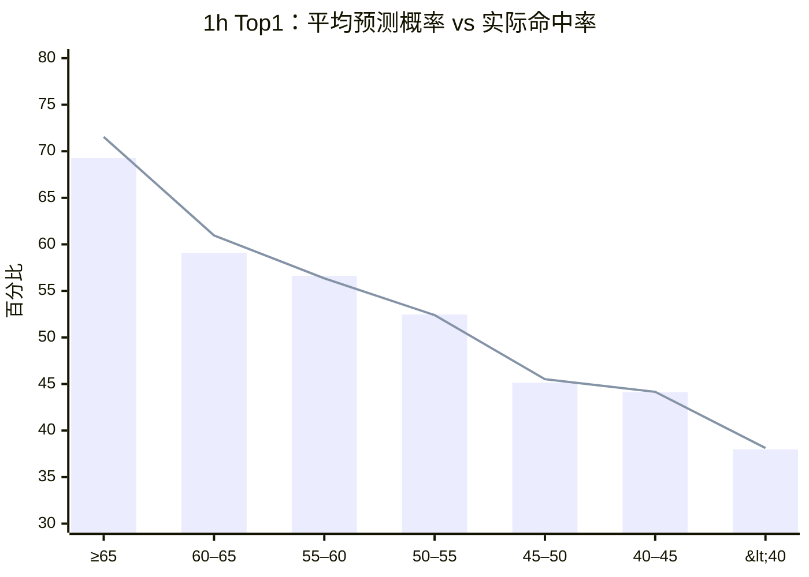
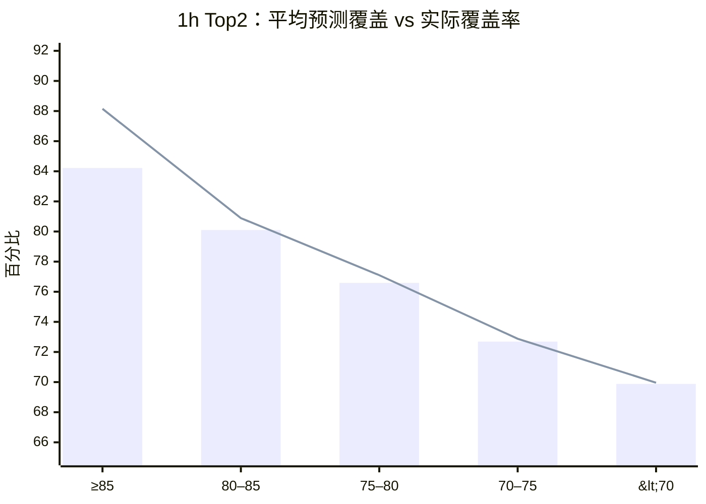

---
aliases:
  - Top1 Top2 校准曲线
  - EURO BJLINE Calibration
tags:
  - beijing-lot
  - calibration
  - top1
  - top2
status: historical-proxy
updated: 2026-07-29
---

# Top1 / Top2 校准曲线

> [!summary]
> 在 1h 历史代理样本的 153,627 场中，[[EURO-BJLINE-Baseline]] 的主体区间
> 校准良好：Top1 40%–60%、Top2 70%–85% 的预测与实际接近。
> 高概率尾部明显偏乐观，不能直接照单全收。

> [!note]
> 本页主体分桶曲线来自 #82 的离散 `EURO_BJLINE_BASELINE`。#83 的连续候选
> 使用略小的 152,825 场共同样本；其高置信尾部对比见
> [[#连续 EURO 候选的高置信尾部]]。

## 口径

- **Top1 概率**：`max(p3, p1, p0)`；命中表示概率最大的一个结果等于官方
  北单让球赛果。
- **Top2 概率**：三个结果中概率最高的两个之和；命中表示官方赛果落在这两个
  结果之中。
- **Gap**：`实际命中率 - 平均预测概率`。负值表示模型偏乐观。
- 概率来自 `EURO_BJLINE_BASELINE` 的 `p3/p1/p0`，不是原始 EURO 概率。

## Top1 校准曲线

图中柱为实际命中率，线为平均预测概率。

| Top1 概率段 | 场次 | 平均预测 | 实际命中 | Gap |
| --- | ---: | ---: | ---: | ---: |
| ≥65% | 729 | 71.54% | 69.27% | -2.26pp |
| 60%–65% | 533 | 60.96% | 59.10% | -1.86pp |
| 55%–60% | 6,916 | 56.35% | 56.62% | +0.27pp |
| 50%–55% | 11,484 | 52.40% | 52.46% | +0.06pp |
| 45%–50% | 18,867 | 45.52% | 45.15% | -0.37pp |
| 40%–45% | 69,092 | 44.16% | 44.12% | -0.05pp |
| <40% | 46,006 | 38.12% | 37.98% | -0.14pp |

**解读：** 40%–60% 的大样本主体区间非常贴合；≥60% 后开始偏乐观，
但 ≥60% 合计只有 1,262 场，尾部结论需要继续前瞻验证。

## Top2 校准曲线

| Top2 概率段 | 场次 | 平均预测 | 实际覆盖 | Gap |
| --- | ---: | ---: | ---: | ---: |
| ≥85% | 868 | 88.15% | 84.22% | -3.93pp |
| 80%–85% | 6,728 | 80.89% | 80.10% | -0.79pp |
| 75%–80% | 26,627 | 77.10% | 76.59% | -0.51pp |
| 70%–75% | 109,470 | 72.88% | 72.69% | -0.19pp |
| <70% | 9,934 | 69.96% | 69.88% | -0.08pp |

**解读：** Top2 的 70%–85% 主体区间校准稳定。≥85% 只占样本的
`868 / 153,627 = 0.56%`，而且实际只有 84.22%，不能把“88%”当作真实覆盖。

## 按 Top1 结果类别分层

下表写作 `场次 / 实际命中率`。

| Top1 概率段 | 胜（3） | 平（1） | 负（0） |
| --- | ---: | ---: | ---: |
| ≥65% | 568 / 69.54% | — | 161 / 68.32% |
| 60%–65% | 304 / 57.57% | 6 / 33.33% | 223 / 61.88% |
| 55%–60% | 4,264 / 55.96% | 6 / 50.00% | 2,646 / 57.71% |
| 50%–55% | 5,220 / 52.68% | 12 / 83.33% | 6,252 / 52.22% |
| 45%–50% | 5,538 / 43.61% | — | 13,329 / 45.79% |
| 40%–45% | 37,218 / 44.83% | — | 31,874 / 43.28% |
| <40% | 30,516 / 38.23% | 37 / 32.43% | 15,453 / 37.49% |

关键观察：

- “平”成为 Top1 的场次总共只有 61 场，任何分段命中率都不稳定；
- 高置信“负”的平均预测约 75.10%，实际命中 68.32%，比高置信“胜”
  更需要收缩；
- 胜负分层可以作为校准层，但不能因为某一小格命中率高就生成规则。

## 按 Top2 组合分层

| Top2 概率段 | 胜平 | 胜负 | 平负 |
| --- | ---: | ---: | ---: |
| ≥85% | 371 / 85.71% | 155 / 81.94% | 342 / 83.63% |
| 80%–85% | 5,642 / 80.50% | 74 / 79.73% | 1,012 / 77.87% |
| 75%–80% | 3,717 / 76.43% | 15,611 / 76.11% | 7,299 / 77.68% |
| 70%–75% | 34,477 / 73.64% | 63,784 / 72.17% | 11,209 / 72.73% |
| <70% | — | 9,934 / 69.88% | — |

在 ≥85% 尾部，胜平覆盖最好，胜负最差；但每组样本仍然较薄。
更合理的下一步是为组合类别分别做收缩校准，而不是硬设一个通用阈值。

## 不同快照的稳定性

### Top1 实际命中率

| 概率段 | 1h | 10h | initial |
| --- | ---: | ---: | ---: |
| ≥65% | 69.27% | 68.70% | 67.03% |
| 60%–65% | 59.10% | 62.63% | 50.45% |
| 55%–60% | 56.62% | 56.28% | 55.43% |
| 50%–55% | 52.46% | 52.98% | 52.07% |
| 45%–50% | 45.15% | 45.18% | 46.27% |
| 40%–45% | 44.12% | 44.41% | 43.75% |
| <40% | 37.98% | 38.31% | 38.20% |

### Top2 实际覆盖率

| 概率段 | 1h | 10h | initial |
| --- | ---: | ---: | ---: |
| ≥85% | 84.22% | 84.02% | 83.46% |
| 80%–85% | 80.10% | 80.28% | 80.34% |
| 75%–80% | 76.59% | 76.79% | 76.84% |
| 70%–75% | 72.69% | 72.65% | 72.79% |
| <70% | 69.88% | 69.18% | 70.01% |

Top2 主体曲线跨快照非常稳定；高尾仍稳定地偏乐观。Top1 的 60%–65%
initial 格只有 111 场，50.45% 不应单独解读。

## 连续 EURO 候选的高置信尾部

[[Issue-83-Continuous-Market-Model|#83]] 在同一共同样本上比较了离散基线与
`CONTINUOUS_EURO_BJLINE`。下表仍使用
`Gap = 实际 Top2 覆盖率 - 平均预测 Top2 概率`：

| 快照 | 阈值 | 离散基线 Gap | 连续 EURO Gap | 绝对误差是否缩小 |
| --- | --- | ---: | ---: | --- |
| initial | Top2 ≥80% | -3.85pp | **-2.15pp** | 是 |
| initial | Top2 ≥85% | -5.96pp | **-3.26pp** | 是 |
| 10h | Top2 ≥80% | -1.00pp | **+0.10pp** | 是 |
| 10h | Top2 ≥85% | -4.07pp | **-3.91pp** | 是 |
| 1h | Top2 ≥80% | -1.07pp | **-0.35pp** | 是 |
| 1h | Top2 ≥85% | -4.56pp | **-3.42pp** | 是 |

连续模型在六个快照 × 阈值组合中都缩小了绝对校准误差。10h 的
Top2 ≥80% 从偏乐观变成轻微偏保守，但 `+0.10pp` 接近零。

这为 N7 双选排序提供了更好的概率输入，但不是直接的阈值授权：

- 不同模型越过 80%/85% 的比赛集合不同；
- 高尾样本仍比主体区间薄；
- `+2` 北单让球线在 #83 中仍然反向；
- 组合命中还取决于同一期相关性和选场过程。

## 对 N7 压缩的含义

若把 Top2 ≥85% 的实际单腿覆盖 `0.8422` 当作粗略输入，四场双选在完全独立时：

\[
0.8422^4 \approx 0.503
\]

这与此前“三场全包 + 四场双选”约需 50% 联合命中的盈亏平衡直觉相近。
但这只是上限式诊断，因为：

- 同一期比赛并不独立；
- 选场过程会改变概率分布；
- 北单最终 SP 与赛前估值会漂移；
- 票的回报由实际命中组合的结算 SP 决定。

因此，Top2 曲线适合做**候选腿校准与排序**，不应直接当作 N7 收益证明。

## 可执行结论

1. Top1 40%–60% 与 Top2 70%–85% 可继续作为稳定研究区间；
2. 对 Top1 ≥60%、Top2 ≥85% 做概率收缩，而不是奖励其表面高置信度；
3. Top2 应按胜平、胜负、平负分别校准；
4. 组合回测必须使用同一期联合命中和北单结算 SP，不得只连乘边际概率；
5. 下一轮严格赛前样本要复核上述曲线，而不是重新发明概率阈值。

相关：[[EURO-BJLINE-Baseline]] · [[Issue-82-Market-Fusion]] ·
[[Issue-83-Continuous-Market-Model]] · [[Research-Wiki]]
