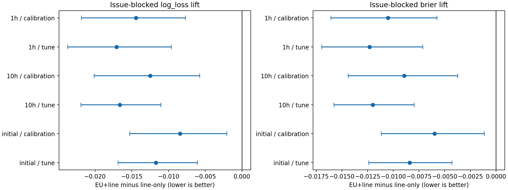
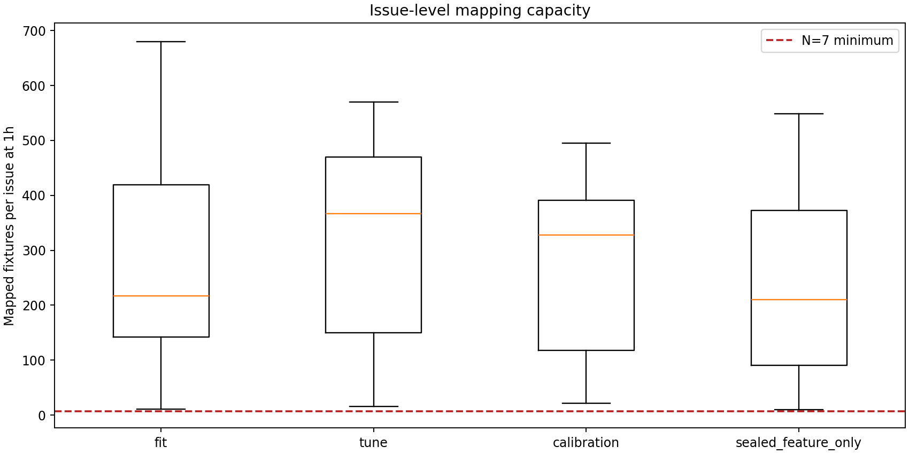

# Issue #238 — historical divergence materializer decision report

## Executive decision

**Disposition: `READY_FOR_209_PI_MODELABILITY_REVIEW`.**

The experiment answers one narrower question positively: average-European 1X2
probabilities contain event-specific information that improves the translation
from a Beijing handicap line into native handicap W/D/L probabilities. All
three relative horizons passed the frozen 2022 tune and untouched 2023
confirmation rule.

This is not a profitability result. The line-only control is a coarse prior for
the handicap category, not a de-vigged Beijing three-way SP distribution. The
historical package still has zero actual pre-event `Q_BJ_SP_DEVIG` cells.

## Frozen design

- Experimental/resampling unit: Beijing issue, not fixture or outcome cell.
- Fit: whole issues ending no later than 2021-12-31.
- Tune: 2022 issues.
- Confirmation: untouched 2023 issues.
- Sealed feature-only partition: 2024 and later; zero result labels were queried.
- Control A: European identity probability when the Beijing line is zero.
- Control B: chronological line-only multinomial prior.
- Experimental C: fixed scikit-learn logistic model using the European triplet,
  native integer line, and simple line × probability interactions.
- Acceptance per horizon: lower issue-blocked log loss and Brier than control B
  in both 2022 and 2023.

Only integer lines from -3 through +3 are supported. Missing lines, half-lines,
and the sparse ±4/±5 rows are explicitly masked rather than extrapolated.

## Data surface

| Partition | Issues | Frozen inventory fixtures | Role |
|---|---:|---:|---|
| Fit | 505 | 135,812 | model fitting |
| Tune | 62 | 19,199 | frozen selection rule |
| Calibration | 53 | 14,721 | untouched confirmation |
| 2024+ | 188 | 43,531 | feature-only sealed holdout |
| **Total** | **808** | **213,263** | |

The #268 source contributes 638,792 valid fixture × horizon European triplets,
or 1,916,376 M×3 cells. The mapper supports 636,632 fixture × horizon rows
(99.662%); remaining rows retain raw European probability and an explicit
mapping-unavailable status. There are 167,134 distinct pre-2024 development
labels. Label and inference outputs are physically separate.

All 808 issues have at least seven mapped fixtures at each horizon. The minimum
issue-level capacity is 11 in fit, 16 in tune, 22 in 2023 calibration and 10 in
the sealed feature-only partition. This establishes N7 capacity but does not
fix N or require tickets from one issue to share the same fixtures.

## Matched probability results

The following values cover non-zero supported lines. Lower is better.

| Horizon | Partition | Control log loss | EU+line log loss | Delta | Control Brier | EU+line Brier | Delta |
|---|---|---:|---:|---:|---:|---:|---:|
| initial | 2022 tune | 1.08178 | 1.06963 | -0.01215 | 0.65563 | 0.64676 | -0.00887 |
| initial | 2023 confirm | 1.08294 | 1.07452 | -0.00841 | 0.65660 | 0.65049 | -0.00611 |
| 10h | 2022 tune | 1.08182 | 1.06427 | -0.01756 | 0.65565 | 0.64284 | -0.01281 |
| 10h | 2023 confirm | 1.08288 | 1.06980 | -0.01308 | 0.65656 | 0.64700 | -0.00956 |
| 1h | 2022 tune | 1.08180 | 1.06401 | -0.01778 | 0.65565 | 0.64272 | -0.01293 |
| 1h | 2023 confirm | 1.08298 | 1.06910 | -0.01388 | 0.65663 | 0.64638 | -0.01025 |

ECE also improves in every matched comparison. The stronger 10h/1h result is
consistent with later market information carrying more event-specific signal,
but this report does not claim that one horizon is a profitable betting epoch.

Issue-blocked bootstrap is stronger than a raw-row significance claim:

| Horizon | Partition | Log-loss delta 95% CI | Brier delta 95% CI |
|---|---|---|---|
| initial | 2022 | [-0.01695, -0.00606] | [-0.01239, -0.00432] |
| initial | 2023 | [-0.01520, -0.00198] | [-0.01114, -0.00108] |
| 10h | 2022 | [-0.02184, -0.01110] | [-0.01576, -0.00808] |
| 10h | 2023 | [-0.02003, -0.00581] | [-0.01437, -0.00376] |
| 1h | 2022 | [-0.02371, -0.00969] | [-0.01698, -0.00712] |
| 1h | 2023 | [-0.02179, -0.00782] | [-0.01612, -0.00584] |



## Candidate disagreement feature

The accepted feature is

```text
Q_EU_BJLINE(event, line) - Q_LINE_ONLY_CONTROL(line)
```

It measures how the event-specific European market moves the native handicap
outcome distribution away from the unconditional prior for that line. In 2023
the mean absolute per-cell difference is about 4.19 percentage points at
initial, 4.60 at 10h and 4.87 at 1h; the respective 90th percentiles are about
9.82, 10.77 and 11.34 points.

That separation is large enough to be a useful #209 feature. It is not yet
mispricing: the European market may simply refine match strength that the coarse
integer line omits. #209 must learn whether direction and magnitude predict
settled value after the model contract is frozen.



## Adversarial interpretation

If challenged, the most important counterargument is: “Of course the European
triplet beats a seven-category line prior; this proves representation quality,
not an exploitable market disagreement.” That challenge is correct. The result
earns entry into #209 because it creates a stable, outcome-unexposed feature;
it does not promote a betting strategy.

Other retained limits:

1. `initial/10h/1h` are retrospective relative-horizon proxies, not strict
   common issue decision epochs.
2. Actual historical Beijing pre-event three-way SP is absent. `Q_BJ_SP_DEVIG`
   remains null rather than inferred.
3. The fixed logistic mapper is deliberately simple. A neural learner belongs
   to the downstream value-learning problem, after the feature and holdout
   interfaces are fixed.
4. 2024+ is still untouched outcome evidence. Opening it before #209 freezes
   its objective, loss, baseline and safety fallback would spend the holdout.

## Handoff to #209

#209 may consume these columns separately:

- `Q_EU_RAW_1X2`: raw de-vigged average-European probability;
- `Q_LINE_ONLY_CONTROL`: coarse native-line prior;
- `Q_EU_BJLINE`: accepted event-specific native handicap probability;
- `EU_VS_LINE_DIVERGENCE`: per-cell signed difference;
- availability, line, horizon, provenance and causal-grade masks.

It must not rename the line-only prior as capital probability or claim that
`Q_BJ_SP_DEVIG` exists. The first #209 model comparison should remain matched
to the frozen market baseline and should keep 2024+ sealed until its method is
fully specified.

The executable analysis is
[bj238_divergence_materializer.ipynb](../../notebooks/research/issue-238/bj238_divergence_materializer.ipynb).
Compact metric, bootstrap, capacity, divergence and model-receipt files are in
[`docs/research/evidence/bj238/`](evidence/bj238/).
The 64 MiB inference Parquet and pre-2024 label table remain outside Git under
`data/derived/bj238_divergence_materializer_v4r3/`; Git stores the executable
code, notebook, compact receipts, tables, figures and this report.
