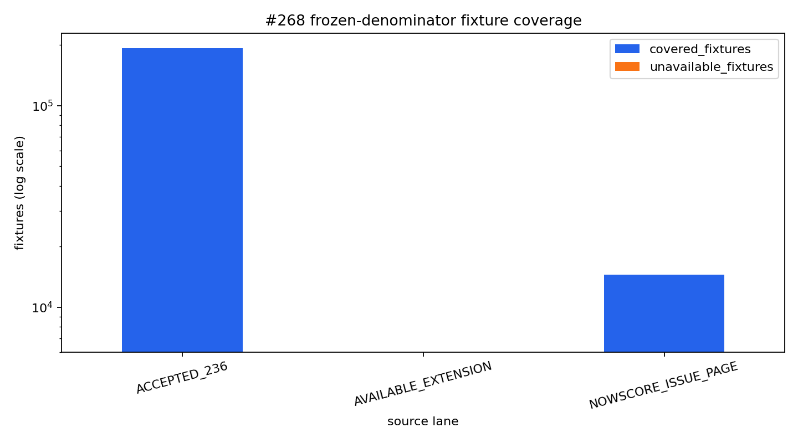

# Issue #268 — Historical proxy backfill decision report

## Executive result

The frozen denominator is complete: **808 issues / 213,263 fixtures** are represented in the candidate database. Valid European-odds-derived probability triplets are available for **212,994 fixtures (99.874%)**; the remaining **269 fixtures** stay in the denominator as explicit unavailable rows rather than disappearing.

The delivery is intentionally SQLite-first:

1. content-addressed Nowscore/Titan payloads remain the external origin evidence;
2. a versioned SQLite database is the durable normalized ingestion and QA store;
3. the #236-compatible Parquet package is a rebuildable analysis view derived from that database.

No result, settlement, winning SP, payout or Beijing 0.65 factor is read or inferred. All snapshots retain the `RETROSPECTIVE_RELATIVE_PROXY` causal grade.

## Source-lane coverage

| Frozen source lane | Inventory fixtures | Valid probability fixtures | Explicit unavailable | Coverage |
|---|---:|---:|---:|---:|
| `ACCEPTED_236` | 192,709 | 192,443 | 266 | 99.862% |
| `AVAILABLE_EXTENSION` | 6,001 | 6,000 | 1 | 99.983% |
| `NOWSCORE_ISSUE_PAGE` | 14,553 | 14,551 | 2 | 99.986% |
| **Total** | **213,263** | **212,994** | **269** | **99.874%** |

The three newly evaluated unavailable fixtures are:

| Issue | Slot | Provider match | Lane | Reason |
|---|---:|---:|---|---|
| 25053 | 442 | 2776635 | recovered | all 45 recorded cells are null |
| 25091 | 217 | 2776165 | recovered | all 45 recorded cells are null |
| 26051 | 331 | 2924541 | 2026 extension | all 45 recorded cells are null |

These are source-data absences, not crawl failures. Gate 3 received successful terminal receipts for all 73 issue pages and all 14,553 Titan pages.

## Database and view facts

The complete SQLite candidate contains:

- 213,263 inventory rows across 808 issues;
- 9,596,835 raw quote observations;
- 9,596,835 deterministic resolved quotes;
- 9,596,835 rows in the #236-compatible `market_snapshots` interface;
- 14,626 terminal acquisition receipts and 43,659 fixture-horizon dispositions for the recovered lane.

The Parquet analysis view contains:

- 1,916,376 probability rows;
- 638,792 complete fixture-horizon probability triplets;
- 639,789 source-trace rows;
- 638,792 translation-readiness rows;
- 1,660,287 explicit invalid/unavailable quote ledger rows.

The last number is large because invalid bookmaker triplets are deliberately ledgered at raw-book granularity; it is not a count of missing fixtures.

## Preservation and adversarial checks

- SQLite `PRAGMA integrity_check`: `ok`.
- Every probability triplet has exactly three outcomes and sums to one within `1e-10`.
- All Parquet part hashes match the package manifest.
- The 1,731,423 accepted #236 probability rows are **exactly equal cell-for-cell** to the frozen #236 package. The backfill therefore extends rather than silently rewrites the accepted baseline.
- Candidate schemas contain no outcome/result/settlement/winning-SP/payout fields.
- Full build peak RSS was approximately 412 MiB; the earlier all-row `pd.concat` path was removed from the publication workflow.

## Input lineage correction

The first Gate-start receipt recorded hashes for mutable live SQLite files. That was an over-broad lineage definition: zero-network Gate 3 replay never consumes those files. The accepted replay binds only the frozen inventory, immutable per-issue DONE parts, content-addressed payload receipts and the frozen #236/2026 source databases at their exact point of use. Mutable live databases are classified `NOT_CONSUMED_BY_GATE3_REPLAY` and cannot invalidate a replay they did not feed.

## Decision and downstream use

This is `COMPLETE_808_ISSUES`, not `INCOMPLETE_SOURCE_GAP`. The result makes the full historical proxy surface available to #238 and later modeling, but it does **not** upgrade retrospective `initial/10h/1h` labels into strict decision-time evidence. The live multi-snapshot collector remains the path for accumulating true causal history.

The executable analysis is [Issue-268-Historical-Proxy-Backfill.ipynb](../../notebooks/Issue-268-Historical-Proxy-Backfill.ipynb). Bulk SQLite, raw payloads and Parquet remain outside Git under `data/derived/bj268/eu_proxy_backfill_v2/`; Git stores code, the executed notebook, compact report and figure.
