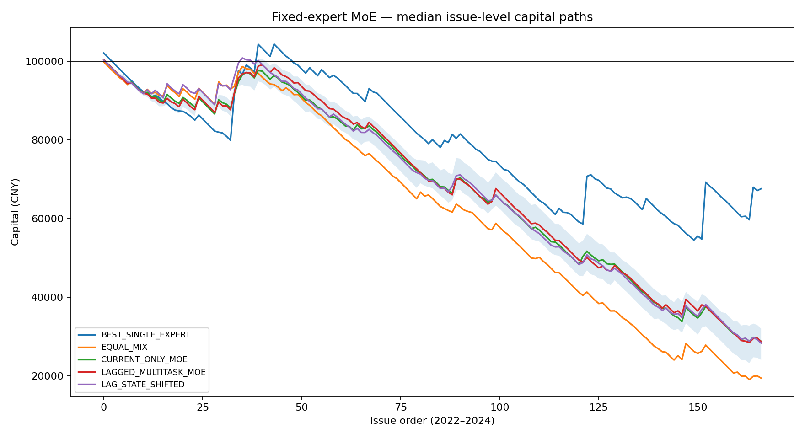
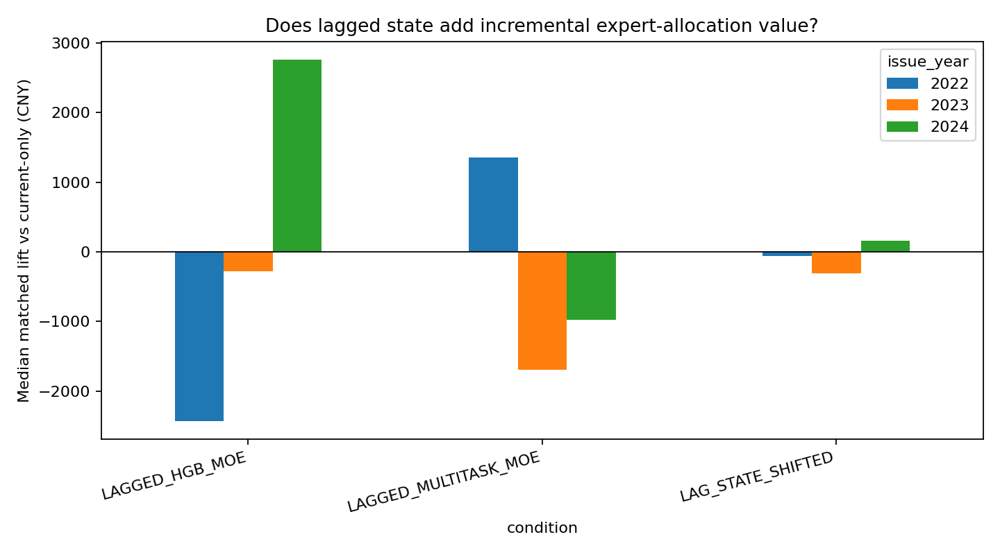
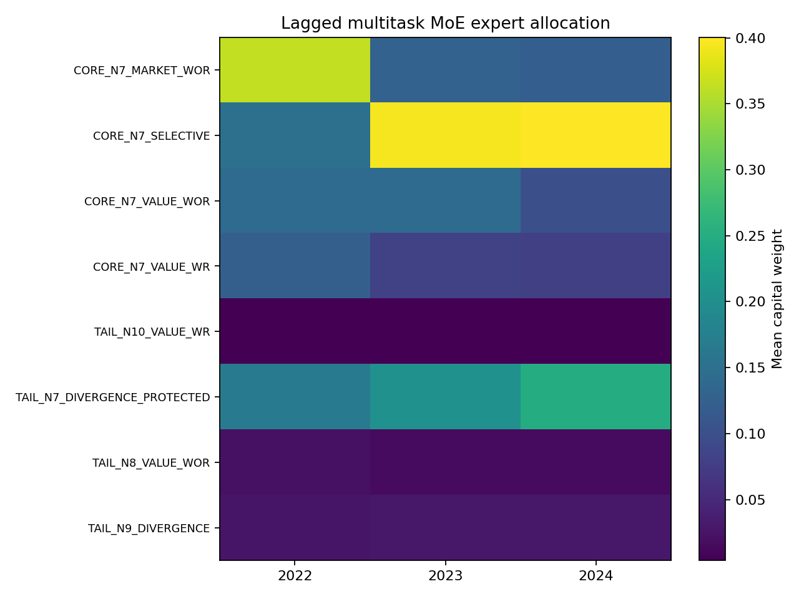

# Issue #332 — Fixed-expert causal multitask MoE

## Five-minute result

- Disposition: **NO_EXPERT_MIX_SIGNAL**.
- The experiment uses eight frozen #314 experts and always allocates exactly 512 paid tickets per issue. There is no cash/no-bet escape hatch.
- The model first predicts dense hit/near-miss/positive-seed outcomes, then fits a Ridge utility head only on chronological OOF dense predictions. Realized expert PnL is not the sole representation target.
- 2023 and 2024 are reported independently; 2025+ is untouched.
- Promotion: **False**; #210 unlock: **False**.

## What was tested

The expert set spans N7–N10, MARKET/VALUE/DIVERGENCE direction, WR/WOR generation and selective protection. Current issue features are compared with the strictly prior #330 global state plus expert-specific prior hit/near-miss history. `LAG_STATE_SHIFTED` delays lag inputs by seven additional anchors, and `EXPERT_IDENTITY_SHUFFLED` breaks the training identity-to-mechanism map.

The primary soft allocation is fixed before settlement: experts are ranked by predicted utility and receive 205/128/77/51/26/15/8/2 tickets. Every arm therefore stakes CNY 1,024 per issue. The 0.65 factor is applied once to a complete winning ticket.

## Capital and risk summary

    ```text
 issue_year            condition  terminal_capital_cny  capital_return  turnover_roi  max_drawdown_pct  longest_losing_issues  ex_largest_pnl_cny
       2022   BEST_SINGLE_EXPERT            98368.8734         -0.0163       -0.0301            0.2152                12.0000         -14696.8518
       2022 LAGGED_MULTITASK_MOE            92394.0286         -0.0761       -0.1401            0.1319                 9.0000         -12286.1772
       2022     CURRENT_ONLY_MOE            90138.8078         -0.0986       -0.1817            0.1449                 9.0000         -13914.3550
       2022    STATIC_SHRUNK_MIX            90138.8078         -0.0986       -0.1817            0.1449                 9.0000         -13914.3550
       2022    LAG_STATE_SHIFTED            89775.4869         -0.1022       -0.1884            0.1168                10.0000         -14533.7528
       2022            EQUAL_MIX            88778.6175         -0.1122       -0.2068            0.1301                 9.0000         -18077.4577
       2022       LAGGED_HGB_MOE            86786.6681         -0.1321       -0.2435            0.1321                13.0000         -17279.6197
       2023       LAGGED_HGB_MOE            76588.7203         -0.2341       -0.4763            0.2463                13.0000         -26989.7052
       2023    STATIC_SHRUNK_MIX            75718.0943         -0.2428       -0.4940            0.2490                15.0000         -27029.7746
       2023     CURRENT_ONLY_MOE            75488.6966         -0.2451       -0.4987            0.2488                15.0000         -27486.6125
       2023    LAG_STATE_SHIFTED            75181.0384         -0.2482       -0.5049            0.2506                15.0000         -27494.7069
       2023   BEST_SINGLE_EXPERT            74996.2875         -0.2500       -0.5087            0.2523                15.0000         -27918.6346
       2023 LAGGED_MULTITASK_MOE            74952.9335         -0.2505       -0.5096            0.2612                15.0000         -28074.7303
       2023            EQUAL_MIX            69855.0048         -0.3014       -0.6133            0.3063                14.0000         -32150.2412
       2024   BEST_SINGLE_EXPERT            94712.0448         -0.0529       -0.0782            0.1832                14.0000         -20507.4877
       2024    STATIC_SHRUNK_MIX            71081.6099         -0.2892       -0.4279            0.3122                15.0000         -34002.6024
       2024       LAGGED_HGB_MOE            65025.4090         -0.3497       -0.5175            0.3801                15.0000         -38799.1369
       2024    LAG_STATE_SHIFTED            63087.9594         -0.3691       -0.5462            0.3730                15.0000         -39394.0953
       2024     CURRENT_ONLY_MOE            62737.7459         -0.3726       -0.5513            0.3754                14.0000         -40113.6908
       2024            EQUAL_MIX            61646.9767         -0.3835       -0.5675            0.3925                15.0000         -43782.5643
       2024 LAGGED_MULTITASK_MOE            61484.5004         -0.3852       -0.5699            0.3858                15.0000         -41009.9547
```

## Primary matched lifts

    ```text
 issue_year            condition           baseline  nuisance_seeds  median_lift_cny  minimum_lift_cny  maximum_lift_cny  paired_seed_win_rate
       2022 LAGGED_MULTITASK_MOE BEST_SINGLE_EXPERT              11       -5866.4637        -9141.0584        -1941.5705                0.0000
       2022 LAGGED_MULTITASK_MOE   CURRENT_ONLY_MOE              11        1350.6046        -1315.9477         3337.9495                0.8182
       2022 LAGGED_MULTITASK_MOE          EQUAL_MIX              11        3191.4612       -16728.1347         9331.7437                0.7273
       2023 LAGGED_MULTITASK_MOE BEST_SINGLE_EXPERT              11       -1642.3240        -5699.0611         4516.1703                0.3636
       2023 LAGGED_MULTITASK_MOE   CURRENT_ONLY_MOE              11       -1693.2162        -2669.8533          257.1283                0.0909
       2023 LAGGED_MULTITASK_MOE          EQUAL_MIX              11        4536.6099        -5794.1256         8411.9069                0.9091
       2024 LAGGED_MULTITASK_MOE BEST_SINGLE_EXPERT              11      -33733.6901       -37696.8534       -21441.3373                0.0000
       2024 LAGGED_MULTITASK_MOE   CURRENT_ONLY_MOE              11        -974.5727        -2489.3253          -36.0058                0.0000
       2024 LAGGED_MULTITASK_MOE          EQUAL_MIX              11        -515.2383        -4220.7816         4070.6407                0.4545
```

## Bootstrap against current-only

```text
 issue_year            condition         baseline  issues  matched_lift_cny  bootstrap_p025_cny  bootstrap_p50_cny  bootstrap_p975_cny  bootstrap_positive_probability
       2022       LAGGED_HGB_MOE CURRENT_ONLY_MOE      53        -2950.0060          -9256.3139         -2854.7673           3267.2545                          0.1845
       2022 LAGGED_MULTITASK_MOE CURRENT_ONLY_MOE      53         1112.9488          -3588.0436           902.2061           6372.9296                          0.6525
       2022    LAG_STATE_SHIFTED CURRENT_ONLY_MOE      53          -13.6467          -5734.5487           -40.9277           5389.3447                          0.4950
       2023       LAGGED_HGB_MOE CURRENT_ONLY_MOE      48          -93.0943          -1362.2092           -52.3186           1065.4875                          0.4665
       2023 LAGGED_MULTITASK_MOE CURRENT_ONLY_MOE      48        -1490.2789          -3364.3342         -1426.9061            155.7333                          0.0405
       2023    LAG_STATE_SHIFTED CURRENT_ONLY_MOE      48         -439.5231          -1712.2046          -445.4934            864.8979                          0.2405
       2024       LAGGED_HGB_MOE CURRENT_ONLY_MOE      66         2223.2005          -1738.7241          1966.9254           7488.4682                          0.8295
       2024 LAGGED_MULTITASK_MOE CURRENT_ONLY_MOE      66        -1062.0361          -4695.0305          -805.6465           1502.9304                          0.3000
       2024    LAG_STATE_SHIFTED CURRENT_ONLY_MOE      66          -96.5847          -1002.2288           -55.8654            625.4476                          0.4440
```

## Accepted #319 Top-2 N7 baseline (exact common support, 512-ticket matched exposure)

```text
 issue_year            condition                  baseline  matched_issues  policy_pnl_cny  baseline_pnl_cny  matched_lift_cny  ex_largest_lift_cny  positive_issue_fraction
       2023   BEST_SINGLE_EXPERT TOP2_N7_P_TOP2_NO_GATE_X4              43     -26402.3690       -24392.4762        -2009.8928           -6287.2160                   0.5116
       2023     CURRENT_ONLY_MOE TOP2_N7_P_TOP2_NO_GATE_X4              43     -22169.5824       -24392.4762         2222.8938           -2148.2296                   0.7674
       2023       LAGGED_HGB_MOE TOP2_N7_P_TOP2_NO_GATE_X4              43     -21657.5369       -24392.4762         2734.9393           -1587.9053                   0.7442
       2023 LAGGED_MULTITASK_MOE TOP2_N7_P_TOP2_NO_GATE_X4              43     -23028.2294       -24392.4762         1364.2468           -3006.8765                   0.7674
       2024   BEST_SINGLE_EXPERT TOP2_N7_P_TOP2_NO_GATE_X4              58       2132.1879        14269.1876       -12136.9997          -25978.6880                   0.5172
       2024     CURRENT_ONLY_MOE TOP2_N7_P_TOP2_NO_GATE_X4              58     -33334.8558        14269.1876       -47604.0434          -49137.8182                   0.5517
       2024       LAGGED_HGB_MOE TOP2_N7_P_TOP2_NO_GATE_X4              58     -30833.9859        14269.1876       -45103.1735          -47120.5123                   0.5690
       2024 LAGGED_MULTITASK_MOE TOP2_N7_P_TOP2_NO_GATE_X4              58     -34396.8919        14269.1876       -48666.0795          -50391.4296                   0.5517
```

## Auxiliary representation diagnostics

    ```text
 issue_year            condition                 target    mae  correlation
       2022     CURRENT_ONLY_MOE               hit_rate 0.0114       0.2310
       2022     CURRENT_ONLY_MOE        within_one_rate 0.0656       0.2978
       2022     CURRENT_ONLY_MOE        within_two_rate 0.1599       0.3630
       2022     CURRENT_ONLY_MOE positive_seed_fraction 0.2392       0.0901
       2022 LAGGED_MULTITASK_MOE               hit_rate 0.0144       0.2090
       2022 LAGGED_MULTITASK_MOE        within_one_rate 0.0758       0.3104
       2022 LAGGED_MULTITASK_MOE        within_two_rate 0.1720       0.3969
       2022 LAGGED_MULTITASK_MOE positive_seed_fraction 0.2933       0.1892
       2022    LAG_STATE_SHIFTED               hit_rate 0.0147       0.0691
       2022    LAG_STATE_SHIFTED        within_one_rate 0.0777       0.1487
       2022    LAG_STATE_SHIFTED        within_two_rate 0.1810       0.2703
       2022    LAG_STATE_SHIFTED positive_seed_fraction 0.2669       0.0547
       2023     CURRENT_ONLY_MOE               hit_rate 0.0078       0.2327
       2023     CURRENT_ONLY_MOE        within_one_rate 0.0480       0.3065
       2023     CURRENT_ONLY_MOE        within_two_rate 0.1213       0.4089
       2023     CURRENT_ONLY_MOE positive_seed_fraction 0.1940       0.2074
       2023 LAGGED_MULTITASK_MOE               hit_rate 0.0096       0.2409
       2023 LAGGED_MULTITASK_MOE        within_one_rate 0.0608       0.2899
       2023 LAGGED_MULTITASK_MOE        within_two_rate 0.1512       0.3554
       2023 LAGGED_MULTITASK_MOE positive_seed_fraction 0.2540       0.2400
       2023    LAG_STATE_SHIFTED               hit_rate 0.0098       0.1274
       2023    LAG_STATE_SHIFTED        within_one_rate 0.0566       0.1694
       2023    LAG_STATE_SHIFTED        within_two_rate 0.1389       0.2359
       2023    LAG_STATE_SHIFTED positive_seed_fraction 0.2292       0.0471
       2024     CURRENT_ONLY_MOE               hit_rate 0.0076       0.1917
       2024     CURRENT_ONLY_MOE        within_one_rate 0.0484       0.2977
       2024     CURRENT_ONLY_MOE        within_two_rate 0.1345       0.4061
       2024     CURRENT_ONLY_MOE positive_seed_fraction 0.2040      -0.0039
       2024 LAGGED_MULTITASK_MOE               hit_rate 0.0090       0.1844
       2024 LAGGED_MULTITASK_MOE        within_one_rate 0.0575       0.2753
       2024 LAGGED_MULTITASK_MOE        within_two_rate 0.1624       0.3431
       2024 LAGGED_MULTITASK_MOE positive_seed_fraction 0.2450       0.0370
       2024    LAG_STATE_SHIFTED               hit_rate 0.0086       0.1560
       2024    LAG_STATE_SHIFTED        within_one_rate 0.0506       0.2701
       2024    LAG_STATE_SHIFTED        within_two_rate 0.1327       0.3931
       2024    LAG_STATE_SHIFTED positive_seed_fraction 0.2266       0.0518
```

## PI interpretation

Dense hit and near-miss structure is learnable, but it does not map to stable payout value through this fixed expert library. The lagged soft mixture has only a small raw 2023 lift against accepted Top-2 (1364 CNY) that becomes -3007 CNY ex-largest, then trails it by 48666 CNY in 2024. This falsifies more capacity on the same mixture-weight interface. The next experiment will keep the accepted Top-2 N7 baseline and learn residual match/outcome/ticket value directly.

The adversarial reading is decisive: an apparent capital lift is not credited if it disappears after the largest issue, is confined to one nuisance seed/year, is reproduced by delayed state, or merely reflects the strongest fixed expert receiving more capital. The correct baseline for a dynamic gate is both the strongest prior-only fixed expert and an otherwise identical current-only gate.

## Figures






