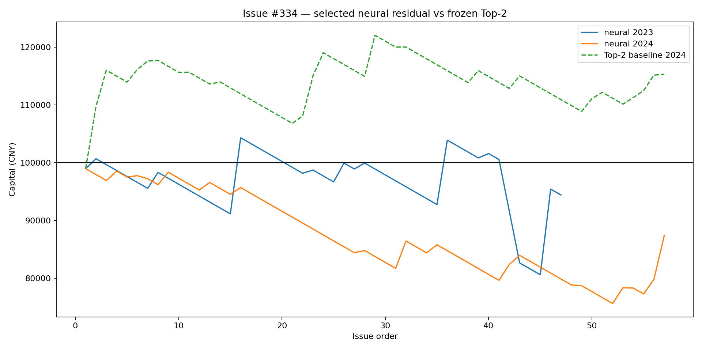
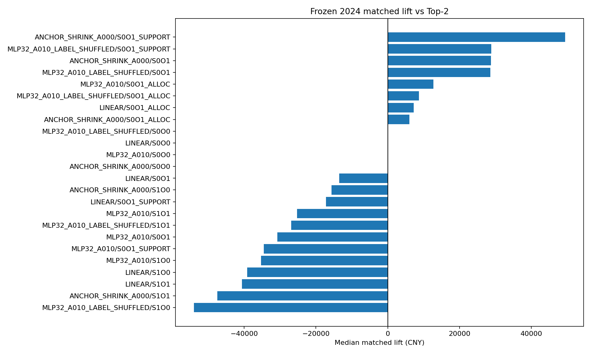
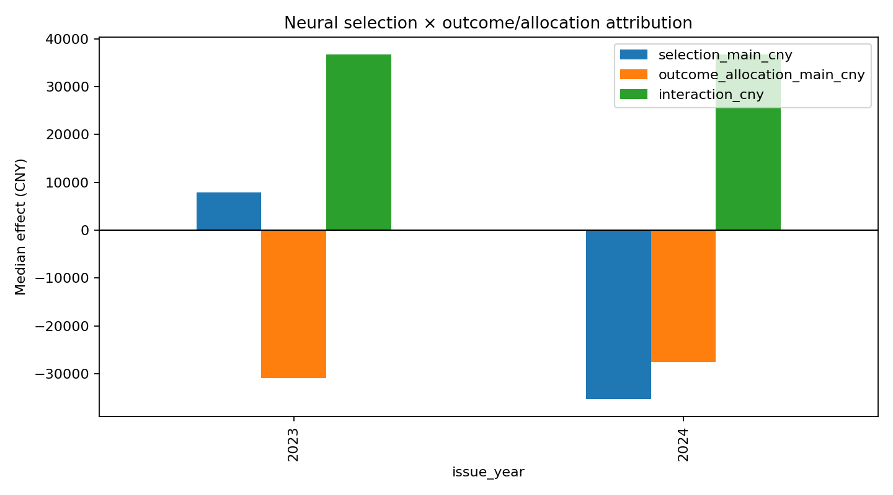
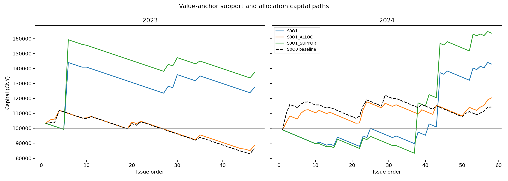

# Issue #334 — Neural Top-2 residual action-value learner

## Five-minute decision summary

- Frozen fallback: #319 `P_TOP2_NO_GATE`, N7, 128 distinct tickets funded to 512 CNY2 units.
- Selected on 2023 only: `MLP32_A010` / `S1O0`.
- Frozen 2024 median lift: CNY -35277.96; ex-largest: CNY -31786.75.
- Interpretable anchor control: `ANCHOR_SHRINK_A000`; 2024 lift CNY 28766.87, ex-largest CNY 3292.54.
- Decision: **ANCHOR_SHRINKAGE_SIGNAL_NOT_YET_PROMOTED**; promotion=false; #210 unlock=false.
- The cell target is `result indicator × official winning SP`; 0.65 is applied once only when a complete N7 ticket wins.

## Scientific design

2020–2022 fit the anchored residual models, 2023 selects architecture and S/O arm, and 2024 is read once as the terminal historical transfer. All resampling is issue-clustered. The neural model changes match selection, outcome support and within-support ticket funding only through named factorial arms; the exact Top-2 baseline remains reproducible.

Source coverage: 282 issues, 82519 matches and 247557 M×3 cells over [2020, 2021, 2022, 2023, 2024].

## Selected-policy performance

```
 issue_year  seeds  issues  median_pnl_cny  median_lift_cny  median_ex_largest_lift_cny  median_ending_capital_cny
       2023      5    45.0    -5589.096229      7940.529015                 2579.443811               94410.903771
       2024      5    56.0   -21177.603190    -35277.956816               -31786.745946               78822.396810
```

## Selection × outcome/allocation attribution

```
 issue_year    seed  issues  selection_main_cny  outcome_allocation_main_cny  interaction_cny  joint_lift_cny
       2023 33403.0    45.0         7940.529015                -30847.623277     36773.995246    10482.548447
       2024 33403.0    56.0       -35277.956816                -27552.519844     36737.643786   -25278.135186
```

## Value-anchor support vs allocation decomposition

`S0O1_SUPPORT` changes only which two outcomes are retained; `S0O1_ALLOC` keeps the market Top-2 support and changes only ticket funding; `S0O1` combines both.

```
             model          arm  issue_year  issues       pnl_cny  matched_lift_cny  ex_largest_lift_cny  payout_issues  ticket_hhi_mean
ANCHOR_SHRINK_A000         S0O0        2023      47 -13529.625244          0.000000             0.000000             11         0.007812
ANCHOR_SHRINK_A000         S0O1        2023      47  27268.686146      40798.311390          4152.724623              7         0.009502
ANCHOR_SHRINK_A000   S0O1_ALLOC        2023      47 -11455.336892       2074.288352          4338.838306             11         0.010203
ANCHOR_SHRINK_A000 S0O1_SUPPORT        2023      47  37192.895852      50722.521096         -1157.661199              7         0.007812
ANCHOR_SHRINK_A000         S0O0        2024      58  14269.187609          0.000000             0.000000             20         0.007812
ANCHOR_SHRINK_A000         S0O1        2024      58  43036.057232      28766.869623          3292.544629             13         0.009462
ANCHOR_SHRINK_A000   S0O1_ALLOC        2024      58  20337.392176       6068.204567          7971.789846             20         0.010230
ANCHOR_SHRINK_A000 S0O1_SUPPORT        2024      58  63662.635912      49393.448303         23919.123309             13         0.007812
```

## Risk and holding path

```
 issue_year    seed  max_drawdown_fraction  max_consecutive_losing_issues  worst_rolling_5_cny  worst_rolling_10_cny  worst_rolling_20_cny  max_recovery_issues
       2023 33403.0               0.174086                           14.0              -5120.0              -10240.0         -14153.227652                 35.0
       2024 33403.0               0.265282                           17.0              -5120.0              -10240.0         -18448.612634                 54.0
```

## Model diagnostics

```
             model  issue_year    seed   cells    brier  log_loss  value_mae  value_rank_correlation  mean_abs_probability_residual
ANCHOR_SHRINK_A000        2023    -1.0 43644.0 0.215359  0.621227   1.344373                0.042858                       0.000000
ANCHOR_SHRINK_A000        2024    -1.0 53799.0 0.215244  0.621015   1.337361                0.047199                       0.000000
          BASELINE        2023    -1.0 43644.0 0.215359  0.621227   1.344373                0.042858                       0.000000
          BASELINE        2024    -1.0 53799.0 0.215244  0.621015   1.337361                0.047199                       0.000000
            LINEAR        2023    -1.0 43644.0 0.215338  0.621171   1.376469                0.035352                       0.004579
            LINEAR        2024    -1.0 53799.0 0.215174  0.621185   1.368888                0.038193                       0.004457
        MLP32_A010        2023 33403.0 43644.0 0.215571  0.621754   1.378313                0.016583                       0.011471
        MLP32_A010        2024 33403.0 53799.0 0.215447  0.621483   1.371867                0.019448                       0.012155
```

## Issue-cluster bootstrap

```
          candidate  issue_year    seed  issues  observed_lift_cny  bootstrap_p025_cny  bootstrap_median_cny  bootstrap_p975_cny  bootstrap_positive_fraction
        ANCHOR_S0O1        2023    -1.0    47.0       40798.311390       -30258.822519          32197.507191       145381.426915                        0.764
        ANCHOR_S0O1        2024    -1.0    58.0       28766.869623       -49191.609482          26345.781294       124659.359929                        0.735
  ANCHOR_S0O1_ALLOC        2023    -1.0    47.0        2074.288352        -5710.428331           2389.031647         9495.350898                        0.706
  ANCHOR_S0O1_ALLOC        2024    -1.0    58.0        6068.204567       -13993.888658           6516.147539        23071.628818                        0.749
ANCHOR_S0O1_SUPPORT        2023    -1.0    47.0       50722.521096       -34438.888358          43285.702455       183755.940020                        0.705
ANCHOR_S0O1_SUPPORT        2024    -1.0    58.0       49393.448303       -46926.143849          45955.148375       160574.923558                        0.820
             NEURAL        2023 33403.0    45.0        7940.529015       -33749.496419           6859.838578        55648.391140                        0.613
             NEURAL        2024 33403.0    56.0      -35277.956816       -76242.813185         -32861.797703         2435.418442                        0.037
```

## PI adversarial interpretation

1. A lower Brier score is not sufficient: promotion is decided only by matched payout value on frozen 2024.
2. The factorial table separates match selection, outcome/allocation and their interaction; a joint headline is not accepted without this attribution.
3. Ex-largest and shuffled-label controls test jackpot concentration and spurious model identity.
4. The anchored linear control asks whether neural capacity contributes beyond a simpler residual model.
5. The baseline remains the deployment fallback regardless of this exploratory result.








