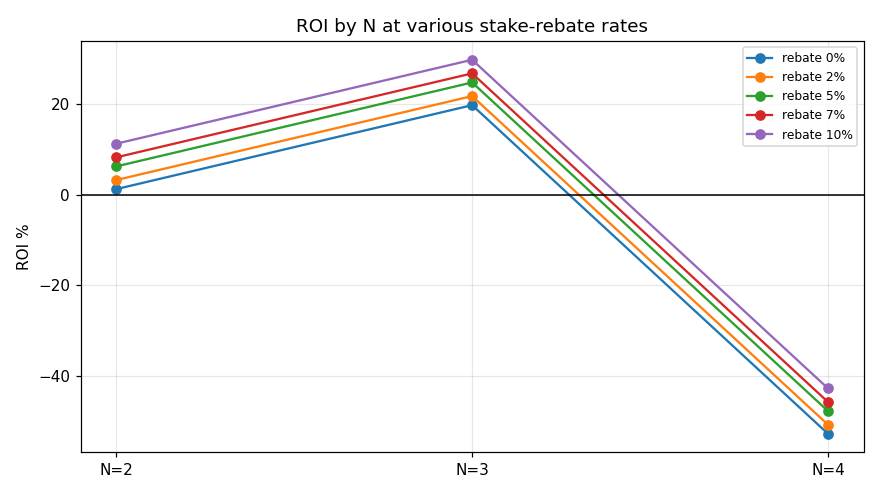

# 成本/返点/税务敏感性：成本结构能不能把策略救成正？（A3）

**日期**: 2026-06-24
**作者**: Claude（应「A3 成本/返点/税务敏感性」）
**数据**: `data/webui.db`（已结算计划）× `data/beidan_live.db`（settlements），3093 张已结算票（与 pnl_attribution 同口径）
**复现**: `PYTHONPATH=".:src" .venv/bin/python scripts/analyze_cost_sensitivity.py`（确定性，ORDER BY，无采样）
**关联**: [[pnl_attribution]]、`docs/strategy/cost_rebate_tax_edge.md`(设计稿)、`docs/strategy/research_roadmap.md`(A3)

---

## 0. 问题

亏损是结构性的（rake 0.65 × drift），选腿层面没 edge（O2-O5）。**唯一没算过、可能把「约打平」变「转正」的杠杆是成本结构**：返点率多高能让策略转正？税务拆票对高 SP 的真实削减有多大？这是路线图里「可能一锤定音改变可行性判断」的一项。本研究是**纯会计 + 敏感性**，不创造 edge，只把盈亏平衡线往下挪多少算清楚。

## 1. 返点：按投注额返，ROI 平移 +r

返点是按**投注额**返的现金（`services.reconcile_pending`：`commission = total_stake × commission_rate`，与赛果无关）。所以它对已实现 ROI 是一个**均匀加法平移**：

```
ROI(r) = (Σpayout/Σstake − 1) + r = base_ROI + r
盈亏平衡返点  r* = −base_ROI   （按 N 分别算）
```

| N | 票数 | baseROI | r=2% | r=5% | r=7% | r=10% | 盈亏平衡 r* |
|---|---|---|---|---|---|---|---|
| 2 | 20 | **+1.2%** | +3% | +6% | +8% | +11% | −1.2%（已>0） |
| 3 | 1291 | **+19.7%** | +22% | +25% | +27% | +30% | −19.7%（已>0） |
| 4 | 1782 | **−52.7%** | −51% | −48% | −46% | −43% | **+52.7%** |
| 全部 | 3093 | **−26.4%** | −24% | −21% | −19% | −16% | **+26.4%** |



## 2. 三条读数

1. **返点不改 N 的排序、也救不了 N=4。** 它对所有 N 同量平移。N=4 要 **52.7% 返点**才打平——现实返点率（业内大致 2-10%）差一个数量级，**不可能**。全仓口径要 26.4%，同样够不着。
2. **返点最有用的地方是「已接近打平」处——即低 N。** N=2/N=3 的已实现 ROI 本就 >0（不需返点）；任何返点都是纯增益。这与 A1（降 N）同向：**成本杠杆和结构杠杆都指向「降 N」**，不指向「靠返点硬扛高 N」。
3. **成本结构无法独立把策略救正。** 在当前 N 混合（大头是 N=4）下，没有任何现实返点率能把全仓 −26.4% 拉过 0。**可行的成本路径只有一条：降 N + 适度返点**，不是「维持现状 + 高返点」。

> ⚠️ **重要保留**：表中 baseROI（N3 +19.7%、N4 −52.7%）是 live 票上的**已实现、样本内**数字（与 pnl_attribution 同），N=2 仅 20 张、统计上不可信。**「N3 +19.7% 是否 OOS 站得住」要由 A1 降 N walk-forward 裁决**——本成本研究只回答「给定这些已实现 ROI，返点能挪多少」，不independently证明 N3 转正。

## 3. 税务：当前奖金稀疏，封顶不触发；已被拆票规避

单票奖金 ≥10000 元会被 20% 征税。sizer 用**拆票**规避（`cap = floor_to_even(9999 / payout_per_yuan)`，`n_tickets = ceil(raw_stake / cap)`），保每票奖金 <1 万。

- **86 张中奖票里，按 1 张投注会触发 >1 万封顶的 = 0 张**；拆票规避税额 ≈ 0 元。
- 即当前实盘 stake / payout 量级下，**税务封顶根本没咬到**——奖金还没大到需要拆。拆票机制是对的（已上线、确定性），但对当前主仓 PnL 没有实质影响。
- **税务只在高 SP / 高 N / 登月仓（博大奖）才成为真约束**——那时单票名义奖金轻松破万，拆票是规避 20% 税的关键。对当前 S9 主仓，税不是当下问题。

## 4. 结论

1. **成本结构不能独立把策略救正。** 返点是按投注额的均匀加法平移，救不了 N=4（需 52.7%，不现实）；唯一可行的成本路径是**降 N + 适度返点**，与 A1 同向。
2. **返点的价值集中在已接近打平处（低 N）**——是「锦上添花」而非「雪中送炭」。把可行性押在「高返点扛高 N」上是错的。
3. **税务当前不咬**（0/86 触发封顶），拆票机制已正确规避；它只在登月/高 SP 仓才成为一级约束。
4. 与全局一致：成本侧也没有「免费的转正」。**理性路径仍是降 N（A1 验证）+ 纪律性空仓（B1）+ 隔离登月仓**；返点谈得越高越好，但它是乘数不是救命稻草。

## 5. 局限

- baseROI 是样本内已实现，受 N=4 占比与小样本影响；OOS 由 A1 裁决（本研究不替代它）。
- 返点率按投注额、与赛果独立——若某渠道返点口径不同（如按理论抽水返、或仅中奖返），ROI(r)=base+r 的线性关系需重算；本研究按已落库的 `commission = total_stake × rate` 口径。
- 税务结论限于当前 stake 量级；登月仓需单独的封顶/拆票 PnL 建模（backlog t_d0e0127e）。
- N=2 仅 20 张，其 +1.2% 不作结论依据，仅列出。
