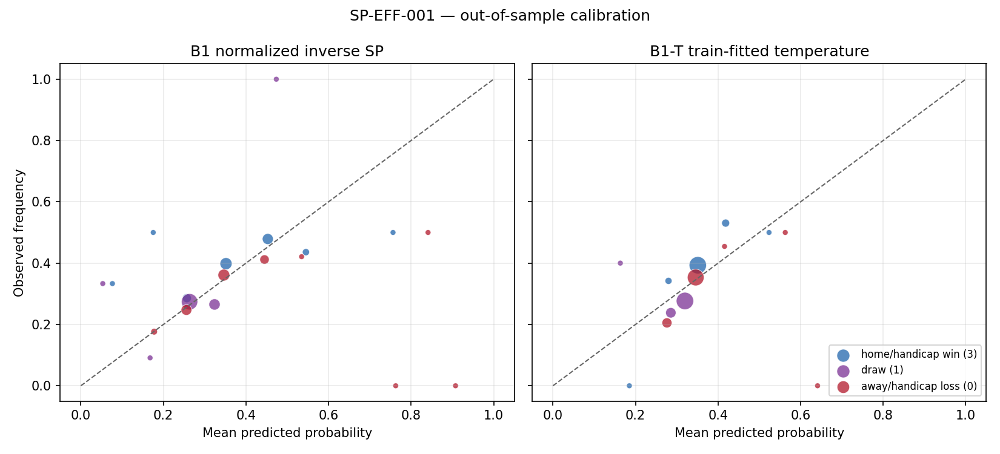

# SP-EFF-001 — SP Market Efficiency Study

> This is a market-information experiment, not a strategy backtest. No betting rule, stake rule, parameter search, or ROI objective is used.

## Dataset version

- Source: `data/beidan_live.db` (`163,311,616` bytes)
- Extracted: `2026-07-20T17:19:03+00:00`
- Canonical extract SHA-256: `eb4f956f5717c6d615a8613c2d8d0f3ff10817f6b4650c16005fc87fe425c531`
- Complete-snapshot rows examined: `509,666`; valid settled matches: `2,247`
- Eligible matches after strict pre-kickoff filtering: `2,126`
- Kickoff range (UTC): `2026-05-02T03:55:00+00:00` to `2026-07-19T19:00:00+00:00`
- Included snapshot range (UTC): `2026-05-02T00:57:41+00:00` to `2026-07-19T18:55:39+00:00`
- Rejected invalid-timestamp rows: `0`; rejected post-kickoff rows: `104,306`
- Closing snapshot lead time: minimum `0.02` min; median `7.70` min

Dataset version is the canonical extract hash, not merely the mutable SQLite filename. It hashes match identity, opening/closing snapshot timestamps and SP vectors, and settlement outcome.

## Research Question

RQ001: Does Beijing Single Match (北京单场) SP contain calibrated predictive information about the 90-minute handicap win/draw/loss result?

- H0: after a reasonable probability transformation/calibration, SP probabilities agree with realized outcome frequencies.
- H1: systematic calibration deviations remain.

## Methodology

1. Keep settled 3/1/0 matches with a complete three-way SP vector (`SP > 1` for all outcomes).
2. Interpret `snapshot_ts` as UTC and naive `kickoff_ts` as Asia/Shanghai. Select the latest complete vector strictly before kickoff; post-kickoff and invalid timestamps are excluded.
3. Transform SP jointly, not as `P = 1/SP`: `p_i = (1/SP_i) / Σ_j(1/SP_j)`. This removes the match-level overround and forces coherent three-way probabilities.
4. Preserve full issue boundaries in a fixed 70/30 chronological split. The first issues train the historical prior and one temperature parameter; the last issues are untouched holdout data.
5. Fit temperature scaling only on training log loss: `p'_i ∝ p_i^(1/T)`. No outcome-dependent rule or profitability search is performed.
6. Report fixed 0.1 probability calibration bins, fixed SP bands, and SP movement quartiles. SP movement is the mean absolute log change across the three outcomes from the earliest to the closing eligible snapshot; quartile cutoffs come from training data only.

Training issues (16, n=1,802): `26051, 26052, 26053, 26054, 26055, 26056, 26057, 26058, 26061, 26062, 26063, 26064, 26065, 26066, 26067, 26068`.

Holdout issues (7, n=324): `26069, 26071, 26072, 26073, 26074, 26075, 26076`.

## Baseline

- B0 — uniform random: `(1/3, 1/3, 1/3)`.
- B1 — SP market: normalized inverse-SP probabilities.
- B1-T — the same market probabilities with a single train-fitted temperature (`T=2.3270`). This is the calibrated H0 check.
- B2 — independent historical-win-rate model: the constant 3/1/0 frequencies estimated only from training outcomes.

## Metrics

- Multiclass Log Loss (lower is better).
- Three-class Brier Score `mean(Σ(p-y)²)`, unscaled, range 0–2 (lower is better).
- Calibration curve and ECE (cell-count-weighted absolute calibration gap).
- Per-cell standardized calibration residual tests with Holm family-wise correction across the fixed holdout cells.
- Paired proper-score differences with a 5,000-sample whole-issue cluster bootstrap.

ROI is deliberately absent.

## Results

### Holdout baseline comparison

| Baseline | Log Loss | Brier Score | ECE |
| --- | --- | --- | --- |
| B0 uniform random | 1.09861 | 0.66667 | 0.0494 |
| B1 normalized inverse SP | 1.08653 | 0.65704 | 0.0403 |
| B1-T train-fitted temperature | 1.08020 | 0.65459 | 0.0441 |
| B2 historical outcome frequency | 1.08759 | 0.65947 | 0.0256 |

Temperature calibration changes holdout Log Loss by `-0.00633` and Brier Score by `-0.00245` relative to raw normalized SP.

### Paired holdout score differences

Negative values favor the SP model. Confidence intervals resample whole holdout issues.

| Model | Comparator | Metric | Delta | 95% CI low | 95% CI high |
| --- | --- | --- | --- | --- | --- |
| B1 normalized inverse SP | B0 uniform random | Log Loss | -0.01208 | -0.06391 | +0.03292 |
| B1 normalized inverse SP | B0 uniform random | Brier Score | -0.00963 | -0.04383 | +0.01978 |
| B1 normalized inverse SP | B2 historical outcome frequency | Log Loss | -0.00105 | -0.04640 | +0.03982 |
| B1 normalized inverse SP | B2 historical outcome frequency | Brier Score | -0.00243 | -0.03292 | +0.02437 |
| B1-T train-fitted temperature | B0 uniform random | Log Loss | -0.01841 | -0.03724 | -0.00190 |
| B1-T train-fitted temperature | B0 uniform random | Brier Score | -0.01207 | -0.02548 | -0.00048 |
| B1-T train-fitted temperature | B2 historical outcome frequency | Log Loss | -0.00738 | -0.02090 | +0.00671 |
| B1-T train-fitted temperature | B2 historical outcome frequency | Brier Score | -0.00488 | -0.01471 | +0.00465 |



### Calibrated market probability bins (holdout)

| Outcome | Probability bin | n | Mean p | Actual rate | Gap | Holm p | Significant |
| --- | --- | --- | --- | --- | --- | --- | --- |
| 3 | 0.1-0.2 | 1 | 0.185 | 0.000 | -0.185 | 1.0000 | False |
| 3 | 0.2-0.3 | 38 | 0.280 | 0.342 | +0.062 | 1.0000 | False |
| 3 | 0.3-0.4 | 234 | 0.351 | 0.393 | +0.042 | 1.0000 | False |
| 3 | 0.4-0.5 | 49 | 0.418 | 0.531 | +0.112 | 1.0000 | False |
| 3 | 0.5-0.6 | 2 | 0.523 | 0.500 | -0.023 | 1.0000 | False |
| 1 | 0.1-0.2 | 5 | 0.163 | 0.400 | +0.237 | 1.0000 | False |
| 1 | 0.2-0.3 | 84 | 0.286 | 0.238 | -0.047 | 1.0000 | False |
| 1 | 0.3-0.4 | 235 | 0.320 | 0.277 | -0.043 | 1.0000 | False |
| 0 | 0.2-0.3 | 78 | 0.276 | 0.205 | -0.071 | 1.0000 | False |
| 0 | 0.3-0.4 | 218 | 0.346 | 0.353 | +0.007 | 1.0000 | False |
| 0 | 0.4-0.5 | 22 | 0.416 | 0.455 | +0.039 | 1.0000 | False |
| 0 | 0.5-0.6 | 4 | 0.563 | 0.500 | -0.063 | 1.0000 | False |
| 0 | 0.6-0.7 | 2 | 0.641 | 0.000 | -0.641 | 0.7619 | False |

### Closing SP bands (calibrated market, holdout)

| outcome | SP band | n | mean p | hit rate | gap |
| --- | --- | --- | --- | --- | --- |
| 3 | 1-1.5 | 2 | 0.523 | 0.500 | -0.023 |
| 3 | 1.5-2 | 39 | 0.423 | 0.436 | +0.013 |
| 3 | 2-3 | 172 | 0.368 | 0.436 | +0.068 |
| 3 | 3-5 | 98 | 0.310 | 0.337 | +0.026 |
| 3 | 5-8 | 10 | 0.265 | 0.500 | +0.235 |
| 3 | 8+ | 3 | 0.217 | 0.333 | +0.117 |
| 1 | 2-3 | 28 | 0.344 | 0.393 | +0.049 |
| 1 | 3-5 | 279 | 0.310 | 0.262 | -0.048 |
| 1 | 5-8 | 9 | 0.263 | 0.111 | -0.152 |
| 1 | 8+ | 8 | 0.185 | 0.250 | +0.065 |
| 0 | 1-1.5 | 6 | 0.589 | 0.333 | -0.256 |
| 0 | 1.5-2 | 19 | 0.418 | 0.421 | +0.003 |
| 0 | 2-3 | 137 | 0.364 | 0.372 | +0.009 |
| 0 | 3-5 | 128 | 0.308 | 0.297 | -0.011 |
| 0 | 5-8 | 34 | 0.261 | 0.176 | -0.085 |

### SP change magnitude (calibrated market, holdout)

Training cutoffs for mean absolute log-SP change: `0.25576, 0.56732, 1.03787`.

| change quartile | n | mean change | log loss | Brier |
| --- | --- | --- | --- | --- |
| Q1 | 59 | 0.15790 | 1.09132 | 0.66159 |
| Q2 | 80 | 0.38840 | 1.08304 | 0.65703 |
| Q3 | 107 | 0.76941 | 1.06553 | 0.64447 |
| Q4 | 78 | 1.51650 | 1.08902 | 0.66069 |

## Limitations

- The live collector covers only a short 2026 window; issue sizes and league mix vary, and early issues are much larger than later issues.
- The last observed collector snapshot is a closing proxy, not an exchange-grade official closing timestamp. Lead time varies by match.
- `result_code` is taken from the settlement table as the 90-minute handicap 3/1/0 label; this experiment does not independently reconstruct every settlement from raw scores and handicap history.
- The historical-frequency baseline is intentionally simple. It establishes an outcome-frequency comparator, not a best possible team-strength model such as a mature Elo system.
- Calibration cells in the tail can be small. Holm correction controls the declared family of fixed-bin tests, but the short holdout still has limited power.
- SP movement is descriptive and may reflect unequal observation windows. It is not interpreted as a tradable signal.

## Conclusion

The calibrated SP model beats both non-market baselines in holdout Log Loss, but at least one issue-block-bootstrap interval crosses zero. This is directional, not conclusive, evidence of incremental predictive information.

Fail to reject H0 on this holdout: no pre-specified probability/outcome cell retains a calibration deviation after Holm correction.

The market-information conclusion should also consider whether B1/B1-T improve proper scoring rules over B0 and B2. A detected statistical bias is only a research starting point; it does not establish a realizable trading edge after payout rules, timing, limits, or costs.

## Reproduction

```bash
python scripts/run_sp_eff_001.py --db data/beidan_live.db
```
