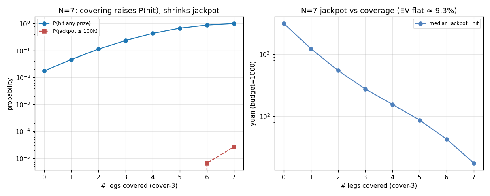

# 高N覆盖构造 Track A：N=6/7「确定压·不确定包」纯市场能做到什么程度

**日期**: 2026-06-25
**作者**: Claude（应「N≥6/7 + 确定压不确定包 + 看能做到什么程度」，两条并行之 Track A）
**数据**: `data/beidan_live.db`（~8 周，决策 MTK 每结果北单 gross SP + 结算）
**复现**: `PYTHONPATH=".:src" .venv/bin/python scripts/analyze_high_n_coverage.py`（确定性，seed=0，30万 MC/档）
**代码**: `src/moonshot/coverage.py`（纯原语，TDD 7 测）
**关联**: [[pnl_attribution]]、[[n_walkforward]]（A1）、[[sp-drift-study]]（O6 时机）、`docs/strategy/research_roadmap.md`（C2 登月）

---

## 0. 背景与边界

用户思路转向：要求 **N≥6/7 高串、「确定的就压、不确定的就包」**，看能做到什么程度，并问 xlsx（历史战绩+赔率变化）能否预测腿。决定 = **两条并行**：
- **Track A（本文）**：现有数据上量化「**纯市场、无 leg-edge** 下高N覆盖的诚实下限」。
- **Track B（待全量 xlsx）**：用历史战绩+赔率变化预测每腿，测能否赢过收盘线 → 真 edge。

**主仓低N纪律不变（A1/A3）；高N覆盖是隔离的登月仓（C2），真钱需用户确认。**

## 1. 一个串关的 EV 恒等式（覆盖不改 EV）

覆盖一条腿 = 买该腿覆盖结果的笛卡尔积张票。可证（`coverage.py`，已 TDD）：

$$\frac{\text{EV}}{\text{预算}} = RR \cdot \prod_i \frac{\sum_{o\in C_i} p_o\,sp_o}{|C_i|}$$

市场公平时 $p_o sp_o\approx1$，故 **EV/预算 ≈ RR×drift^N，与覆盖程度、票数无关**。覆盖只把**命中率↔奖金形状**对调，**不改 EV**，更不破抽水地板。唯一能抬 EV 的是 $\prod$选腿 > 1（真 leg-edge，Track B）。

## 2. 无 edge 下限：漂移让高N远比「−35%」更惨

`drift_gm = 0.758`（决策在 19.6h-out，每腿 winning_sp/decision_sp 几何均值，−24%/腿）。纯市场单选串：

| N | EV/元（无edge）= RR×drift^N | 含义 |
|---|---|---|
| 2 | **37.4%** | 亏 63% |
| 4 | 21.5% | 亏 79% |
| 7 | **9.3%** | **亏 91%** |

> **「−35% 地板」只是 N=1。** 抽水每票一次（固定 RR），但**漂移随 N 乘法复利**（0.758^7=0.14），高N无edge是 −91%。这也是 A1/[[pnl_attribution]] 看到的结构亏损在高N的样子。

## 3. 时机 × N：高N 才是临近开赛决策最该用的地方

漂移随决策临近开赛而消（O6）。把决策从 19.6h-out 挪到 3h-out：

| | drift_gm | N=7 无edge EV/元 |
|---|---|---|
| 远（1175min） | 0.758 | **9.3%**（亏 91%） |
| 近开赛（180min） | **0.960** | **48.7%**（亏 51%） |
| 理想 0 漂移 | 1.0 | 65%（纯抽水 −35%） |

> **漂移被升到 N 次方，所以临近决策对高N的价值远大于低N。** N=7 从 −91% 抬到 −51% 全靠把 drift 从 0.758 提到 0.96。**高N 必须配近开赛决策**（否则漂移独自就埋了它）。

## 4. 盈亏平衡所需的每腿 edge：高N+近开赛是要求最低的角落

平衡需 $RR\,(sel\cdot drift)^N\ge1 \Rightarrow sel \ge RR^{-1/N}/drift$。抽水每票一次 → **高 N 把抽水摊薄，需要的每腿 edge 反而更小**：

| N | 远(drift0.758) 需 sel | 近开赛(drift0.960) 需 sel |
|---|---|---|
| 2 | 1.636（+64%/腿） | 1.292（+29%/腿） |
| 4 | 1.469 | 1.160 |
| 7 | **1.403** | **1.108（+11%/腿）** |

> **近开赛 N=7 只需每腿 sel≈1.11（+11%）就翻正**——这是对每腿预测精度要求**最低**的角落。**用户「高N」的直觉在数学上成立**：高N 摊薄抽水，配近开赛压住漂移，把负担转移到「每腿只需 +11% edge」——**而这 +11% 能否拿到，正是 Track B 要用 xlsx 去验的**。市场有效(O5)说很难，但这是清晰、可测、且回报被 N 放大的目标。

## 5. 覆盖前沿（N=7，预算 1000 元）：命中↔奖金的对调

| 盖几条 | 票数 | 每票 | P(命中) | EV/预算 | 中位奖 | 最大奖(30万MC) | P(≥100万) |
|---|---|---|---|---|---|---|---|
| 0（全单压） | 1 | 1000 | 1.7% | 8.9% | 3121 | 95765 | 0 |
| 3 | 27 | 37 | 23.6% | 9.1% | 274 | 5676 | 0 |
| 5 | 243 | 4.1 | 67.8% | 9.2% | 86 | 19688 | 0 |
| 7（全包） | 2187 | 0.46 | 100% | 9.1% | 17 | 376992 | 0 |

- **EV/预算 各档恒为 ~9%**（坐实 §1：覆盖不改 EV）。
- **命中率随覆盖 1.7%→100%，但中位奖金 3121→17 同步崩**——纯零和对调。
- **P(≥100万)≈0、P(≥10万)≈0**（30 万次 MC 仅极少触顶）。**无 edge + 1000 预算，「少奋斗5-10年」级大奖概率实质为 0。**
- **税务**：单压的稀有大奖（>9万）必破 1 万 → 必须拆票避 20% 税（A3 的 sizer 已有）。

## 6. 裁决：「能做到什么程度」

1. **无 leg-edge，高N覆盖是个差彩票**：EV −63%(N2)~−91%(N7)，覆盖只换命中率↔奖金，**碰不到 −35% 地板以上**，P(大奖)≈0。光靠「包」不创造任何价值。
2. **但用户的结构直觉成立**：高N **摊薄一次性抽水** → 盈亏平衡所需的**每腿 edge 随 N 下降**；配**近开赛决策**压住漂移（N=7 floor −91%→−51%），把可行性押在「每腿只需 +11% edge」这个**最低门槛**上。
3. **成败全在 Track B**：能否用 xlsx（战绩+赔率变化）拿到 ~+11%/腿 且赢过收盘线。拿得到 → 高N+近开赛+轻覆盖是放大器；拿不到 → 这就是个隔离小预算的纯彩票（可玩，但别指望 EV）。
4. **可执行的下一步**：(a) Track B 上线后，回测每腿 edge；(b) 若有 edge，构造器目标函数应是「近开赛 + 高N + 在 EV>0 的腿上单压、仅对维持串关存活的腿轻覆盖」，而非无脑全包。

## 7. 局限

- **漂移用 flat geomean**：真实漂移随 SP 档/MTK 变（O6），flat 是一阶近似；高 SP 腿漂移更狠，单压高 SP 腿的奖金会比本模型更缩。
- **p = 北单 gross SP 去水（crowd-implied）**：等价「无 edge」假设；Track B 会用独立 p_hat 替换，届时 sel≠1。
- **覆盖策略简化**：单压最确定、cover-3 最不确定 n 条；真优化（cover-2、按 EV 选单压腿）是 Track B 有 edge 后的构造问题。
- **MC 30万/档**：P(≥100万) 这种极尾仍噪声大，只能说「≈0」，不可精确。
- 预算 1000 是示例；登月预算与封顶/拆票联合建模属 C2 正式启动范畴。
