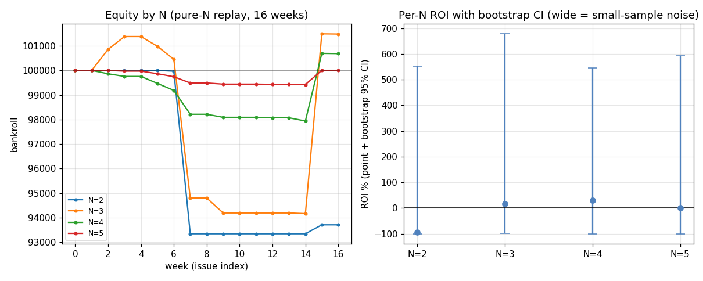

# A1 降N walk-forward：N3 的样本内 +19.7% 在 OOS 站得住吗？

**日期**: 2026-06-25
**作者**: Claude（应「A1 降N walk-forward」）
**数据**: `data/beidan_live.db`（SP 轨迹，2026-04-30~06-26，1901 已结算场 / 16 期）× `data/webui.db`（baseline 决策 MTK）
**复现**: `PYTHONPATH=".:src" .venv/bin/python scripts/analyze_n_walkforward.py`（确定性，seed=0，20000 次 bootstrap）
**关联**: [[pnl_attribution]]（N3 +19.7% 来源）、[[high_n_favorite_parlay]]（O4 方差上界）、[[cost_sensitivity]]（A3）、`docs/strategy/research_roadmap.md`(A1)

---

## 0. 问题与方法

[[pnl_attribution]] 在**实际下注**的票上算出 N3 已实现 ROI **+19.7%**、N4 −52.7%。这是**样本内**数字——本研究问：**N3 的 +19.7% 在干净 out-of-time 上站得住吗？还是和 N=5「甜区」一样是抽样假象？**

**N 不是拟合参数**（不是从数据里选出来的），所以「walk-forward」在这里 = **out-of-time 已实现表现 + 逐期稳定性 + bootstrap 不确定性 + 留一周脆弱性**，不是 train/test 选参。用 `replay_policy`：在**决策时刻 SP**（生产 baseline ≈1175min≈19.6h-out）上 qualify/size，在**真实 winning_sp** 上结算，逐期滚 bankroll。纯 N 无拟合、无前瞻泄露。N=2/3/4/5 各跑一遍。

## 1. 全样本 replay（16 期）

> ⚠️ **ROI 的尺度陷阱**：ROI = Σpnl/Σstake，而 stake 被 Kelly 在小 edge 上压得极小，所以 ROI% 是在很小的下注基数上算的。**「账户Δ」**（16 周后 10 万本金的净变化）才是经济上真实的量级。

| N | 票 | 中 | 命中% | ROI | boot中位 | P(ROI>0) | boot 95%CI | 账户Δ(元) | 实盘ROI |
|---|---|---|---|---|---|---|---|---|---|
| 2 | 15 | 1 | 6.7% | −93.6% | −93.6% | 0.24 | [−100%, +552%] | **−6288** | +1.2% |
| 3 | 268 | 19 | 7.1% | **+17.8%** | 15.1% | **0.56** | [−98.7%, +678%] | **+1480** | +19.7% |
| 4 | 396 | 5 | 1.3% | +31.0% | **20.5%** | **0.56** | [−100%, +545%] | **+684** | −52.7% |
| 5 | 155 | 1 | 0.6% | +0.4% | −10.1% | 0.47 | [−100%, +592%] | **+2** | — |

## 2. 三个杀手级读数

1. **bootstrap CI 巨宽且完全重叠 → 任何 N 都统计不可区分。** N3 CI=[−98.7%, +678%]、N4 CI=[−100%, +545%]，互相吞没。`P(ROI>0)` 上 N3 与 N4 **同为 0.56**（仅略高于抛硬币），bootstrap **中位数 N4(20.5%) 反而高于 N3(15.1%)**。**数据无法分辨 N3 比 N4 好。**
2. **N3 的「+17.8%」吊在一个星期上。** 留一周脆弱性：去掉单周 **26067**，N3 → **−75.7%**、N4 → −100%、所有 N 崩。去掉 26057 又全部暴涨。摆幅 180~440 pp。**整张表由 1~2 个星期的零星命中驱动**——这正是 N=5 甜区假象的同款病。
3. **账户层面所有 N 都是平的。** 16 周净变化：N3 +1480、N4 +684、N5 +2、N2 −6288（10 万本金）。最好的也就 +1.5%、远在噪声内。**ROI% 的「+17.8%/+31%」是小 stake 基数放大的，经济上什么都没发生。**

## 3. replay +31% vs 实盘 −52.7%（N4 背离）

replay 的干净 EV 过滤 N4 = +31%（噪声），但**实际下注的 N4 = −52.7%**（[[pnl_attribution]]）。背离说明：实盘 N4 票比「决策价上 EV 过滤」的理想 replay 差得多——亏在执行/漂移/实际选票，而非 N=4 本身在干净 replay 里必然差。**但两者都被噪声主导，不可过度解读**；只能说「实盘 N4 的惨亏不是这个干净 replay 能复现的，根因在结构损失（漂移×执行）」。

## 4. 裁决（预注册判据）

**预注册**：N3 的 OOS edge 仅当其 bootstrap ROI CI **排除** N4 点估、且逐期排序稳定，才算「统计上成立」。

**结果：判据未满足。** N3 与 N4 的 CI 完全重叠、`P(ROI>0)` 相同、中位数 N4 还更高、且全靠单周。**⇒ N3 样本内 +19.7% 在 OOS 上未被坐实，不能当作真实可加注的 edge。** 同时——这份 16 周数据**也无法证明「低 N 已实现 ROI 更优」**：它的信噪比不足以确立任何 N 的 ROI 优势。

**那「降 N」还成立吗？成立，但依据是结构性先验，不是这个 ROI：**
- O1（[[pnl_attribution]]）：漂移随 N **乘法**放大，低 N 少复利一层结构损失。
- O4（[[high_n_favorite_parlay]]）：高 N 全中是稀有事件、方差主导，期望中奖注数随 N 暴跌。
- 本研究的 `命中%`/`账户Δ` 也与此一致（N4/N5 命中率 1.3%/0.6%、账户基本不动）。

即**偏好低 N 的理由是「少叠乘法漂移 + 低方差」的 a priori 结构论证**，A1 能说的是「ROI 层面分不出高下、且高 N 命中极稀方差极大」，**不能**说「实测低 N ROI 更高」。

## 5. 局限

- **16 周、命中集中在 1~2 周**：任何 ROI 点估都被个位数命中支配，bootstrap/jackknife 已量化此脆弱性。要真正裁决需更多周（与 forward-test 同受 [[sp-drift-study]] 的轨迹数据薄约束）。
- **单一决策 MTK（1175min）**：未扫 MTK×N 交互（近开赛决策×低 N 的联合效应是另一格，属 A2/forward 范畴）。
- **Kelly 小 stake**：ROI% 与账户Δ 量级脱节；本文已用账户Δ 与 P(ROI>0) 纠偏，避免被 ROI% 误导。
- replay 用 NicheConfig 默认 EV 门槛/sizing，与实盘 S9 参数不完全一致；本研究测的是「纯 N 杠杆」而非「S9 实盘复刻」。

## 6. 结论

1. **N3 +19.7% 不是可加注的 OOS edge**——统计上与 N4/噪声不可分，全靠单周，账户层面所有 N 都平。
2. **降 N 仍是合理默认，但凭结构先验（O1 乘法漂移 + O4 方差），非本数据的 ROI。** 不要把「降 N」当成「实测更赚」来卖。
3. 与全局一致：[[pnl_attribution]] 选腿+EV亏在结构、[[cost_sensitivity]] 成本救不正、本研究 ROI 分不出 N——**16 周轨迹数据的信噪比不足以确立任何选择/N 层面的 ROI edge；真正能动的只有结构（降N/时机/纪律空仓）+ 时间累积**。
