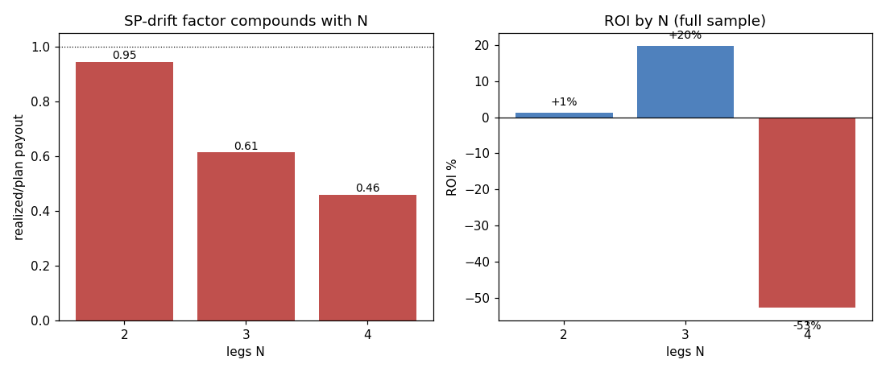

# 实盘盈亏归因：钱被结构吃掉，还是被选择吃掉？

**日期**: 2026-06-23
**作者**: Claude（承接 kanban `t_f15290fc`）
**数据**: 3093 张已结算组合票（`data/webui.db` plan_json × `data/beidan_live.db` settlements）
**复现**: `PYTHONPATH=".:src" .venv/bin/python scripts/analyze_pnl_attribution.py`
**关联**: [[sp-drift-study]]、[[beijing-lot-kanban]]、`docs/research/q_persistence_analysis.md`、`docs/research/sp_drift_phase4.md`

---

## 0. 方法

一张票是否命中由 `result_code` 决定，**与用哪个 SP 给它估值无关**。于是对每张已结算票，分别用「计划 SP 乘积」和「结算 winning_SP 乘积」重算派彩，做**乘法归因**：

```
R_actual = Σ payout(winning_sp) / Σ stake          # 真实实现回报
R_planSP = Σ payout(plan_sp)    / Σ stake          # 反事实：没有 SP 漂移
R_actual = rake(0.65) × selection × drift
    selection = R_planSP / 0.65    （>1 = 选腿在计划价上 +EV）
    drift     = R_actual / R_planSP（<1 = 结算 SP 低于计划 SP）
```

`payout = stake_per_ticket × ∏SP × 0.65 × n_tickets`（命中时），与 `reconcile.py` 一致。

---

## 1. 全样本结论（3093 票，ROI −26.4%）

| 量 | 值 | 含义 |
|----|----|----|
| R_actual | 0.736 | 真实 ROI **−26.4%** |
| R_planSP | **1.350** | 若无漂移，ROI 本是 **+35.0%** |
| rake | 0.650 | 抽水：每票一次性 −35% **结构地板** |
| **selection** | **2.077** | **选腿在计划价上强烈 +EV——选择不是问题** |
| **drift** | **0.545** | **SP 漂移把派彩砍到计划的 54.5%——这才是杀手** |

**翻转认知**：我们的 niche 选腿模型**是有价值的**（在决策看到的价格上 +EV，selection=2.08）。钱不是被「选错腿」吃掉的，是被**抽水 + SP 漂移**两道结构因子吃掉的。

### 漂移沿 N 成倍放大（核心机制）

| N | drift 因子 | ROI |
|---|-----------|-----|
| 2 | **0.945** | **+1.2%** |
| 3 | 0.614 | **+19.7%** |
| 4 | **0.460** | **−52.7%** |



每加一条腿，漂移损害就多乘一次：N=2 几乎不痛（0.945），N=4 砍掉一半还多（0.460）。**ROI 随 N 单调崩塌：N=3 全样本 +19.7%，N=4 −52.7%。** 这是「降 N」最硬的证据——不是优化，是从「漂移乘 4 次」退回「乘 2~3 次」。

腿间相关性可忽略（各 N 的实际全中率 ≈ 独立预测 `per-leg-hit^N`，无系统性正/负相关）——所以亏损是 rake+drift，**不是隐藏的腿间相关**。

---

## 2. 近期（issue≥26057，~2026-05-22 后，1572 票，ROI −67.6%）

| 量 | 全样本 | 近期 |
|----|-------|------|
| selection | 2.077 | **1.275** |
| drift | 0.545 | **0.390** |
| 全中率 | 2.8% | **0.8%** |

近期变差是**三重**叠加：① 选腿 edge 衰减（2.08→1.28）；② 漂移更狠（0.55→0.39）；③ 处在一段冷流（1572 票仅 12 次全中，方差）。注意近期 selection 仍 >1（1.275），说明**模型没坏，只是边际变薄 + 漂移变重 + 运气差**同时发生。

---

## 3. 结论：这游戏可玩，但必须改结构

1. **选择不是问题，别动 niche 模型**：selection=2.08 证明选腿在决策价上明显 +EV。把精力放在选腿优化上是搞错对象。
2. **两道结构墙吃掉一切**：抽水 0.65（地板，无解）× SP 漂移 0.545（可救）。
3. **降 N 是最硬的杠杆**：N=3 全样本 **+19.7%**、N=2 +1.2%、N=4 −52.7%。漂移按腿数乘法放大，砍腿直接止血。⇒ 推进 `t_52d34ba5`（N=3/5 forward arm）验证样本外。
4. **减漂移是第二杠杆**：drift=0.545 意味着「把决策推近开赛 / 用 haircut 计 EV」能救回的空间巨大。⇒ 已实现的 haircut（`maybe_haircut_snapshots`，默认关）和 kickoff 分批正对此；应进 forward-test。
5. **一个诚实的注脚**：selection=2.08 是在**计划 SP**（决策时的偏高价）上测的，而那个价正是会漂移下来的价——所以 selection 与 drift 部分纠缠，本质是「在一个守不住的价上决策太早」。但这不改变结论：可救空间在 **drift（时机）× N（腿数）**，不在选腿。

> 一句话：**我们选腿是对的，是「串太多关 + 决策太早、吃满 SP 漂移」把一手好牌打成 −26%。** 降 N + 临场决策能不能把全样本的 +35%(无漂移上界) 兑现一部分，由 forward-test 判定。

---

## 4. 局限

- `R_planSP=+35%` 是**反事实上界**（假设能在计划价结算，现实做不到）；它的作用是**隔离**出漂移=主因，不是说真能赚 35%。
- 计划 SP 偏高（决策早），故 selection 被高估、drift 被低估在「时机」名下——两者按「决策时机」联动，不必拆得过细。
- 近期样本薄（12 次全中），近期数字方差大；全样本（86 次全中）更可信。
- 票级 stake 加权 ROI 与 settlements_log 的 bankroll 加权（含 profit-lock）口径不同，数值不可直接对照。
