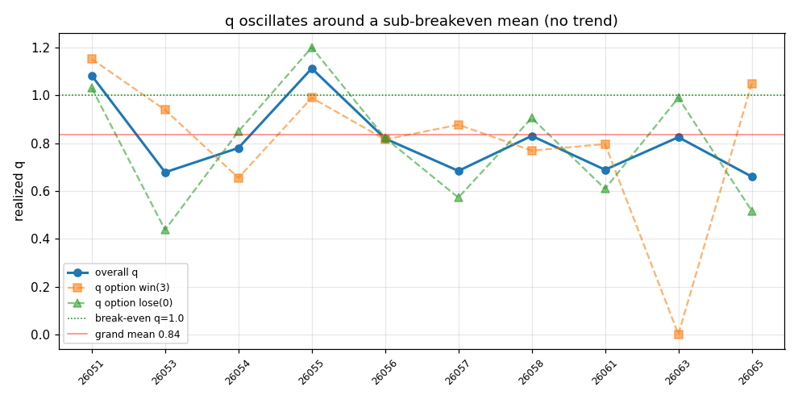

# 实盘 q 的时间结构：是趋势还是噪声？能否做均值回归？

**日期**: 2026-06-23
**作者**: Claude（应「q 自动降权该看近期还是全局」之问）
**数据**: `data/webui.db`(已结算 plan) × `data/beidan_live.db`(settlements)，504 条已结算腿、10 个期次（26051–26065）
**复现**: `PYTHONPATH=".:src" .venv/bin/python scripts/analyze_q_persistence.py`
**关联**: [[sp-drift-study]]、kanban `t_2bc0b07b`（q 监控/降权）、`src/webui/services.py::q_buckets`

---

## 0. 问题

q 监控（t_2bc0b07b）默认判据是「样本够且**全局** q 低 → 拉黑联赛」。但 q 是有时间结构的量：

- 若 q **有趋势/持续性** → 近期低 q 的联赛会继续低，按近期降权有意义。
- 若 q **剧烈摆动（均值回复的噪声）** → 近期低 q 明天就反弹，按近期降权 = 追噪声。

并进一步：若是摆动，能否**反向押注 q 的均值回归**（买当前低 q）？

**q 定义**（每腿实现回报倍数）：`q = RETURN_RATE × Σ(命中腿 SP) / n`，RETURN_RATE=0.65。q=1 为盈亏平衡，q<1 净亏。全样本 grand-mean q = **0.838**（< 1，系统性负 EV）。

---

## 1. 整体 q：无趋势，围绕 0.82 摆动

逐期 q 序列：

| 期次 | 26051 | 26053 | 26054 | 26055 | 26056 | 26057 | 26058 | 26061 | 26063 | 26065 |
|------|-------|-------|-------|-------|-------|-------|-------|-------|-------|-------|
| q | 1.08 | 0.68 | 0.78 | 1.11 | 0.82 | 0.68 | 0.83 | 0.69 | 0.83 | 0.66 |

- 均值 0.817，标准差 0.154，变异系数 0.19
- **lag-1 自相关 = −0.20**（≈0、略负）

> 最近的 0.83→0.66 **不是下滑趋势**，是围绕 0.82 的正常抖动。在 10 个点上 −0.20 与 0 无法区分（标准误≈0.32）。**整体 q 基本是围绕 0.82 的 iid 噪声，择不了时。**

---

## 2. 联赛级 q：强烈「反持续」

按期次中位数把时间切成早/晚两半，取两段各 ≥5 腿的联赛，比较其 q：

| 联赛 | 早期 q | 晚期 q | | 联赛 | 早期 q | 晚期 q |
|------|-------|-------|-|------|-------|-------|
| J1联赛 | 1.59 | 0.24 | | 爱甲 | 1.07 | 0.35 |
| 巴西甲 | 0.99 | 0.82 | | 瑞典甲 | 0.63 | 0.54 |
| 挪甲 | 0.91 | 0.77 | | 美职 | 0.42 | 0.55 |
| 挪超 | 1.00 | 0.35 | | 西乙 | 1.28 | 0.56 |
| 波兰甲 | 1.14 | 0.00 | | 西甲 | 0.64 | 0.72 |
| | | | | 解放者杯 | 0.00 | **1.57** |

**早期 q 与晚期 q 相关 = −0.745**（n=11 联赛）。

> 强负相关：早期好的联赛后期普遍变差、早期差的后期反而变好。解放者杯是活例——早期 q=0.00 会被全局/近期判据拉黑，结果回到 1.57。**联赛级 q 不持续，按它降权会精确踢掉正要反弹的联赛。**

---

## 3. 选项层（胜/平/负）：同样是噪声

| 选项 | 是否押 | 均值 q | lag-1 自相关 |
|------|-------|-------|------------|
| 胜(3) | 10/10 期 | 0.805 | −0.21 |
| 平(1) | **从不押** | — | — |
| 负(0) | 10/10 期 | 0.794 | −0.38 |

> 策略从不押平局；胜/负两档都稳在 ~0.80（负 EV）且无持续性。**选项层也择不了时。**

---

## 4. 逆向均值回归回测（核心）

对每条腿，查其联赛在**上一个出现期**的 q（需 ≥4 腿估计），据此分桶，看本期实际 q：

| 上一期该联赛 | → 本期实际 q | n |
|------------|------------|---|
| **低 q**（< 0.84） | **0.756** | 73 |
| **高 q**（≥ 0.84） | **0.480** | 77 |

差 = **+0.276**。

**两个事实**：
1. **逆向方向真实**：押「最近差」的联赛（0.756）显著好过「最近好」的（0.480）。最危险的是**最近异常热**的联赛——它们崩到 0.48（赢家诅咒）。原本「降权最近差联赛」的**动量思路是反的**。
2. **但仍不可盈利**：即便最优的逆向桶也只回到 **0.756 < 1.0**，仍在亏损区。因为**均值回归的中心是 0.82，本身就在盈亏平衡线下**。逆向只是「亏得少」，不是「赚」。

⚠️ **假象警告**：这 +0.276 有相当一部分是**小样本回归均值**的机械产物（上期 q 高多半运气好、必回落；低多半运气差、必回升）。纯噪声也会产生此图案，而纯噪声**不可交易**——事前分不清某低 q 联赛是「运气差要反弹」还是「真的烂」。

---

## 5. 结论

1. **q 在任何切口（整体/联赛/选项）都是围绕 ~0.82 摆动的噪声，无可利用的趋势或持续性。** lag-1 自相关全为 0~负；联赛级跨段相关 −0.745。
2. **均值回归方向真实但不可盈利**：中心 0.82 < 1.0，逆向最多把亏损从 −52%（高 q 桶 0.48）收窄到 −24%（低 q 桶 0.756），**过不了盈亏平衡线**。负 EV 的基底无法靠 q 择时变正。
3. **唯一信息量是防御性的**：别做动量降权（追最近差联赛拉黑）——是反的；真要动是警惕最近异常热的联赛，但这条大概率也只是回归均值且本身仍亏，不值得单独成策略。

**对 q 监控（t_2bc0b07b）的定位**：**纯诊断看板**——确认「整体负 EV、且是全局摊薄而非集中在可识别的坏联赛」。**不应接任何自动降权**（无论全局或近期口径）。

**真正的解药仍是结构性的**（见 [[sp-drift-study]]）：SP 漂移 haircut、决策时机、降 Kelly / 降方差 / 降 N。**联赛/选项 q 过滤是死胡同。**

---

## 6. 局限

- 样本薄：504 腿、10 期，逆向桶各 ~75 腿，联赛级每段 5–13 腿。结论是「在此样本量下 q 无可提取信号」，强度足以否决「按 q 降权」，但不足以精确量化任何微弱残余结构。
- 时间轴用期次（issue）序，未按日历周；期次本身近似单调，足够判断趋势/摆动。
- q 用决策 SP（计划价）算，与「按结算 winning_sp 的实现」有 SP 漂移差异（漂移单独在 sp_drift 研究中处理）。
