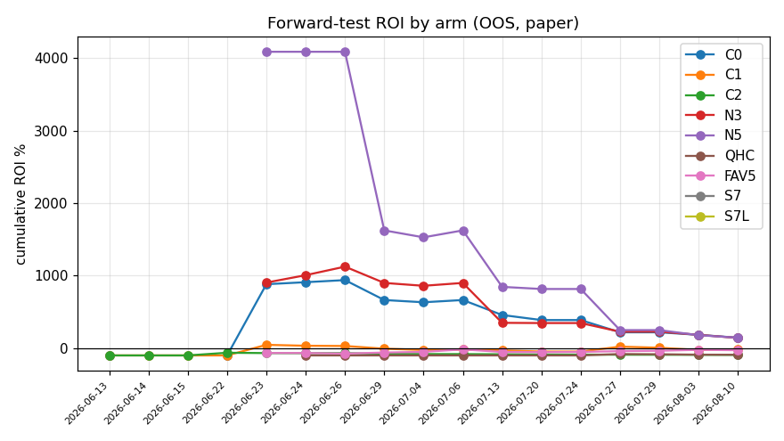

# SP 漂移 Forward-Test（纸面 · OOS）

run_date=2026-08-10; FORWARD_START=2026-06-13; weeks_elapsed=8.3

## 各 arm 累计（FORWARD_START 至今的样本外切片）

| arm | 组合 | 命中 | 命中率 | 总投注 | ROI | MaxDD | 周σ |
|-----|------|------|--------|--------|-----|-------|-----|
| C0 | 393 | 5 | 1.3% | 1,184 | **+143.9%** | 1% | 647.4 |
| C1 | 710 | 7 | 1.0% | 4,190 | **-13.9%** | 1% | 412.9 |
| C2 | 818 | 1 | 0.1% | 9,452 | **-92.6%** | 9% | 281.1 |
| N3 | 227 | 15 | 6.6% | 3,472 | **+141.7%** | 2% | 1,804.4 |
| N5 | 109 | 1 | 0.9% | 240 | **+144.3%** | 0% | 136.3 |
| QHC | 563 | 1 | 0.2% | 2,192 | **-90.6%** | 2% | 138.2 |
| FAV5 | 3221 | 34 | 1.1% | 3,221 | **-27.8%** | 1% | 140.7 |
| S7 | 0 | 0 | 0.0% | 0 | — | 0% | 0.0 |
| S7L | 0 | 0 | 0.0% | 0 | — | 0% | 0.0 |

## 停止规则 / GATE-FT 状态

- stop=True  reason=n_combos>=200  **verdict=no_go**
- C2 组合数 818/200 · 周数 8.3/12 · C2 MaxDD 9%/50%
- ROI: C0 +143.9% / C1 -13.9% / C2 -92.6%（go 需 C2>0 且 C2−C0≥5pp 且 C1−C0≥5pp）

> 纸面、样本外、haircut 冻结在 GATE 1 值。样本初期很小，勿据早期数据下结论。
> **N3 / N5 是描述性 N-sweep arm**（与 C0 同决策时机、仅 n_legs 不同），用于观察腿数对 ROI/漂移的影响（盈亏归因显示漂移随 N 乘法放大）；**不参与 GATE-FT 判定**（judging 仍只看 C0/C1/C2）。
> **QHC 是「模型保守分位 haircut」arm**（与 C1/C2 同决策时机=180min 窗口，但 sizing 用 (SP档×MTK桶) 漂移模型的 q=0.25 保守分位预测结算 SP，而非 C2 的冻结档位点估计）；**模型仅在 FORWARD_START 之前的数据上拟合（无前瞻泄露）**；检验模型+分位能否捞回 C2 漏掉的价值；不进 GATE-FT。
> **FAV5 是「押每场最热门(最低SP)、N=5」arm**（平注，非 Kelly）：检验「抽水每票一次×热门 realized p×SP>1×中等N」的假说（见 high_n_favorite_parlay 研究）；roi/命中率/周σ 为有效指标，其 MaxDD 与 Kelly-sized 的 C/N arm 不可直接比；不进 GATE-FT。
> **S7 是「1h strict stable-SP, N=7」arm**：在 1h 决策面板上只保留温和 SP、预测结算倍率不差、10h→1h 变化不剧烈的腿，然后走现有 phase5a planner 并用真实 winning_sp 结算。该 arm 是 `n7_sp_stability_gate_2026-06-26.md` 的 live OOS 纸面跟踪，不进 GATE-FT。
> **S7L 是 S7 的宽松对照 arm**：使用历史 moderate gate `max_odds=5.0 / min_multiplier=0.75 / max_abs_log_move=0.20 / min_stability_score=0.55`，用于观察 strict gate 是否过度饿死候选池；同样只纸面跟踪、不进 GATE-FT。
> ⚠️ **运营口径差**：C1/C2 的 window 是按期次池化、每场各取其「距开赛 180min」的 SP；实盘 `kickoff_window_hours` 是「距现在 N 小时内开赛」的同时性过滤，二者不等价。经 P1 权衡分析（2026-06-14）：受 N=4 需 ≥30 场同时在池约束，任何窗口值都无法两全（紧→autoplan 饿死、松→漂移不降），故实盘窗口已改回 0。本 test 量化的是「理想临近决策」的上界，落地需运营机制重设计（已搁置）。

