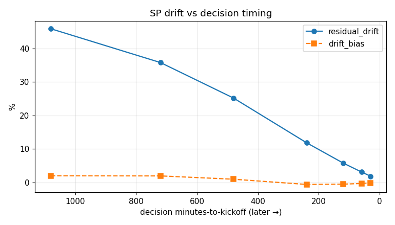
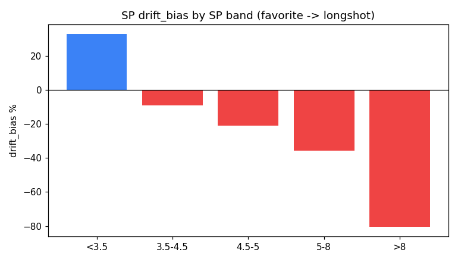

# SP 漂移 Phase 1 — 量化与 GATE 1

基线决策 MTK = 1078 分钟 (~18h before kickoff); 决策腿 n = 3,959

> ⚠️ **vol_pct 不可用**：snapshots 的 vol_pct 全为空（0% 非零），故 spec 的 Q1.3（vol% 失衡预判漂移）**无法用现有数据完成**。可预判性改由 SP 档 + 决策时机评估。

## 总体漂移（基线 18h-out，注意被 SP 档结构抵消）
- drift_bias（有符号，全腿平均）= +2.0%  ← 平均掩盖了档间结构
- residual_drift（幅度）= 46%（极大，因 18h-out SP 噪声）
- Q1.4 选择偏差: winners_bias +2.2% vs all_bias +2.0%（gap +0.3pp）→ −16.5% 不是中奖腿偏差，而是**下注档位选择**所致

## ★ 发现一：drift_bias 强烈依赖 SP 档（平均把它抹平了）
```
sp_band    n  drift_bias  residual_drift  unfavorable_share
   <3.5 2390    0.328942        0.438506           0.298745
3.5-4.5  556   -0.090803        0.183103           0.607914
  4.5-5  112   -0.209678        0.232315           0.812500
    5-8  203   -0.355696        0.378609           0.866995
     >8  698   -0.805859        0.808469           0.965616
```
热门（低 SP）漂移**向上**，冷门（高 SP）漂移**向下**；策略下注的中高档（5-8 ≈ −36%、3.5-4.5 ≈ −9%）正是不利漂移区——这解释了实盘 −16.5%。

## ★ 发现二：决策时机是核心杠杆（residual 随逼近开赛而坍缩）
```
decision_MTK   drift_bias   residual_drift     n
      1080       +2.0%           46%    3959
       720       +1.9%           36%    4827
       480       +0.9%           25%    4946
       240       -0.6%           12%    5019
       120       -0.5%            6%    5029
        60       -0.3%            3%    5029
        30       -0.2%            2%    5029
```
residual 从 18h-out 的 46% 坍缩到 30min 的 2%。现在策略在 ~18h-out 决策，承受最大 SP 噪声；移到临近开赛可大幅消除。

## 最差格子（drift_bias 升序前 10）

```
  n  drift_bias  residual_drift  favorable_share  stable_share  unfavorable_share selection hcp_class sp_band league_bucket comp_type
 34   -0.882537        0.882537         0.000000      0.000000           1.000000         0        h1      >8       LowerEU    league
165   -0.860808        0.860808         0.000000      0.006061           0.993939         1        h1      >8       LowerEU    league
113   -0.855863        0.860452         0.008850      0.008850           0.982301         3        h1      >8       LowerEU    league
 22   -0.842681        0.842681         0.000000      0.045455           0.954545         1    h2plus      >8       LowerEU    league
 26   -0.811611        0.811611         0.000000      0.000000           1.000000         3        h1      >8        Top5EU    league
 64   -0.794126        0.794126         0.000000      0.062500           0.937500         3        h1      >8         Other    league
 80   -0.791467        0.794946         0.012500      0.062500           0.925000         1        h1      >8         Other    league
 52   -0.754056        0.754056         0.000000      0.038462           0.961538         1        h1      >8        Top5EU    league
 25   -0.369701        0.369701         0.000000      0.000000           1.000000         1        h0     5-8         Other    league
 36   -0.292831        0.341003         0.083333      0.055556           0.861111         3        h0 3.5-4.5         Other    league
```

下注档 5-8 的跨联赛一致性: {'n_slices': 3, 'n_negative': 3, 'n_positive': 0, 'consistent': True}

## GATE 1 决策

- (a) 大？ SP 档间 drift_bias 跨度 113pp（>5pp）→ **True**
- (b) 系统？ 档间单调（热门↑冷门↓）+ 下注档跨联赛一致 → **True**
- (c) 可预判？ residual 随决策时机坍缩（46%→2%）→ **True**（注：靠 SP 档 + 时机，**非** vol%，后者无数据）

**判定**：漂移大、系统、可预判，但预判靠 **SP 档 + 决策时机**而非 vol% 模型。vol% 预测器（Phase 2 主支柱）因无数据不可行 → **建议跳过 Phase 2，直接进 Phase 3**：(1) `kickoff_window` 把决策移到临近开赛（residual 46%→3%）；(2) 按 SP 档的 EV haircut / 过滤（治系统性 bias）。



