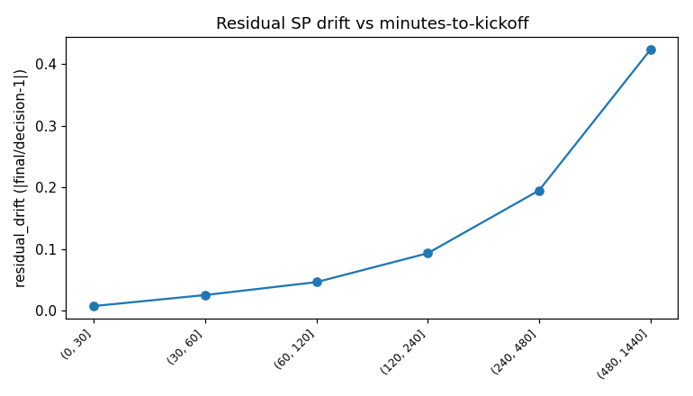

# SP 漂移 Phase 1 — 量化与 GATE 1

基线决策 MTK = 1078 分钟; 决策腿 n = 3,959

## 总体漂移
- drift_bias（有符号）= **+2.0%**
- residual_drift（幅度）= 45.9%
- 不利 / 稳定 / 有利 = 50% / 10% / 40%

## Q1.4 选择偏差（仅中奖腿 vs 全腿）
- winners_bias = +2.2% (n=1267)
- all_bias = +2.0% (n=3959)
- gap = +0.3pp（gap 越负说明 −16.5% 越被中奖腿高估）

## Q1.3 vol% 可预判性
- 高 vol% 腿 bias = +nan% (n=0)
- 低 vol% 腿 bias = +nan% (n=0)
- spread = +nanpp

## Q1.2 多切片一致
- 按联赛: {'n_slices': 3, 'n_negative': 0, 'n_positive': 3, 'consistent': True}
- 按 SP 档: {'n_slices': 5, 'n_negative': 4, 'n_positive': 1, 'consistent': False}

## 最差格子（drift_bias 升序前 10）

```
  n  drift_bias  residual_drift  favorable_share  stable_share  unfavorable_share selection hcp_class sp_band league_bucket comp_type
 34   -0.882537        0.882537         0.000000      0.000000           1.000000         0        h1      >8       LowerEU    league
165   -0.860808        0.860808         0.000000      0.006061           0.993939         1        h1      >8       LowerEU    league
113   -0.855863        0.860452         0.008850      0.008850           0.982301         3        h1      >8       LowerEU    league
 22   -0.842681        0.842681         0.000000      0.045455           0.954545         1    h2plus      >8       LowerEU    league
 26   -0.811611        0.811611         0.000000      0.000000           1.000000         3        h1      >8        Top5EU    league
 64   -0.794126        0.794126         0.000000      0.062500           0.937500         3        h1      >8         Other    league
 80   -0.791467        0.794946         0.012500      0.062500           0.925000         1        h1      >8         Other    league
 52   -0.754056        0.754056         0.000000      0.038462           0.961538         1        h1      >8        Top5EU    league
 25   -0.369701        0.369701         0.000000      0.000000           1.000000         1        h0     5-8         Other    league
 36   -0.292831        0.341003         0.083333      0.055556           0.861111         3        h0 3.5-4.5         Other    league
```

## GATE 1 决策

- (a) 大？ |drift_bias|>5% → **False**
- (b) 系统？ 多切片一致 → **False**
- (c) 可预判？ vol% spread>3pp → **False**

**判定**：漂移不大 → 重新审视诊断口径（可能 −16.5% 是中奖腿偏差所致）。


