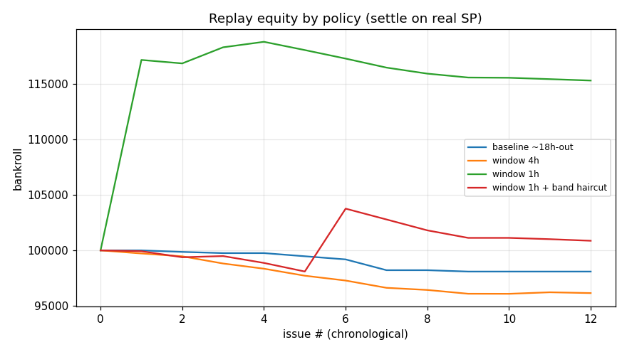

# SP 漂移 Phase 4 — 反事实重放与 GATE 3

基线决策 MTK = 1175 分钟; N=4, kelly=0.0625, 起始 bankroll=100,000

> 重放不变量：在**决策时刻 SP**（可选 haircut）上 qualify/sizing，在**真实结算 winning_sp** 上结算。

## 各策略对比

| 策略 | 周数 | 票数 | 总投注 | ROI | MaxDD | 终值 bankroll |
|------|------|------|--------|-----|-------|----------------|
| baseline ~18h-out | 12 | 290 | 1,910 | **-100.0%** | 2% | 98,090 |
| window 4h | 12 | 526 | 4,116 | **-93.6%** | 4% | 96,149 |
| window 1h | 12 | 559 | 5,860 | **+261.3%** | 3% | 115,311 |
| window 1h + band haircut | 12 | 548 | 7,506 | **+11.6%** | 3% | 100,868 |

基线 ROI = -100.0%；最优 = **window 1h** ROI +261.3%。

## GATE 3 决策

- 最优策略 ROI（扣 35% 房费后，即重放净 ROI）= +261.3% → **跨过房费为正**
- 相对基线改善 = +361.3pp

**判定**：最优策略真实 ROI 为正且优于基线 → 推荐落地（kickoff_window 默认值 + 按档 haircut），交付上线前实盘验证 spec。

> ⚠️ 局限：样本仅 ~5.5 周（单赛季切片）；重放用面板覆盖的比赛；haircut 用的是同期 GATE 1 估计（in-sample），上线前需用时间外样本复核。

