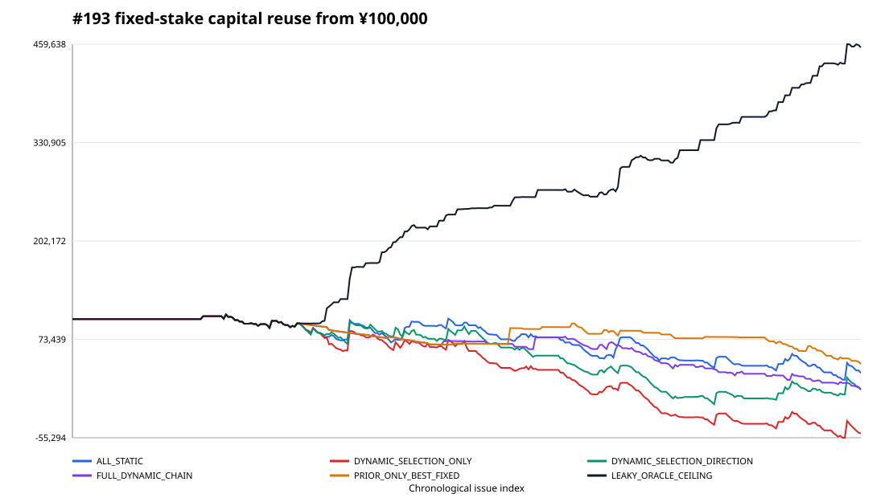
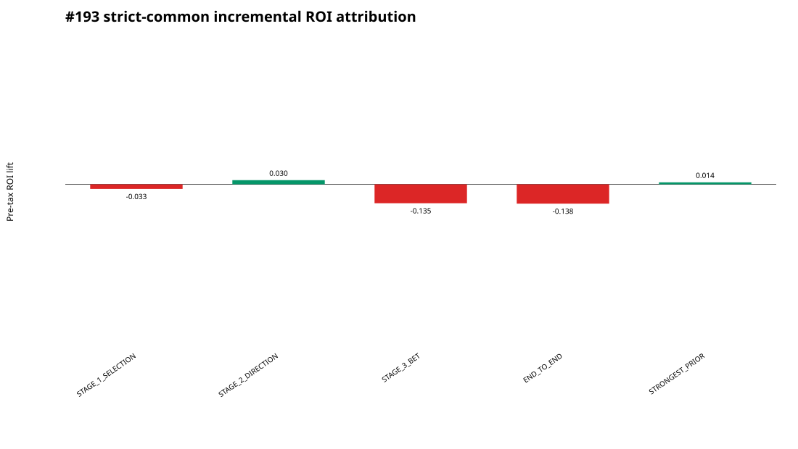
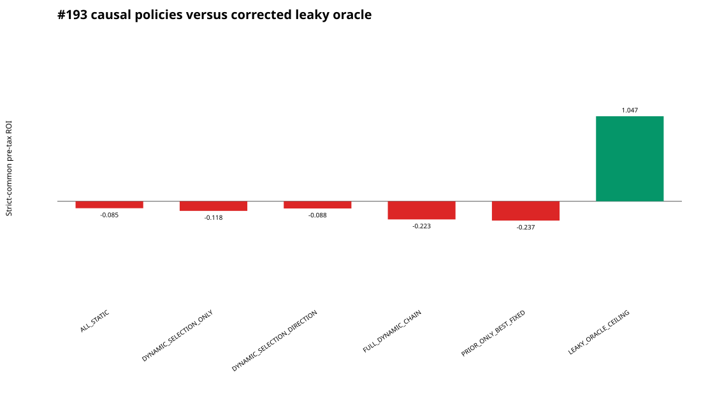
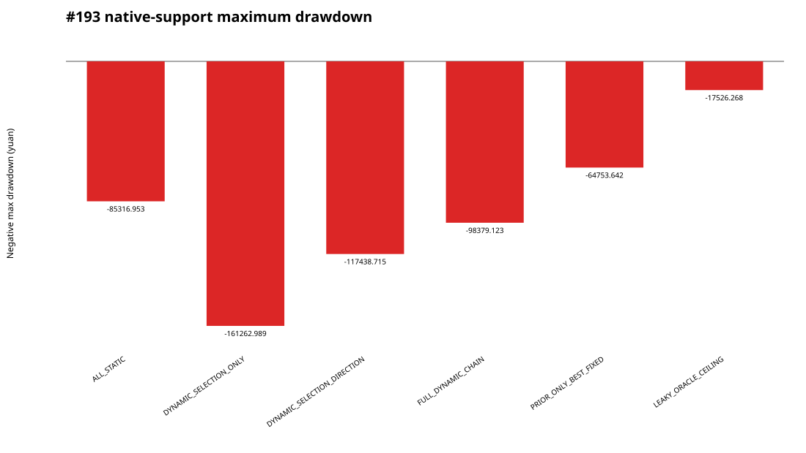

# Issue 193 — Regime-conditioned N7 meta-policy

Terminal research disposition candidate: **NO_PROMOTION**.

The frozen chronological chain separately learns match selection, direction and allocation/M. On the 189-issue strict common support it does not beat the strongest matched baseline with a positive paired-bootstrap lower bound. The corrected oracle is positive, but because it uses outcome information it is only a ceiling: the result is `CAUSAL_GENERALIZATION_FAILURE`, not a deployable edge.

## Decision readout

- Strongest surviving baseline: `ALL_STATIC`.
- Largest incremental bottleneck: `STAGE_3_BET` with lift `-0.134674248835`.
- Controlling economics: pre-tax; tax-adjusted values are reference-only.
- No strict EV escalation and no handoff to #192.

## Capital and risk

The ¥100,000 view reuses cash across issues with the native frozen stakes and no compounding or top-ups. Capital turnover is stake/start-capital, not ROI and not bankroll growth. Two dynamic chains are unfundable; all negative causal policies lose substantial bankroll. The leaky oracle grows capital but remains diagnostic-only.

The complete report, source tables, 20,000-draw paired bootstrap, stability and durability boundaries are in the immutable Gate-B package. This is historical paper research, not an operational betting rule.
